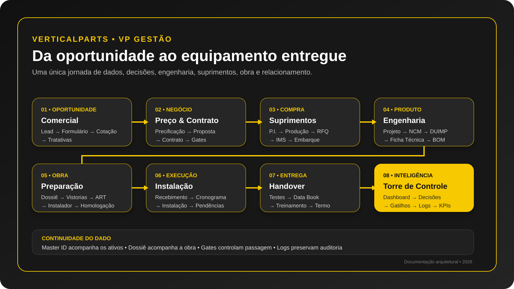

<p align="center">
  
</p>

<h1 align="center">VP Gestão</h1>
<p align="center"><strong>Da oportunidade ao equipamento entregue.</strong></p>
<p align="center">Plataforma corporativa para gestão integrada de venda, fornecimento, importação, engenharia, obra, instalação, entrega e inteligência operacional de equipamentos de transporte vertical.</p>

<p align="center">
  <a href="#-visão-executiva">Visão Executiva</a> •
  <a href="#-jornada-ponta-a-ponta">Jornada</a> •
  <a href="#-onde-está-cada-coisa">Onde está cada coisa</a> •
  <a href="#-arquitetura-de-negócio">Arquitetura</a> •
  <a href="#-regras-de-governança-e-gates">Gates</a> •
  <a href="#-guia-para-humanos-e-agentes-de-ia">Guia para IA</a> •
  <a href="#-btime--vistorias-em-equipamentos-sistema-externo">Btime</a>
</p>

---

## 🎯 Visão Executiva

O nome histórico do repositório, `010_GestaoImportacao`, não descreve mais sozinho o produto atual.

O **VP Gestão começa antes da importação**: quando existe apenas uma oportunidade comercial. A partir dela, o sistema estrutura requisitos, solicita cotações, forma preço, gera proposta, formaliza contrato, governa a autorização de compra, acompanha P.I., produção, sourcing, embarque, engenharia, obra, instaladores, vistorias, instalação, documentação e entrega.

> **Definição curta:** o VP Gestão é a representação digital do ciclo empresarial da VerticalParts — do primeiro lead ao handover do equipamento.

O principal ativo do sistema não é uma tela isolada. É a **continuidade do dado** entre as etapas.

```text
Lead
  ↓
Formulário / Especificação
  ↓
Cotação a Fornecedor + Tratativas
  ↓
Precificação
  ↓
Proposta
  ↓
Contrato + Sinal + Aval + Decisão
  ↓
P.I. + Produção + RFQ + IMS
  ↓
Embarque / Aduana ─────────────┐
                              ├─→ Obra / Instalação
Engenharia / Vistorias / RH ──┘
  ↓
Testes + Data Book + Treinamento + Termo
  ↓
ENTREGUE / HANDOVER / PÓS-VENDA
```

---

## 🚀 Jornada ponta a ponta

<p align="center">
  
</p>

A jornada deve ser lida como um **workflow empresarial**, não como uma sequência obrigatoriamente linear de páginas. Diversas atividades acontecem em paralelo — especialmente durante produção e trânsito internacional.

### Oito macroetapas

| # | Macroetapa | Fluxo principal | Pergunta de negócio |
|---|---|---|---|
| 1 | Oportunidade | Lead → Formulário → Cotação → Tratativas | Quem pode comprar e o que precisa? |
| 2 | Negócio | Precificação → Proposta → Contrato → Gates | Podemos vender, com que margem e condições? |
| 3 | Compra | P.I. → Produção → RFQ → IMS → Embarque | O que comprar, de quem e como movimentar? |
| 4 | Produto | Projeto → NCM → DUIMP → Ficha → BOM | Qual é a identidade técnica/fiscal do produto? |
| 5 | Obra | Dossiê → Vistorias → ART → Instalador → Homologação | A obra e os parceiros estão preparados? |
| 6 | Execução | Recebimento → Cronograma → Instalação → Pendências | O equipamento pode ser instalado com segurança e controle? |
| 7 | Entrega | Testes → Data Book → Treinamento → Termo | A obrigação técnica e contratual foi concluída? |
| 8 | Inteligência | Dashboard → Decisões → Gatilhos → Logs → KPIs | Onde a gestão precisa agir agora? |

---

## 🧭 Modelo mental de navegação

A sidebar é somente a primeira camada. A arquitetura real deve ser entendida assim:

```text
Sidebar
  └─ Módulo
      └─ Lista / Painel
          └─ Registro
              └─ Detalhe
                  ├─ Ação
                  ├─ Modal / Wizard
                  ├─ Documento / Preview
                  ├─ Gate / Decisão
                  └─ Evento / Automação → próxima etapa
```

Por isso, uma IA ou pessoa que analise apenas os itens do menu terá uma visão incompleta do produto. Rotas de detalhe, editores, wizards, inboxes, dossiês, timelines e estados internos fazem parte do domínio.

---

---

## 🧩 Onde está cada coisa

> **Este README é a porta de entrada, não o manual.** O detalhe de cada módulo (telas, rotas, regras, tabelas, testes, pendências) mora no documento do módulo, que é a **fonte da verdade** e é atualizado junto com cada mudança. Aqui ficam só a visão do produto, a jornada, os princípios e o glossário, que mudam raramente.

**Leia nesta ordem antes de mexer em qualquer coisa:** [`CLAUDE.md`](CLAUDE.md) (a Constituição: as leis e as áreas blindadas) → o documento do módulo que você vai tocar.

| Nº | Módulo | O que cobre | Documento (fonte da verdade) |
|---|---|---|---|
| 1 | Geral | Painel de controle: dashboard, notificações, decisões, prazos e pendências, inbox | [`01_geral.md`](docs/modulos/01_geral.md) |
| 2 | CRM | Leads e funil comercial | [`02_crm.md`](docs/modulos/02_crm.md) |
| 3 | Cadastros Mestres | Clientes e fornecedores | [`03_cadastros_mestres.md`](docs/modulos/03_cadastros_mestres.md) |
| 4 | Comercial \| Pré-venda | Formulários, cotações a fornecedor, propostas (é aqui que nasce o Nº da cotação) | [`04_comercial_pre_venda.md`](docs/modulos/04_comercial_pre_venda.md) |
| 5 | Financeiro & Preços | Custos, precificação, avais, emissão de NF, comissões | [`05_financeiro_precos.md`](docs/modulos/05_financeiro_precos.md) |
| 6 | Contratos & Jurídico | Contrato de venda, aval jurídico, minutas e assinatura digital | [`06_contratos_juridico.md`](docs/modulos/06_contratos_juridico.md) |
| 7 | Suprimentos & Importação | P.I., RFQ, IMS, embarques, rastreio marítimo, importação de varejo | [`07_suprimentos_importacao.md`](docs/modulos/07_suprimentos_importacao.md) |
| 8 | Engenharia & Produto | Projeto, ficha técnica, solicitações de produto | [`08_engenharia_produto.md`](docs/modulos/08_engenharia_produto.md) |
| 9 | Obras & Instalação | Dossiê da obra, vistorias, instalação em campo, mapa de obras, ART | [`09_obras_instalacao.md`](docs/modulos/09_obras_instalacao.md) |
| 10 | Entrega & Documentação | Central de documentos, data book, termo e entrega final | [`10_entrega_documentacao.md`](docs/modulos/10_entrega_documentacao.md) |
| 11 | Parceiros & Instaladores | Empresas instaladoras, homologação, contrato e pagamentos do instalador | [`11_parceiros_instaladores.md`](docs/modulos/11_parceiros_instaladores.md) |
| 12 | Logística Interna | Almoxarifado, expedição, separação, etiquetas | [`12_logistica_interna.md`](docs/modulos/12_logistica_interna.md) |
| 13 | Fabricação | PCP, carga de máquina, matérias-primas e produtos, corrimão e corte, simulação, relatórios | [`13_fabricacao.md`](docs/modulos/13_fabricacao.md) |
| 14 | Quadros de Comando | Pedidos com quadro vindos do Omie, separação (PV QC e FAB QC) e Fabricação QC | [`14_quadros_comando.md`](docs/modulos/14_quadros_comando.md) |
| 15 | Administração | Logs de atividade e configurações do sistema | [`15_administracao.md`](docs/modulos/15_administracao.md) |
| 16 | Serviços | WhatsApp, gi-avisos, Copiloto VP, Telegram, vpsistema e o canal de e-mail (usados por vários módulos; não é item do menu) | [`16_servicos.md`](docs/modulos/16_servicos.md) |

**Mapas gerados do código e dos documentos** (não se editam à mão; sempre em dia):
- [`docs/rag/mapa-de-telas.md`](docs/rag/mapa-de-telas.md) — módulo → tela → rota → onde está no documento;
- [`docs/MAPA_DE_ROTAS.md`](docs/MAPA_DE_ROTAS.md) — rotas, menu, abas e botões de navegação, lidos do código;
- [`docs/rag/`](docs/rag/LEIAME.md) — índice de seções de cada documento, com o selo de verificação de cada trecho.

---
## 🔑 Arquitetura de negócio

### Master ID

Identidade persistente que permite que oportunidade/equipamento sobreviva à troca de documentos e etapas. Deve preservar rastreabilidade entre ativos, precificação, proposta, contratos e demais entidades relacionadas.

### Dossiê da Obra

Enquanto o **Master ID acompanha o ativo**, o **Dossiê acompanha a obra**. São conceitos complementares, não sinônimos.

### Fontes de verdade

O sistema deve evitar bases paralelas para o mesmo fato. Exemplos de intenção arquitetural:

- P.I. como fonte financeira da compra;
- Embarque como consolidador logístico;
- as vistorias como dado estruturado (detalhe em [`09_obras_instalacao.md`](docs/modulos/09_obras_instalacao.md)), não como nota solta;
- Cadastro Central como origem para clientes/fornecedores/produtos;
- Dossiê como prontuário da obra;
- Logs como trilha de auditoria.

### Herança de dados

Princípio fundamental: **não redigitar o que o pipeline já sabe**.

```text
Cliente / Obra
   ↓
Lead → Formulário → Cotação → Precificação → Proposta → Contrato
                    ↓                         ↓
                 Master ID ───────────────→ Ativos
                    ↓
                   P.I. → Embarque

Dossiê da Obra ← Engenharia / Vistorias / ART / Instalador / Instalação
```

---

---

## 🚦 Regras de governança e Gates

O VP Gestão não deve tratar “próxima etapa” como um botão livre. Gates existem para impedir avanço indevido. **Aqui está o conceito; a regra exata e o código estão nos documentos de módulo.**

- **Gate de compra** — a compra ao fornecedor só é liberada quando os avais exigidos estão dados (Financeiro, Jurídico e Engenharia; o CEO entra conforme a margem). Regra e código: [`01_geral.md`](docs/modulos/01_geral.md) §1.3.8 e §1.4.8, e [`05_financeiro_precos.md`](docs/modulos/05_financeiro_precos.md).
- **Gate técnico / importação** — pré-requisitos técnicos, documentais e contratuais satisfeitos antes da liberação correspondente. Ver [`07_suprimentos_importacao.md`](docs/modulos/07_suprimentos_importacao.md).
- **Gate de instalação** — contrato, liberação financeira aplicável, projeto/documentação técnica e instalador habilitado e vinculado. Ver [`09_obras_instalacao.md`](docs/modulos/09_obras_instalacao.md) e [`11_parceiros_instaladores.md`](docs/modulos/11_parceiros_instaladores.md).

**Princípio:** automação verifica fatos; decisões empresariais relevantes permanecem explícitas e auditáveis.

---
## ⚡ Paralelismo operacional

Uma das maiores oportunidades de redução de lead time está no período em que equipamento está em produção ou em trânsito.

Enquanto a carga cruza o oceano, podem avançar em paralelo:

- engenharia e revisão técnica;
- vistorias;
- homologação e contratação de instaladores;
- ART;
- andaime, Munck e recursos IMS;
- planejamento de recebimento;
- preparação física da obra;
- cronograma e mobilização.

O ERP deve, portanto, **orquestrar trabalho futuro**, e não apenas registrar fatos passados.

---

---

## 🧠 Inteligência e automação

**Dashboard** observa o processo.

**Notificações** informam eventos.

**Central de Decisões** solicita decisão humana.

**Prazos & Pendências** (antes "Gatilhos & Prazo") encadeiam obrigações e datas.

**Logs** preservam evidência.

**Análise de Preços** transforma RFQs passadas em memória de sourcing.

**Copiloto VP** adiciona assistência contextual; áreas especializadas podem possuir copilotos próprios.

**AIS** sustenta rastreamento marítimo, separado do fluxo operacional de Embarques.

**NCM / DUIMP** sustentam classificação e preparação fiscal/técnica.

**Omie** pode receber/publicar dados de integração, evitando que o VP Gestão se torne uma ilha.

---

## 🖼️ Identidade visual e famílias de produto

<p align="center">
  
  
  
</p>

> As imagens acima representam famílias de produto existentes no repositório. Capturas de tela devem ser adicionadas somente quando corresponderem à UI atual; documentação visual desatualizada é pior do que ausência de screenshot.

### Padrão recomendado para screenshots

Ao adicionar telas reais, salvar em `docs/screenshots/` com nomes estáveis, por exemplo:

```text
docs/screenshots/01-dashboard.png
docs/screenshots/02-leads.png
docs/screenshots/03-formulario-elevador.png
docs/screenshots/04-cotacoes-fornecedor.png
docs/screenshots/05-precificacao.png
docs/screenshots/06-proposta.png
docs/screenshots/07-pi.png
docs/screenshots/08-embarques.png
docs/screenshots/09-dossie-obra.png
docs/screenshots/10-ficha-tecnica.png
```

---

---

## 🛠️ Stack e execução

React 18 (UMD, por CDN) com Babel no navegador, CSS próprio, Supabase/PostgreSQL como camada de dados e Edge Functions (Deno) para integrações e automações. O servidor (`node server.js`, Express) entrega os arquivos estáticos. **Não há etapa de build do app**; a única exceção são os PDFs vetoriais (`pdf-bundle/`, Vite), cujo resultado é versionado. A `main` implanta sozinha no Hostinger: **merge é produção**. O detalhe técnico e as leis de arquitetura estão em [`CLAUDE.md`](CLAUDE.md) (Títulos III e VIII).

```bash
npm install                         # dependências
node server.js                      # sobe em http://localhost:3000
npm test                            # testes de unidade (Node)
npm run lint                        # ESLint
npm run test:e2e                    # telas abrem sem erro (Playwright, Supabase simulado)
npm run rag                         # regenera docs/rag/ (rode depois de editar documentos)
npm run docs:conferir -- origin/main  # documento do módulo mudou junto com o código?
```

> **Importante para agentes:** antes de alterar stack, deploy, autenticação, IDs de projeto ou infraestrutura, valide o código/configuração corrente.

### Segurança

- sistema corporativo, não destinado a exposição pública irrestrita;
- nunca commitar secrets, tokens ou credenciais;
- **estado real:** o app fala com o banco pela chave pública e boa parte das tabelas ainda tem leitura/escrita abertas a ela; trava na tela é organização, não segurança. O isolamento de verdade é a issue #571 — ver o Art. 25 do [`CLAUDE.md`](CLAUDE.md) e [`15_administracao.md`](docs/modulos/15_administracao.md);
- tabela nova nasce com RLS fechada; decisões, aprovações e mudanças críticas devem ser auditáveis.

---
## 🤖 Guia para humanos e agentes de IA

Se Você é uma pessoa, Claude Code, Codex, ChatGPT ou outro agente trabalhando neste repositório, siga estas regras antes de modificar o produto:

0. **Comece por [`CLAUDE.md`](CLAUDE.md)** (as leis) e pelo **documento do módulo** que você vai tocar (tabela acima). Em conflito, vale a Constituição.
1. **Entenda a jornada antes da tela.** Descubra de onde o dado vem e quem o consome depois.
2. **Não crie uma segunda fonte de verdade** sem necessidade arquitetural comprovada.
3. **Preserve Master ID, vínculos e rastreabilidade** entre ativos/documentos.
4. **Não contorne gates** para “fazer funcionar”. Gates são controles de negócio.
5. **Não confunda notificação, gatilho e decisão.** São conceitos distintos.
6. **Não redigite dados existentes.** Prefira herança/vínculo entre entidades.
7. **Diferencie estado implementado de estado planejado.** `planned` não é funcionalidade pronta.
8. **Preserve histórico.** Negociação, rolagens de ETD, decisões, pagamentos e eventos relevantes precisam de trilha.
9. **Trate a P.I. como fonte da compra e o Embarque como consolidador logístico**, salvo mudança arquitetural deliberada.
10. **Trate o Dossiê como prontuário da obra** e vistorias oficiais como dados estruturados, não notas soltas.
11. **Pense em paralelismo.** Engenharia e preparação de obra podem avançar durante produção/trânsito.
12. **Antes de criar um módulo novo, procure componente, store, tabela, função ou rota existente** que já represente o domínio.
13. **Mudou o comportamento de um módulo? O documento daquele módulo muda no mesmo PR** (e `npm run rag`). Este README só muda quando muda o conceito do produto, a jornada, o glossário ou a lista de módulos — nunca por causa de uma tela.

### Checklist mínimo antes de uma alteração

```text
[ ] Qual problema empresarial estou resolvendo?
[ ] Qual entidade é a fonte de verdade?
[ ] Existe Master ID / Dossiê / Cotação / P.I. relacionado?
[ ] A mudança afeta algum gate?
[ ] Há dados que podem ser herdados em vez de duplicados?
[ ] Há impacto em permissões/RLS?
[ ] Há impacto em logs/auditoria?
[ ] Há impacto em documentos/PDF/assinatura?
[ ] Há impacto em integrações (Omie, AIS, NCM/DUIMP etc.)?
[ ] O documento do módulo e a ajuda do "?" foram atualizados? Testes também?
```

---
## 📚 Leitura do produto por volume

Para documentação aprofundada, a jornada pode ser estudada em oito volumes:

| Volume | Tema | Escopo |
|---|---|---|
| I | A oportunidade | Lead → Formulário → Cotação → Tratativas |
| II | O negócio | Precificação → Proposta → Contrato → Decisões → Gatilhos |
| III | A compra | P.I. → Produção → RFQ → IMS → Embarque → Aduana |
| IV | O produto | Cadastros → Produtos → NCM → DUIMP → Ficha Técnica |
| V | A obra | Engenharia → Projeto → Dossiê → Vistorias → ART → Instalador → Homologação |
| VI | A execução | Recebimento → Instalação → Cronograma → Status → Pendências |
| VII | A entrega | Data Book → Testes → Treinamento → Termo → Handover |
| VIII | A inteligência | Dashboard → Decisões → Gatilhos → Alertas → Logs → Análise de Preços → KPIs |

---

## 🧾 Glossário essencial

| Termo | Significado no VP Gestão |
|---|---|
| Master ID | Identidade persistente que conecta ativos ao longo da jornada |
| Dossiê | Prontuário operacional/documental da obra |
| Gate | Regra de liberação que exige pré-condições antes do avanço |
| Gatilho | Evento/prazo derivado de uma condição anterior ou criado manualmente |
| Notificação | Informação de que algo aconteceu ou exige atenção |
| Decisão | Ato humano explícito que não deve ser inferido por automação |
| P.I. | Proforma Invoice e fonte principal da compra internacional |
| RFQ | Request for Quotation / matriz de sourcing |
| IMS | Solicitação/gestão de recursos físicos e serviços da operação |
| Cargo Ready | Marco de prontidão da mercadoria para embarque |
| ETD | Estimated Time of Departure |
| AIS | Automatic Identification System, usado no contexto de rastreamento marítimo |
| NCM | Nomenclatura Comum do Mercosul |
| DUIMP | Declaração Única de Importação |
| BOM | Bill of Materials |
| ART | Anotação de Responsabilidade Técnica |
| Data Book | Dossiê documental técnico de entrega |
| Handover | Transição formal do projeto entregue para cliente/pós-venda |

---

## 🧱 Princípio de produto

> **O VP Gestão não é uma coleção de módulos. É uma cadeia de continuidade empresarial.**

O cliente informado no início reaparece na proposta. A cotação reaparece na precificação. A precificação alimenta a proposta. A proposta alimenta contratos. O Master ID preserva os ativos. A P.I. alimenta o embarque. O Dossiê acompanha a obra. Vistorias alimentam liberações. Homologação protege a instalação. Data Book e Termo encerram a obrigação. Logs preservam quem participou da história.

Quando essa continuidade está íntegra, o software deixa de apenas registrar a operação e passa a representar **como a VerticalParts conduz um projeto**.

---

## 🌳 Btime — Vistorias em Equipamentos (sistema externo)

> **O que é isto:** documentação de engenharia reversa de um sistema **de terceiros**, não código deste repositório. O VP Gestão não integra com o Btime hoje (nenhuma tabela, edge function ou rota chama `btime.io`) — isto é um mapa de reconhecimento para orientar uma futura integração ou migração de conteúdo. Conferido de novo em 02/11/2026: nenhuma tabela, função, rota ou tela do VP Gestão chama o Btime (só um comentário em `src/vistorias-envio.jsx` aponta para esta seção). Levantado em 01/09/2026 por navegação manual da conta `gelson.simoes@verticalparts.com.br` em `verticalparts.btime.io` (build v6.317.21), sem acesso a banco de dados ou API do produto.

O Btime é onde a VerticalParts hoje **executa e audita o trabalho de campo**: vistorias de elevador, entrega de equipamento, comissionamento de quadro de comando, ordens de serviço gerais. É o sistema que guarda, com muito mais granularidade do que `vistorias_atividades`/`instalacao-checklist-store.js` hoje, o checklist técnico completo de entrega/vistoria de elevador (~90 perguntas). Tenant único: *Vertical Parts Indústria Com. de Peças Escadas e Esteiras Rolantes e Elevadores Ltda*, 9 usuários (grupo Instalação/Engenharia), 894 atividades registradas, 155 locais cadastrados, 30 questionários configurados. Tem app mobile companheiro (um checklist exige validação por QR Code do local).

### 🌱 Raiz — a cadeia de dados

```text
Local (cadastro)               ── Nome, Endereço, Tipo de serviço/visita, aba Ativos, aba Níveis
   ↓
Atividade (execução)           ── Código nnnnnn/ano, Responsável, SLA, Prioridade,
   ↓                              Check-in/out com GPS, Status, Auditoria, Linha do tempo
Questionário (template)        ── Categorias → Perguntas, 21 tipos de campo, ramos condicionais
   ↓                              (também publicável como "Formulário", versão compartilhável/pública)
Plano de Ação (exceção)        ── disparado por resposta fora do padrão, alimenta "não conformidades"
```

Equivalência aproximada com o VP Gestão — **não há chave estrangeira real entre os dois sistemas**, o vínculo hoje só existiria por nome/endereço:

| Btime | VP Gestão |
|---|---|
| Local | `dossier_obra` |
| Ativos (aba do Local) | `equipamentos_obra` |
| Atividade + Questionário | `vistorias_atividades` / checklists digitais de vistoria (conferido em 02/11/2026: é a tabela que o código lê; ver `09_obras_instalacao.md`) |

### 🌳 Tronco — os 6 módulos (galhos principais)

- **Dashboard** (`/home`) — KPIs de produtividade, ranking, eficiência, formulários, com filtro por mês.
- **Atividades** (`/service-orders`) — lista mestra de tarefas de campo, 894 registros; cada linha é a execução de um Questionário num Local.
- **Formulários** (`/forms`) — versão compartilhável/pública de um Questionário (ex.: *Termo de Entrega Elevador*).
- **Questionários** — o construtor dos checklists: categorias, perguntas, tipos de campo, lógica condicional.
- **Locais** — 155 cadastros (clientes/obras/pontos de visita), cada um com sua lista de Ativos (equipamentos).
- **Usuários** — 9 contas + 1 conta de integração (ver achado abaixo).

### 🍃 Folhas — o motor de questionários

21 tipos de campo disponíveis: `Texto`, `Numérico`, `Decimal`, `Data`, `Data e Hora`, `Coordenadas`, `Endereço`, `Local`, `Ativo`, `Usuário`, `Múltipla escolha`, `Seleção única`, `Sim ou Não`, `Anexos`, `Assinatura`, `Bloco`, `Cálculo`, `Código de validação`, `Estoque`, `Informativa`, `Integração`.

Estudo de caso — questionário **"6. Checklist de Entrega de Elevador"** (tipo *Vistoria*, usado em Formulários + Atividades + Plano de Ação), 11 categorias e ~90 perguntas:

| Categoria | Perguntas |
|---|---|
| Identificação do Cliente / Elevador | 7 |
| Casa de Máquinas / Quadro de Comando | 30 |
| Pavimentos | 6 |
| Cabina | 13 |
| Sobre a Cabina / Caixa de Corrida | 25 |
| Contrapeso | 3 |
| Poço | 14 |
| Testes Finais | 3 |
| Resultado da Inspeção | 1 |
| Dados do Vistoriador / Assinatura | 3 |

Tem ramificação condicional real (ex.: *"O limitador de velocidade instalado é o especificado?"* Sim/Não → só abre a sub-pergunta *"Velocidade do limitador é a mesma do elevador?"* se a resposta for Sim).

### 🔗 Raiz cruzada — achado: integração "Command Center" já iniciada

Existe uma conta **`Command Center (integração)`** (`command-center+verticalparts@btime.io`), com um perfil próprio (`Integração · Command Center`) que nenhum dos outros 8 usuários tem, **criada em 28/08/2026** — poucos dias antes deste levantamento e muito depois da configuração normal do restante da conta. Isso indica fortemente que **já existe, ou foi iniciada recentemente, uma integração programática entre o Btime e algo chamado "Command Center"** — possivelmente o próprio VP Gestão, possivelmente outra ferramenta. A tela de edição do usuário não expõe chave de API/token/webhook, então a credencial real (se existir) está guardada fora do Btime.

> ⚠️ **Antes de desenhar qualquer integração nova**, confirmar com o time (Ari Avila é a administradora do Btime) o que é esse "Command Center", para não duplicar trabalho já em andamento.

### 🧭 Próximos passos sugeridos

1. Confirmar com o time o que é o "Command Center" ligado à conta de integração do Btime.
2. Decidir a direção: Btime como fonte de verdade dos checklists técnicos (VP Gestão só lê/espelha) **vs.** migrar o conteúdo dos 30 questionários para dentro do VP Gestão.
3. Se for espelhar: mapear `Local ↔ dossier_obra` e `Ativo ↔ equipamentos_obra` por nome/endereço, com revisão manual (sem chave compartilhada hoje).
4. Se for migrar: os ~90 itens do checklist de elevador são um roteiro pronto para enriquecer as fases de vistoria/entrega já existentes em `vistorias-obras.jsx`.
---

## 📌 Como este README é mantido

Este README foi reestruturado em **17/08/2026** (visão do ciclo de vida completo) e de novo em **02/11/2026**, quando o antigo "Mapa funcional" (que descrevia tela por tela e já tinha envelhecido) foi trocado por ponteiros para os documentos de módulo. Em 01/09/2026 entrou a seção do Btime, que é um levantamento datado de um sistema externo.

**O que mora aqui e o que não mora:**

| Muda neste README | NÃO muda neste README (muda no documento do módulo) |
|---|---|
| a visão do produto, a jornada e os princípios | telas, botões, rotas, abas |
| o glossário | regras de negócio e gates em detalhe |
| a lista de módulos (módulo novo ou renomeado) | tabelas, integrações, testes, pendências |
| o estado do Btime, se a integração sair do papel | qualquer coisa que um clique na tela mude |

**Como não ficar para trás:** a mudança de um módulo atualiza o documento dele no mesmo PR; o CI confere `docs/rag/` (`npm run rag:conferir`) e avisa quando um arquivo de módulo muda sem o documento dele (`npm run docs:conferir`). O README fica pequeno justamente para quase nunca precisar de atualização.

---

<p align="center"><strong>VerticalParts • VP Gestão</strong><br>Da oportunidade ao equipamento entregue.</p>