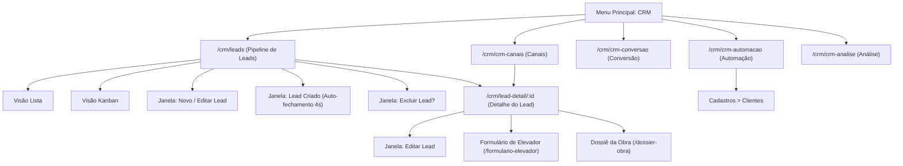
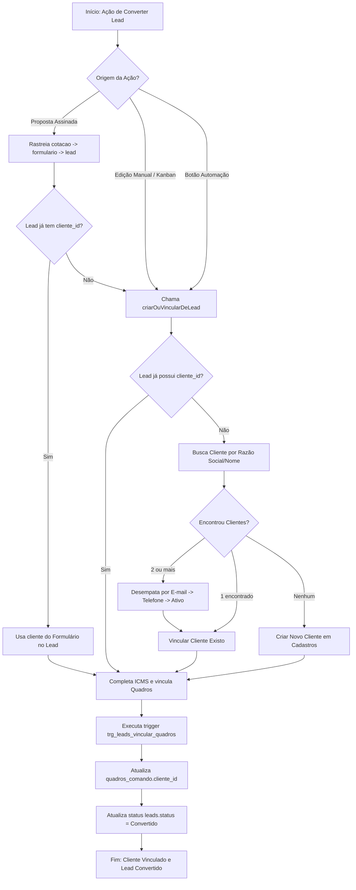
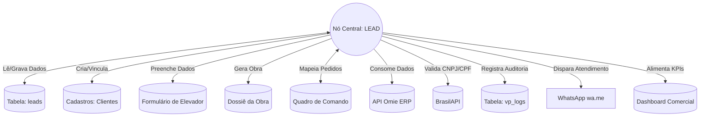
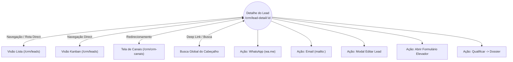

# 2 CRM — documento do módulo (REAL, fonte da verdade — 31/10/2026)

> **Status: REAL (documento oficial do módulo 2), aprovado pelo Gelson em 31/10/2026.** Substituiu a "especificação técnica" de 30/10/2026 (que continua no histórico do Git) e traz tudo o que o `CLAUDE.md` guardava sobre o CRM. Nada foi enviado ao GitHub: até lá a cópia que vale é a do disco local.
>
> **Fonte da verdade:** o código e o banco, conferidos em 31/10/2026 (`origin/main` `5d62c56`). O que veio de documento anterior e **não** foi reconferido agora está marcado **Herdado**; o que não foi possível conferir está marcado **Não verificado** (Art. 6 da Constituição). Sem selo, vale como Não verificado. Sem número de linha (envelhece): cita-se arquivo e função.

## Como esta numeração funciona
- A regra de numeração (móvel, como cláusula de contrato) e os 11 temas de cada tela moram **uma vez só**, em `docs/modulos/01_geral.md` ("Como esta numeração funciona"). Aqui vale a mesma: módulo = **2**; telas filhas = **2.1 a 2.5**; o conteúdo comum do módulo fica na **Parte comum**, com prefixo PC-.
- **O Detalhe do Lead e as três janelas do Lead (Novo/Editar, Lead criado e Excluir) pertencem à tela 2.1**: não são telas à parte, mas cada uma está descrita nos temas da 2.1.
- Mudou algo? Escreva no tema certo da tela e **reescreva o Índice e o Glossário** na mesma sessão.

## Índice
2. **CRM**
   2.1 Leads (lista, Kanban, Detalhe do Lead e janelas)
   &nbsp;&nbsp;&nbsp;2.1.1 O que é · 2.1.2 Rota e arquivos · 2.1.3 Perfil e acesso · 2.1.4 O que a tela mostra · 2.1.5 Botões e controles · 2.1.6 Comportamento · 2.1.7 Dados (lê/grava) · 2.1.8 Regras e armadilhas · 2.1.9 Testes · 2.1.10 Pendências e decisões · 2.1.11 Histórico
   2.2 Canais
   &nbsp;&nbsp;&nbsp;2.2.1 O que é · 2.2.2 Rota e arquivos · 2.2.3 Perfil e acesso · 2.2.4 O que a tela mostra · 2.2.5 Botões e controles · 2.2.6 Comportamento · 2.2.7 Dados (lê/grava) · 2.2.8 Regras e armadilhas · 2.2.9 Testes · 2.2.10 Pendências e decisões · 2.2.11 Histórico
   2.3 Conversão
   &nbsp;&nbsp;&nbsp;2.3.1 O que é · 2.3.2 Rota e arquivos · 2.3.3 Perfil e acesso · 2.3.4 O que a tela mostra · 2.3.5 Botões e controles · 2.3.6 Comportamento · 2.3.7 Dados (lê/grava) · 2.3.8 Regras e armadilhas · 2.3.9 Testes · 2.3.10 Pendências e decisões · 2.3.11 Histórico
   2.4 Automação
   &nbsp;&nbsp;&nbsp;2.4.1 O que é · 2.4.2 Rota e arquivos · 2.4.3 Perfil e acesso · 2.4.4 O que a tela mostra · 2.4.5 Botões e controles · 2.4.6 Comportamento · 2.4.7 Dados (lê/grava) · 2.4.8 Regras e armadilhas · 2.4.9 Testes · 2.4.10 Pendências e decisões · 2.4.11 Histórico
   2.5 Análise
   &nbsp;&nbsp;&nbsp;2.5.1 O que é · 2.5.2 Rota e arquivos · 2.5.3 Perfil e acesso · 2.5.4 O que a tela mostra · 2.5.5 Botões e controles · 2.5.6 Comportamento · 2.5.7 Dados (lê/grava) · 2.5.8 Regras e armadilhas · 2.5.9 Testes · 2.5.10 Pendências e decisões · 2.5.11 Histórico
   Parte comum do CRM (sem número de tela)
   &nbsp;&nbsp;&nbsp;PC-1 Mapa de ligações · PC-2 Captura de leads (site e formulário público) · PC-3 Convertido → Cliente (todos os caminhos) · PC-4 Consulta do CNPJ/CPF no Omie e a coluna "Está no Omie desde" · PC-5 As duas leituras de leads · PC-6 Identidade, alçadas e segurança · PC-7 Gatilhos e rotinas · PC-8 Tabelas · PC-9 Navegação, cache e testes · PC-10 Menu "?" e tutoriais · PC-11 Documentos soltos e destino do que foi concatenado · PC-12 Benefícios trocados com os outros módulos
3. Cadastros Mestres → `03_cadastros_mestres.md`

## Glossário (módulo CRM)
Termos gerais (soft-delete, alerta, alçada, Nº da cotação, cadeia de etapas) estão no glossário de `01_geral.md` e não se repetem aqui.
- **Lead:** possível cliente ainda em atendimento (um síndico que pediu orçamento, um contato do site, uma indicação). Guarda só a **identificação** (prédio, contato, telefone, e-mail) e o estado comercial; **não guarda equipamento**: o equipamento é montado depois, no Formulário. Linha da tabela `leads`; `id` no formato `LD-` + 6 dígitos.
- **Pipeline:** a fila de leads em aberto, da tela 2.1.
- **Status do lead:** um dos seis de `LEAD_STATUSES`: Em qualificação → Aguardando cotação → Proposta enviada → Negociação → Convertido | Sem retorno. Fonte única do campo, dos filtros, do Kanban e da Análise.
- **Em aberto:** na lista e nos indicadores da 2.1, todo status **diferente de Convertido** (inclui "Sem retorno"; ver 2.1.10).
- **Convertido:** o lead virou cliente. A partir daí ele **mora em Cadastros › Clientes** e some da lista "Em aberto" e do Kanban; o filtro "Convertido" da lista guarda o histórico.
- **Origem:** de onde o lead veio (`leads.origin`): texto; a lista de escolha tem 7 valores e as duas capturas automáticas gravam outros dois (2.1.8).
- **Responsável (`owner`):** nome do vendedor, **texto livre** (não é vínculo com usuário).
- **Prioridade:** Alta, Média ou Baixa; o banco guarda `alta/media/baixa` e há valores antigos com maiúscula (`priorityKey` normaliza).
- **Qualificar → Dossier:** criar o Dossiê da Obra (módulo 9) a partir do lead. **Não muda o status do lead.**
- **Documento pendente:** marca "CPF ou CNPJ será inserido depois"; deixa salvar o lead sem documento.
- **Contribuinte de ICMS:** Sim/Não, obrigatório; define quem recolhe o DIFAL na venda interestadual (não contribuinte = a VerticalParts recolhe e o custo entra na Precificação).
- **Comissão do lead:** percentual manual 0–100; em branco vale **2%** sem gravar o padrão (`COMISSAO_PADRAO_PCT`).
- **Está no Omie desde:** data de cadastro do **cliente** (CNPJ/CPF) no ERP Omie, mostrada na lista; mora em `clientes`, não em `leads` (PC-4). Em branco = não está no Omie, sem documento ou ainda não verificado.
- **Encontrado (`true | false | null`):** resultado de uma consulta ao Omie; `null` é **falha da consulta**, nunca "não cadastrado".
- **Captura automática:** lead criado por uma Edge Function sem ninguém digitar (formulário do site; formulário público do Quadro de Comando). PC-2.
- **Canal:** forma de falar com o lead. Hoje só **WhatsApp** (link `wa.me`); o e-mail é feito pelo Inbox (módulo 1).
- **`useLeadsBase`:** leitura própria das quatro telas de `crm.jsx` (PC-5); **não** é a mesma leitura da lista de Leads.

---

## 2.1 Leads

### 2.1.1 O que é
O início da jornada comercial: onde o lead é captado, qualificado e encaminhado para virar **Cliente** (Cadastros), abrir o **Formulário de Elevador** (cotação) e o **Dossiê da Obra**. A tela tem dois jeitos de ver a mesma lista (**Lista** e **Kanban**), um **Detalhe do Lead** e três janelas: **Novo/Editar Lead**, **Lead criado** e **Excluir lead**. **Lê** `leads` (+ o cliente vinculado) e `vp_logs`; **grava** `leads`, `clientes` (vínculo e dados do Omie) e `vp_logs`.
*Estado em 31/10/2026 (Conferido, banco):* 23 leads na tabela, 10 excluídos (soft-delete) e **13 ativos**: 12 "Em qualificação" e 1 "Aguardando cotação"; por origem, 7 "Indicação" e 6 "Site"; 9 dos 13 têm cliente vinculado. Nenhum lead está "Convertido" hoje.

### 2.1.2 Rota e arquivos
- Lista: `/crm/leads` (id `leads`). Detalhe: `/crm/lead-detail/<id>` (id `lead-detail`). Menu: grupo "CRM", 1º item (ícone bandeira); `MODULE_HOME['CRM'] = 'leads'`. Caminho do topo "CRM / Leads" e "CRM / Detalhe de Lead".
- Tela: `src/comercial.jsx` (o mesmo arquivo guarda ainda `FormulariosPage`, que é do módulo 4): `LeadsPage`, `LeadsKanban`, `LeadDetail` → `LeadDetailView`, `ModalNovoLead`, `ModalExcluirLead`, `OmieStatusBox`, `KvBlock`, `SuggestedStep` e os helpers `comercialSb`, `buscarClienteOmie`, `priorityKey`, `waLink`, `isoParaDataBR`, `gravarOmieNoCliente`, `precisaVerificarOmie`. Exposto em `window`: `LeadsPage, LeadDetail, comercialSb, LEAD_STATUSES, waLink`.
- O **Detalhe resolve o lead pelo id da URL**: `ASYNC_FETCH_ROUTES['lead-detail']` em `src/app.jsx` busca o lead por id (deep-link, F5 e Voltar funcionam); id ausente ou lead não encontrado cai em `leads` (`SUBSEL_FALLBACK_ROUTE`). Essa busca **não filtra `excluido_em`** (de propósito, 2.1.8). Sem lead selecionado a tela mostra "Nenhum lead selecionado" com o botão "Ir para Listagem de Leads".
- Busca global do cabeçalho (`shell.jsx`): acha lead por prédio, contato ou e-mail (até 6, sem os excluídos) e abre `lead-detail`.
- Texto do "?" (`HELP_TOPICS`) e tutorial: ver PC-10. **Selo:** Conferido 31/10/2026 (código).

### 2.1.3 Perfil e acesso
- Qualquer pessoa logada que enxergue o grupo "CRM" no menu abre a tela. O grupo é liberado pela alocação do colaborador (`MODULOS_POR_GRUPO_SIDEBAR['CRM'] = ['leads']`). A alçada `leads` existe no catálogo com as ações padrão (ver, criar, editar, excluir) e há **35 linhas de alçada `leads`** no banco (perfil × ação), **mas `comercial.jsx` e `crm.jsx` não chamam `temCapacidade` em lugar nenhum** (Conferido por busca no código): quem abre a tela cria, edita, move e exclui. Como o menu usa a alocação (e não a alçada de ação) para mostrar ou esconder o grupo: **Não verificado** (não li `grupoVisivel`).
- A tela **não** está em `RESTRICTED` (`app.jsx`): nenhum perfil de visão (comercial, engenharia, financeiro, admin) é barrado.
- Não há restrição por vendedor: todos veem os leads de todos. A restrição por dono que existe no Formulário (`formularios.ver_de_outros`) **não** vale aqui. Segurança real depende da issue #571 (PC-6).

### 2.1.4 O que a tela mostra
**Lista (`/crm/leads`)**
1. **Cabeçalho:** "CRM · Leads / Pipeline de Leads" e a frase "N leads em aberto · pipeline R$ X · N convertido(s) (Y%)". O pipeline soma o valor dos leads que **não** estão Convertido nem Sem retorno; o percentual é convertidos ÷ **total** (todos os status).
2. **Quatro indicadores:** Leads ativos (em aberto), Em qualificação, Propostas no ar (status "Proposta enviada") e Valor pipeline.
3. **Barra:** seletor de visão (Lista/Kanban); na Lista, os filtros de status ("Em aberto", e os seis status), o filtro de responsável, "N por página" (10, 15, 25 ou 50; padrão 15) e a busca "Buscar prédio, contato…" (procura só em prédio e contato).
4. **Tabela:** ID · Lead/Prédio (com a data) · Contato (cargo · telefone) · Origem · Status · Resp. · Valor · Próx. Ação (com a prioridade) · **Está no Omie desde** · ações. Rodapé "Exibindo N de M leads" e paginação.
5. **Vazios:** "Nenhum lead cadastrado. Clique em Novo Lead para começar." ou "Nenhum lead encontrado com os filtros aplicados."; "Carregando leads…" na primeira carga.

**Kanban**
6. Uma coluna por status, na ordem do ciclo, mais **"Outros"** (só aparece se há lead com status antigo fora da lista). Cada coluna mostra o nome, a contagem e a soma de valores; o cartão mostra prédio, contato, prioridade, valor e responsável. A coluna **Convertido** não lista cartões: mostra quantos já viraram cliente e a dica "Arraste para cá para converter".

**Detalhe do Lead (`/crm/lead-detail/<id>`)**
7. **Cabeçalho:** voltar, `id · origem`, nome do prédio, razão social e CNPJ do cliente (ou "Carregando cliente…" / `equip` antigo / "Sem cliente (CNPJ) vinculado ainda"), selo de status, selo de prioridade e **"Última atualização"** (o evento mais recente do histórico; senão a criação).
8. **Coluna esquerda:** cartão **Cliente** (razão social, CNPJ — só `cliente.cnpj`, então cliente pessoa física aparece sem documento —, valor estimado — ou o aviso de que não há cliente com o botão "Abrir Formulário e vincular cliente"); cartão **Histórico de Atividades** (linha do tempo: "Lead criado via <origem>" + eventos de `vp_logs` do lead, até 50, mais recentes primeiro); cartão **Próximo passo** (um passo fixo: "Abrir Formulário e alocar equipamento(s)", com a dica "Cliente já vinculado — abre pronto" ou "Ainda sem CNPJ — resolve lá dentro"; **só informativo**, não é botão).
9. **Coluna direita:** cartão **Contato** (nome, cargo, telefone, e-mail e dois botões); cartão **Especificação técnica** (só aparece quando o lead tem respostas do formulário público; lista genérica por chave); cartão **Atribuição** (vendedor, origem e **comissão prevista** = valor × percentual, com "— padrão" quando vale os 2%; **só aparece quando o lead tem valor estimado**).

**Janelas**
10. **Novo Lead / Editar Lead** (largura 600): ver campos em 2.1.5. **Lead criado** (aparece após criar; fecha sozinha em 4 s). **Excluir lead?** (mostra prédio, id, contato e data; avisa dos registros ligados).

### 2.1.5 Botões e controles (conferidos no código em 31/10/2026)
**Lista — cabeçalho e barra**
- **Lista / Kanban** (seletor, só ícone com `aria-label`) · **Exportar** (baixa `leads.csv` com as linhas **filtradas** — todas as páginas — e as colunas id, predio, contato, cargo, telefone, email, equipamento, origem, status, responsavel, valor, prioridade, proxima_acao, data, no_omie_desde; a coluna "equipamento" é o campo antigo `equip`) · **Novo Lead**.
- Filtros de status (7 botões), seletor de responsável, "por página", busca, paginação (anterior/próxima). Trocar status, responsável, busca ou tamanho de página **volta à página 1**.
- **Por linha:** clicar na linha abre o Detalhe; **Abrir** (idem); **lixeira** ("Excluir lead", abre a janela de exclusão sem abrir a linha).
- O botão "Filtros" foi **removido de propósito** (achado #47: só ecoava os filtros que já existem).

**Kanban**
- Arrastar um cartão de uma coluna para outra **muda o status** (`moverLeadStatus`). Clicar no cartão abre o Detalhe. Não se arrasta **para** "Outros" nem se arrasta um cartão que está em "Outros". Só há arrastar com o mouse (nenhum botão alternativo); em tela de toque: **Não verificado**.

**Janela Novo/Editar Lead** — campos (`*` = obrigatório):
- Prédio / Empreendimento \* · Contato \* · Cargo · Telefone · E-mail.
- Bloco **Cliente (CNPJ/CPF)**: Tipo de pessoa (Pessoa Jurídica/Física) · CNPJ ou CPF (conforme o tipo) · **Buscar CNPJ** (só em PJ) · caixa **"CPF ou CNPJ será inserido depois"** (desliga o campo e limpa o número) · Razão Social · **Contribuinte de ICMS? \*** (Sim/Não).
- Status (os seis; um status antigo fora da lista continua selecionável na edição) · Origem (Site, Indicação, LinkedIn, Cold Call, Evento, WhatsApp, Email) · Prioridade (Alta, Média, Baixa) · Responsável (Comercial) · Valor estimado (R$) · Comissão (%) — manual · Próxima ação.
- Rodapé: **Cancelar** e **Criar Lead** / **Salvar Alterações** (vira "Salvando…").
- O aviso do Omie (`OmieStatusBox`): verde "Cliente cadastrado no ERP desde dd/mm/aaaa" (com razão social e "cadastro INATIVO no Omie" quando for o caso), azul "Não encontrado no ERP" ou amarelo "Não foi possível consultar o ERP".

**Janela "Lead criado"** (título "✓ Lead Criado! (fechará em 4s)"): **Fechar** e **Abrir Formulário →**; mostra o cliente vinculado ou o aviso "Sem CNPJ/CPF vinculado ainda — pode ser resolvido no Formulário".

**Janela "Excluir lead?"**: **Cancelar** e **Sim, excluir lead** (desabilitado enquanto confere os vínculos e durante a exclusão).

**Detalhe**
- **Voltar para Leads** · **WhatsApp** · **Email** (abre o programa de e-mail do computador, `mailto:`; **não** passa pelo Inbox) · **Editar Lead** (abre a janela) · **Abrir Formulário** · **Qualificar → Dossier** / **Abrir Dossier** (desabilitado enquanto cria). WhatsApp e Email aparecem duas vezes (cabeçalho e cartão Contato). Telefone ou e-mail ausente gera o aviso "Telefone/Email não cadastrado."

### 2.1.6 Comportamento
- **Carga:** a lista lê os leads **não excluídos**, do mais novo ao mais antigo, juntando o cliente vinculado (só `cnpj, cpf, omie_cadastrado_desde, omie_verificado_em`). Em erro de rede mostra aviso e lista vazia (nunca "Carregando…" para sempre). A leitura da lista **não é paginada** (PC-5).
- **Salvar lead** (nesta ordem): valida Prédio, Contato, documento (conforme o tipo escolhido, com dígito verificador; vazio só com "documento pendente"), Contribuinte de ICMS e comissão (0–100) → grava `leads` (insert com `id = 'LD-' + últimos 6 dígitos de Date.now()`, ou update) → grava a auditoria em `vp_logs` ("Lead criado"/"Lead editado", só os **nomes** dos campos alterados e status de→para; nunca telefone, e-mail ou valores) → se há CNPJ/CPF (ou o lead já tem cliente), cria ou atualiza o cliente pelo mesmo caminho do Formulário (`buscarOuCriarCliente`) e grava `leads.cliente_id` → se o status é Convertido e ainda sem cliente, `criarOuVincularDeLead` (PC-3) → se Convertido com cliente, vincula os pedidos de Quadro de Comando do lead → em segundo plano, grava no cliente a data do Omie (PC-4). Falha ao vincular cliente **não desfaz** o lead: avisa "Lead criado, mas falhou ao vincular cliente".
- **Buscar CNPJ:** consulta primeiro o Omie e, se achar, preenche telefone e e-mail (só campos vazios) e **sobrescreve a razão social** (`omie.razao_social || p.razaoSocial`) **sem** ir à consulta pública; se não achar ou o Omie falhar, usa a consulta pública (BrasilAPI), que também sobrescreve a razão social, e preenche o telefone se estiver vazio (**Conferido** no código em 31/10/2026). Mexer no número zera o aviso.
- **Excluir:** soft-delete (`excluido_em`/`excluido_por`), com `.select('id')` e 0 linhas = erro; sempre com a janela de confirmação; grava "Lead excluído" em `vp_logs`. A janela conta dossiês, formulários e cotações ligados (limite de 6 s por consulta; se estourar, diz "não foi possível verificar" e libera o botão).
- **Kanban:** o cartão muda de coluna na hora e **volta** se a gravação falhar (confere `.select('id')`; 0 linhas = erro). Mover grava "Lead movido de X para Y" em `vp_logs`. Mover para Convertido chama `criarOuVincularDeLead` e avisa o resultado.
- **Qualificar → Dossier:** antes de criar, confere se o lead já tem dossiê (`limit(1)`: com 2 ou mais abre o primeiro; se a consulta falhar, **não cria nada**). Só cria com o lead em "Em qualificação" ou "Aguardando cotação" (senão avisa "Lead já está avançado. Crie Dossier manualmente."). Cria pelo `__DOSSIER.criarDeDossier`, grava "Lead convertido em Dossiê da Obra" em `vp_logs` e abre o dossiê. **O status do lead não muda.**
- **Abrir Formulário:** vai para `formulario-elevador` com `{ __prefillFromLead: lead }`; o Formulário pré-preenche telefone, e-mail, contato, prédio, observação "Originado do Lead…" e o cliente (se há `cliente_id`; senão mostra direto os campos de cliente). Quando o Formulário é gravado, guarda `lead_id`. **Equipamento nunca é herdado do lead.**
- **Detalhe:** trocar de lead zera cliente, histórico e dossiê antes da nova busca (evita mostrar dados do lead anterior). Depois de editar, o histórico recarrega e o cartão Cliente é atualizado com o cliente sincronizado.
- **Coluna "Está no Omie desde":** ao abrir a lista, consulta o Omie em segundo plano, **um cliente por vez**, no máximo **10 por carga** (PC-4).
- **Realtime:** não há; a tela só atualiza ao recarregar ou ao agir (PC-6).

### 2.1.7 Dados — o que lê e o que grava
- **Grava:** `leads` (insert, update de edição, de status, de `cliente_id`, soft-delete); `clientes` (cria/atualiza e as colunas do Omie); `quadros_comando.cliente_id` (ao converter); `dossier_obra` (via `__DOSSIER.criarDeDossier`); `vp_logs` (módulo "Comercial").
- **Lê:** `leads` (com `clientes` embutido), `clientes`, `dossier_obra` (id por `lead_id`), `formularios_elevador` e `cotacoes` (só contagem, na janela de exclusão), `vp_logs` (histórico), a Edge Function `omie-buscar-cliente`, a BrasilAPI (`EnderecoAPI`).
- **Herda de:** a captura automática (PC-2) e a digitação do vendedor.
- **Doa para:** Cadastros › Clientes (cliente e vínculo), Formulário de Elevador (pré-preenchimento e `formularios_elevador.lead_id`), Dossiê da Obra (`dossier_obra.lead_id`), Dashboard (KPIs e funil de leads, módulo 1.1), busca global e `vp_logs`. Mapa completo em PC-1.
- **Colunas de `leads`** (Conferido no banco, 31/10/2026): `id` (texto), `date`, `building`, `contact`, `role`, `phone`, `email`, `origin`, `status`, `value` (**bigint**), `equip` (antigo), `owner`, `priority`, `next_action`, `created_at`, `cliente_id` (uuid), `documento_pendente`, `excluido_em`, `excluido_por`, `comissao_pct`, `especificacao_tecnica` (jsonb), `contribuinte_icms`. **Não existe `updated_at`.**

### 2.1.8 Regras e armadilhas
**Regras que existem por motivo — não reintroduza o bug que elas evitam:**
1. **Acesso ao Supabase só por `comercialSb()`** (devolve `null` se o Supabase não carregou); nunca `window.__VP_SB.sb` direto (se o script falhar, o acesso direto derruba a tela inteira).
2. **Exclusão é soft-delete, sempre.** Não use DELETE: as chaves de `cotacoes` e `formularios_elevador` apontam para o lead (bloqueiam), `dossier_obra.lead_id` ficaria órfão e `leads` **não tem política de DELETE** (a chave pública voltaria sem erro e sem apagar). O filtro `excluido_em is null` vale **só nas listagens** (lista, busca global, Dashboard e as telas de `crm.jsx`); **de propósito sem filtro:** Precificação (a fila vem do dossiê), histórico do cliente e buscas por id (incluindo o link direto `lead-detail`) — a janela promete que os registros ligados continuam acessíveis. Para recuperar: `update leads set excluido_em = null, excluido_por = null where id = '…'`.
3. **Toda gravação em `leads` que ALTERA uma linha confere o resultado** (`.select('id')`; 0 linhas = erro), porque um update barrado por RLS volta sem erro e sem linhas: mover no Kanban, excluir, salvar lead (edição), gravar `cliente_id` no Detalhe, `criarOuVincularDeLead` e os dois updates do passo de proposta assinada (`proposta-store.js`: status Convertido e `cliente_id`). **Conferido** no código em 31/10/2026. O **insert** do lead não precisa: insert barrado por RLS já devolve erro explícito.
4. **`LeadDetail` é só o estado vazio; todos os hooks ficam em `LeadDetailView`.** Não volte a pôr `if (!lead) return` antes de hooks (quebra a ordem de hooks do React). Cada efeito do detalhe (cliente, histórico, dossiê) zera o estado ao trocar de lead e usa a marca `alive`; o cliente zera para "carregando" (`undefined`), não para "sem cliente" (`null`). "Qualificar → Dossier" não cria nada enquanto a checagem do dossiê não terminou (evita dossiê duplicado).
5. **Não reponha `ModalNovoLead` num ramo "carregando":** `reloadLeads` não zera `leads` de propósito; zerar remonta a janela no meio do salvamento e a tela "Lead criado" nunca aparecia.
6. **O tipo escolhido define o documento:** Pessoa Física exige CPF (11 dígitos), Pessoa Jurídica exige CNPJ (14), os dois com dígito verificador (`EnderecoAPI.validarDocumento`); vazio só com "documento pendente". **Contribuinte de ICMS** é obrigatório.
7. **Comissão:** campo manual de 0 a 100; em branco = **2%** sem gravar o padrão (grava `null`; se o padrão mudar, muda para quem não escolheu). Não se liga a `regras_comissionamento` (a comissão do Financeiro é outro módulo).
8. **Prioridade** sempre por `priorityKey()` + `PRIORITY_VARIANT`/`PRIORITY_LABEL` (normaliza acento e maiúscula).
9. **Datas `aaaa-mm-dd`** formatadas com `isoParaDataBR()`, nunca `new Date('aaaa-mm-dd')` (cai um dia no fuso do Brasil) nem o `fmtDate` global (corta o ano). No histórico do detalhe, data sem hora é montada como data local.
10. **WhatsApp:** `waLink()` é o helper único (Detalhe e Canais): até 11 dígitos prefixa 55; 12 ou mais ficam como estão; sem telefone devolve `null`.
11. **Navegação** de um componente: `setSubsel` + `setRoute` recebidos por prop; `VpRouter.navigate()` sozinho só reescreve a URL.
12. **Status "Convertido" some do Kanban e da lista "Em aberto"** (o lead mora em Clientes); os indicadores, o Dashboard e a Análise continuam contando os convertidos.
13. **Módulos de fora são conferidos antes de usar** (`EnderecoAPI`, `FormularioElevadorStore`, `CadastrosClientesStore`, `__DOSSIER`): se não carregaram, a janela avisa em vez de quebrar. **Erro ao gravar `leads.cliente_id` nunca é ignorado** (antes a janela dizia "Cliente vinculado" mesmo falhando).
14. **Status e origem automáticos:** só **Convertido** é aplicado pelo sistema (Proposta assinada, edição ou Kanban). "Aguardando cotação", "Proposta enviada" e "Negociação" são **sempre manuais** (Conferido: a única escrita automática de status em `leads` é a da Proposta assinada, em `proposta-store.js`).

**Armadilhas conhecidas (achados, sem correção — descrevem como o código se comporta):**
- **"Em aberto" inclui "Sem retorno".** O filtro "Em aberto", o indicador "Leads ativos" e o subtítulo contam como aberto tudo que não é Convertido; a Análise (2.5) chama "Sem retorno" de "perdidos". O valor do pipeline, esse sim, exclui Convertido e Sem retorno.
- **Origem fora da lista de escolha.** A janela só oferece 7 origens, mas as capturas automáticas gravam "Site verticalparts.com.br" e "Formulário Público — Quadro de Comando". Ao **editar** um lead assim, o seletor mostra a primeira opção ("Site") enquanto o valor guardado continua o original até alguém trocar. Na Conversão (2.3) "Site" e "Site verticalparts.com.br" contam separado.
- **Valor com centavos.** `value` é `bigint`: a janela agora **recusa** valor com centavos ou negativo, antes de gravar, com a mensagem "Valor estimado deve ser um número inteiro em reais, sem centavos" (revisão de 02/11/2026; **Conferido** no código, sem teste de tela). Antes enviava `parseFloat` e o banco devolvia erro técnico.
- **`id` do lead vem do relógio** (últimos 6 dígitos de `Date.now()`), igual na tela e na Edge Function: colisão é improvável, mas existe (a chave primária barra a repetição e a tela mostra o erro).
- **Dois botões iguais ao lado** em cada linha ("Abrir" e a própria linha clicável) e dois pares WhatsApp/Email no Detalhe.
- **Nome do log engana:** "Lead convertido em Dossiê da Obra" é gravado, mas o status do lead **não** vira Convertido.
- **O Detalhe de um lead excluído abre** por link direto (2.1.2).
- **`FormulariosPage`** (a rota `formularios`, os cartões do Formulário, usada por `app.jsx`) mora neste arquivo mas é do módulo 4; está descrita em `04_comercial_pre_venda.md` (4.1) e ainda não migrou de arquivo.

### 2.1.9 Testes
- Unitários (Conferido, rodados em 31/10/2026: 13 de 13 passam): `src/enderecos-api.test.js` (3, validação de CPF/CNPJ pelo tipo), `src/proposta-lead-cliente.test.js` (6, o passo "lead→cliente" da Proposta assinada) e `src/cadastros-clientes-vincula-quadros.test.js` (4, vincular os pedidos de Quadro ao converter). Há ainda 3 testes de `criarOuVincularDeLead` em `src/cadastros-nunca-excluir.test.js` (desempate por e-mail, por telefone e preferência pelo cliente ativo, #1228; e update barrado com 0 linhas), e 1 em `proposta-lead-cliente.test.js` (0 linhas no passo da assinatura), que fazem parte da suíte geral e não do total de 13.
- E2E: `e2e/crm.spec.js` (11 testes, Supabase **simulado**, nunca toca produção; **não rodei agora**, rodam no CI): KPI só dos em aberto e filtro/busca voltando à página 1; Kanban (falha reverte o cartão, sucesso muda e loga); Detalhe por URL direta com WhatsApp (55 só no Brasil) e dossiê sem duplicar; dossiê com consulta falha; edição que loga sem telefone/e-mail e atualiza o histórico; Canais com o helper único; cartão de erro e "Tentar de novo" nas quatro telas de `crm.jsx`.
- **Sem teste:** salvar um lead (validações e a gravação do vínculo de cliente no Detalhe; o desempate e o 0 linhas de `criarOuVincularDeLead` têm teste), a janela de exclusão, a busca do CNPJ, a coluna "Está no Omie desde", o pré-preenchimento do Formulário e as duas Edge Functions de captura.

### 2.1.10 Pendências e decisões
Nenhuma decisão do Gelson registrada ainda para esta tela. Achados da 2.1.8 aguardam decisão (nenhum foi corrigido). Além deles:
1. **Restrição por vendedor** e **alçadas de ação** (ver 2.1.3) não existem; qualquer um com acesso à tela faz tudo.
2. **Responsável é texto livre:** erro de digitação divide o mesmo vendedor em dois na Análise (2.5) e no filtro.
3. **Lead sem atualização automática de status:** nem a criação do Formulário, nem o envio da Proposta mudam o status do lead (só a assinatura muda, para Convertido). Os indicadores "Propostas no ar" e o funil dependem de alguém lembrar de mudar à mão.
4. **Tutorial desatualizado** (ver PC-10).
5. ~~Gravações de `leads` sem conferir linhas alteradas~~ — **resolvido em 31/10/2026** (regra 3 da 2.1.8).
6. **O `id` do lead é gerado no navegador com 6 dígitos do relógio** (`'LD-' + Date.now().toString().slice(-6)`, no salvar lead de `comercial.jsx`): esses 6 dígitos se repetem a cada cerca de 16,7 minutos, e a chave primária de `leads` é `id`, então um lead novo que caia nos mesmos 6 dígitos de um antigo (ou dois leads no mesmo instante) é **recusado pelo banco por chave repetida**. Hoje há 23 leads (banco, 31/10/2026): a chance é pequena e cresce com a base. O que a tela mostra nessa recusa **Não verificado**. Achado, sem correção; a regra doada por Cadastros (código pela sequência do banco, `01_geral.md` PC-9) é a saída natural. **Conferido** no código e na chave primária do banco, 31/10/2026.
7. **Nenhum gatilho de identidade em `leads`:** só há gatilhos de evento e de vínculo de quadros; o `id` não é protegido contra troca no banco (o Formulário tem `fn_formularios_elevador_protege` para isso, doado por Comercial | Pré-venda, `01_geral.md` PC-9). **Conferido** (lista de gatilhos, 31/10/2026; não testei um UPDATE). Achado, sem correção.

### 2.1.11 Histórico (só o que ainda ensina)
- **15/08/2026:** o lead deixou de coletar equipamento; só o Formulário aloca equipamento.
- **26/09/2026 (Herdado):** carga inicial da coluna "Está no Omie desde" nos 4 leads que tinham cliente (CTIS desde 09/04/2024; Pirâmide/Grownt desde 21/12/2021; Condomínio Bloco C e Ribeiro Caram não estavam no Omie).
- **26/09/2026:** robustez (E01–E11) e busca do CNPJ no Omie; botão de excluir (soft-delete); campo Status (`LEAD_STATUSES`) e coluna "Está no Omie desde"; Leads migrou de "Comercial | Pré-venda" para o grupo CRM (as alocações dos colaboradores foram migradas junto).
- **04/10/2026:** documento pelo tipo escolhido (CPF/CNPJ com dígito verificador) e comissão manual (2% se em branco).
- **14/10/2026:** lead Convertido deixa de morar em Leads (vai para Cadastros › Clientes).
- **16/10/2026:** Contribuinte de ICMS obrigatório no lead.
- **31/10/2026 (#1200 a #1203):** Kanban confere a gravação; log de criação/edição; página volta à 1 ao filtrar, KPI só dos em aberto e `waLink` único; cartão de erro com retry nas telas de `crm.jsx`.
- **31/10/2026 (reconferência do documento):** todas as gravações que alteram `leads` passaram a conferir as linhas alteradas (`.select('id')`; 0 linhas = erro): salvar lead (edição), `cliente_id` no Detalhe, `criarOuVincularDeLead` e os 2 updates do passo de proposta assinada. Testes novos: `proposta-lead-cliente.test.js` (0 linhas vira falha do passo) e `cadastros-nunca-excluir.test.js` (0 linhas lança erro).
- **31/10/2026 (#1228, T8 de Cadastros):** `criarOuVincularDeLead` desempata clientes de mesmo nome pelo e-mail, depois pelo telefone do lead.
- **02/11/2026 (revisão de código do módulo):** (1) "Qualificar → Dossier" passa a gravar `dossier_obra.cliente_id` quando o lead já tem cliente (antes só `lead_id`; a "Vida do Cliente" não achava a obra); (2) valor com centavos é recusado na janela; (3) em **Editar Lead** o botão "Salvar" fica desabilitado ("Carregando cliente…") até os dados do cliente chegarem, para não mandar documento vazio ao cliente vinculado; (4) o relógio de 4 s da janela "Lead criado" deixa de reiniciar a cada atualização da lista; (5) **editar um lead que já tem cliente deixa de apagar o endereço, a cidade, a UF e a inscrição estadual do cliente**: `buscarOuCriarCliente` (com `clienteIdProvisorio`) só sobrescreve os campos opcionais que a chamada informa, e a janela do Lead não informa nenhum deles (**Conferido** no banco: 5 dos 9 clientes ligados a leads tinham endereço, cidade ou UF; teste `formulario-cliente-provisorio.test.js`). **Fora desta correção (achados, sem mudança):** até 10 consultas seguidas ao Omie por carga da lista (Art. 30); a busca junta prédio e contato sem separador; o filtro de responsável não zera quando o nome some da lista.

---

## 2.2 Canais

### 2.2.1 O que é
Lista dos leads que têm telefone ou e-mail, para chamar pelo **WhatsApp** com um clique e uma mensagem de apresentação pronta. Só consulta e abre o WhatsApp: não cadastra nem edita lead (use a 2.1) e **não envia e-mail** (o e-mail é do Inbox, módulo 1). Escopo decidido em 26/09/2026: só e-mail e WhatsApp (SMS, notificação push e redes sociais ficaram de fora).

### 2.2.2 Rota e arquivos
- `/crm/crm-canais` (id `crm-canais`); menu "CRM", 2º item (ícone e-mail). Tela: `CRMCanaisPage` em `src/crm.jsx` (carrega **depois** de `comercial.jsx` e usa `comercialSb`, `LEAD_STATUSES` e `waLink` expostos em `window`). Recebe `setRoute` e `setSubsel` como props. Texto do "?" em `HELP_TOPICS['crm-canais']` e tutorial `crm/canais` (PC-10). **Selo:** Conferido 31/10/2026.

### 2.2.3 Perfil e acesso
Igual à 2.1.3: sem alçada de ação, sem restrição por vendedor; vê todos os leads ativos.

### 2.2.4 O que a tela mostra
Cabeçalho "CRM · Canais / Canais" com a frase "WhatsApp e e-mail de cada lead — disparo rápido, sem sair do CRM."; cartão **"Como funciona"** (explica que o e-mail com lead vinculado a uma cotação já aparece no Inbox e no histórico do lead, e que o WhatsApp abre na conversa real); tabela **Lead · Contato · Telefone · E-mail · Origem** + botão. Vazio: "Nenhum lead com telefone ou e-mail cadastrado ainda."; erro: cartão de erro (PC-5).

### 2.2.5 Botões e controles
- **WhatsApp** por linha (abre `wa.me` em nova aba; sem telefone mostra "Sem telefone"). **Clicar na linha** abre o Detalhe do Lead (`setSubsel(lead)` + `setRoute('lead-detail')`). **Tentar de novo** só no cartão de erro. Não há busca, filtro nem ordenação.

### 2.2.6 Comportamento
Lê os leads (PC-5), mantém os que têm telefone **ou** e-mail e lista do mais novo ao mais antigo. A mensagem pronta é "Olá <contato>, tudo bem? Aqui é da VerticalParts." (`waLink`). Nenhum envio é registrado em lugar nenhum: **abrir o WhatsApp não grava histórico** do contato.

### 2.2.7 Dados — o que lê e o que grava
- **Lê:** `leads` (não excluídos). **Grava:** nada. **Doa:** nada (a navegação leva ao Detalhe, 2.1).

### 2.2.8 Regras e armadilhas
- O helper `waLink` é o mesmo do Detalhe (2.1.8, regra 10); não crie outro.
- O botão de e-mail do Detalhe (2.1.5) usa `mailto:` e **não** passa pelo Inbox; a frase do cartão "Como funciona" fala do Inbox para e-mail **já vinculado a cotação**. Os dois dizem coisas diferentes e estão certos: o primeiro é um atalho do computador; o segundo é o histórico real.

### 2.2.9 Testes
E2E `e2e/crm.spec.js`: "Canais: WhatsApp usa o helper único" e "Canais: falha de leitura mostra cartão de erro e Tentar de novo recupera" (Supabase simulado; rodam no CI; **não rodei agora**).

### 2.2.10 Pendências e decisões
1. Abrir o WhatsApp não deixa rastro (nem em `vp_logs`): quem ligou para quem não aparece no histórico do lead.
2. Sem busca nem filtro: com muitos leads a lista fica longa.
3. **Tutorial desatualizado** (PC-10).

### 2.2.11 Histórico (só o que ainda ensina)
- **26/09/2026:** tela criada com escopo de WhatsApp e e-mail.
- **31/10/2026 (#1202, #1203):** botão usa o `waLink` único; leitura paginada e cartão de erro.

---

## 2.3 Conversão

### 2.3.1 O que é
Mostra **de onde vêm** os leads: quantos há de cada origem, com barra de comparação, e explica a captura automática do site. Só consulta.

### 2.3.2 Rota e arquivos
`/crm/crm-conversao` (id `crm-conversao`); menu "CRM", 3º item (ícone seta). Tela: `CRMConversaoPage` em `src/crm.jsx`. Texto do "?" e tutorial `crm/conversao` (PC-10). **Selo:** Conferido 31/10/2026.

### 2.3.3 Perfil e acesso
Igual à 2.1.3.

### 2.3.4 O que a tela mostra
Cabeçalho com "N leads capturados · de onde eles vieram"; cartão **Fontes de captura** (uma linha por origem, ordenada da maior para a menor, com barra e contagem; lead sem origem entra em "Não informado"; os excluídos não contam; **os convertidos contam**); cartão **Captura automática do site** (texto sobre o formulário de `verticalparts.com.br` e a Edge Function `capturar-lead-verticalparts`, e o endereço do Webhook a configurar no Elementor). Vazio: "Nenhum lead cadastrado ainda."

### 2.3.5 Botões e controles
Nenhum, além de "Tentar de novo" no cartão de erro. O endereço do Webhook é texto (não há botão de copiar).

### 2.3.6 Comportamento
Conta `leads` por `origin` (PC-5). Lê tudo em páginas de 1000.

### 2.3.7 Dados — o que lê e o que grava
**Lê:** `leads`. **Grava:** nada.

### 2.3.8 Regras e armadilhas
- **O texto "Falta só configurar a ação de Webhook no Elementor" fica de propósito:** o Webhook **ainda não está no ar** (confirmado pelo Gelson em 31/10/2026; issue #1204 aberta). Quando entrar: conferir leads com origem "Site verticalparts.com.br", trocar o texto para "Captura ativa", subir o `?v=` de `crm.jsx` e pedir à sessão de tutoriais que regere o tutorial "Conversão".
- Origens parecidas contam separado ("Site" e "Site verticalparts.com.br"; ver 2.1.8).
- "Conversão" aqui é **origem**; a taxa de conversão está na Análise (2.5).

### 2.3.9 Testes
E2E: cartão de erro e "Tentar de novo" (`e2e/crm.spec.js`, laço das quatro telas). Sem teste da contagem por origem.

### 2.3.10 Pendências e decisões
1. **#1204 (aberta):** o texto do Webhook (2.3.8).
2. Padronizar os nomes de origem entre a janela de lead e as capturas automáticas (decisão do Gelson; ver 2.1.8).
3. **Tutorial desatualizado** (PC-10).

### 2.3.11 Histórico (só o que ainda ensina)
- **26/09/2026:** tela criada (origem dos leads, sem editor de página).
- **31/10/2026 (#1203):** leitura paginada e cartão de erro.

---

## 2.4 Automação

### 2.4.1 O que é
Documenta e confere **uma regra automática**: "lead Convertido → Cliente". Lista os leads convertidos e se cada um já tem cliente vinculado; nos que ficaram sem vínculo, o botão "Vincular agora" corrige. **Não é motor de disparo** de e-mail, SMS ou mensagens em massa.

### 2.4.2 Rota e arquivos
`/crm/crm-automacao` (id `crm-automacao`); menu "CRM", 4º item (ícone raio). Tela: `CRMAutomacaoPage` em `src/crm.jsx`. Chama `CadastrosClientesStore.criarOuVincularDeLead` (`src/cadastros-clientes-store.js`). Texto do "?" e tutorial `crm/automacao` (PC-10). **Selo:** Conferido 31/10/2026.

### 2.4.3 Perfil e acesso
Igual à 2.1.3. **Atenção:** o botão "Vincular agora" **grava** (cria cliente e atualiza o lead) e não exige alçada.

### 2.4.4 O que a tela mostra
Cartão **"Regra ativa: Lead convertido → Cliente"** (texto: quando um lead vira Convertido — por Proposta assinada, edição ou arrastar no Kanban — o sistema garante o registro em Cadastros › Clientes e grava `leads.cliente_id`, sem duplicar) e cartão **"Leads convertidos (N)"** com a tabela Lead · Contato · Vínculo com Cliente (selo verde "Vinculado" ou amarelo "Sem vínculo") · botão.

### 2.4.5 Botões e controles
- **Vincular agora** (só nos "Sem vínculo"; vira "Vinculando…"). **Tentar de novo** no cartão de erro. A linha **não** é clicável aqui (diferente de Canais).

### 2.4.6 Comportamento
Lê os leads (PC-5), filtra os de status Convertido. "Vincular agora" chama `criarOuVincularDeLead(lead)`: se vincula, avisa "Cliente vinculado." e **atualiza só aquela linha** no estado local (`atualizarLead`), sem recarregar a página; se o lead não tem prédio nem contato, avisa que não foi possível.

### 2.4.7 Dados — o que lê e o que grava
**Lê:** `leads`. **Grava:** `leads.cliente_id` e, se preciso, um registro novo em `clientes` (e os pedidos de Quadro de Comando do lead, `quadros_comando.cliente_id`). A regra completa está em **PC-3**.

### 2.4.8 Regras e armadilhas
- Esta tela **não** é quem converte: ela só mostra a regra e conserta o que ficou sem vínculo. Quem converte é o PC-3.
- Como hoje não há lead Convertido (2.1.1), a lista aparece vazia: "Nenhum lead convertido ainda."

### 2.4.9 Testes
E2E: "Análise e Automação: leitura paginada, Outros no funil, vincular sem recarregar" e o cartão de erro (`e2e/crm.spec.js`; não rodei agora). Unitários da regra: `proposta-lead-cliente.test.js` e `cadastros-clientes-vincula-quadros.test.js` (2.1.9).

### 2.4.10 Pendências e decisões
1. "Vincular agora" sem alçada nem confirmação.
2. O nome "Automação" promete mais do que a tela faz (é uma regra, não um motor); decisão do Gelson se renomeia.
3. **Tutorial desatualizado** (PC-10).

### 2.4.11 Histórico (só o que ainda ensina)
- **26/09/2026:** regra "Convertido → Cliente" e a tela de conferência.
- **31/10/2026 (#1203):** "Vincular agora" deixou de recarregar a página inteira.

---

## 2.5 Análise

### 2.5.1 O que é
O funil dos leads: quatro indicadores, quantos há em cada status e quantos cada responsável tem. Não é analítica de site, SEO nem anúncios. Só consulta.

### 2.5.2 Rota e arquivos
`/crm/crm-analise` (id `crm-analise`); menu "CRM", 5º item (ícone tendência). Tela: `CRMAnalisePage` em `src/crm.jsx`. Texto do "?" e tutorial `crm/analise` (PC-10). **Selo:** Conferido 31/10/2026.

### 2.5.3 Perfil e acesso
Igual à 2.1.3.

### 2.5.4 O que a tela mostra
Quatro indicadores: **Total de leads** (ativos), **Convertidos**, **Taxa de conversão** (convertidos ÷ total, arredondada) e **Sem retorno** (perdidos). Cartão **Funil por status** (os seis status com barra e contagem, mais a linha **"Outros (status antigo)"** quando há status fora da lista, para a soma bater com o total) e cartão **Por responsável** (contagem por `owner`; sem responsável vira "Sem responsável").

### 2.5.5 Botões e controles
Nenhum, além de "Tentar de novo" no cartão de erro. Os números não são clicáveis (não levam à lista filtrada).

### 2.5.6 Comportamento
Lê os leads (PC-5) e conta no navegador. A taxa de conversão usa **todos** os leads ativos no denominador (inclusive os "Sem retorno").

### 2.5.7 Dados — o que lê e o que grava
**Lê:** `leads`. **Grava:** nada.

### 2.5.8 Regras e armadilhas
- Fonte única dos status: `LEAD_STATUSES` (a Análise e o Kanban devem sempre coincidir).
- Os convertidos **contam** aqui (diferente do Kanban e da lista "Em aberto").
- **Diferença de definição:** a Análise chama "Sem retorno" de perdidos; a 2.1 conta "Sem retorno" como aberto (2.1.8).
- Esta Taxa de conversão **não** é a "Conversão Lead→Proposta" do Dashboard (1.1), que mede lead com proposta enviada, não lead convertido.

### 2.5.9 Testes
E2E: "Análise e Automação…" e o cartão de erro (`e2e/crm.spec.js`; não rodei agora). Sem teste unitário das contas.

### 2.5.10 Pendências e decisões
1. Duas "taxas de conversão" com definições diferentes (esta e a do Dashboard) — decisão do Gelson sobre unificar ou renomear.
2. Responsável em texto livre (2.1.10).
3. **Tutorial desatualizado** (PC-10).

### 2.5.11 Histórico (só o que ainda ensina)
- **26/09/2026:** tela criada (funil próprio, sem relatórios de marketing digital).
- **31/10/2026 (#1203):** linha "Outros (status antigo)" no funil, leitura paginada e cartão de erro.

---

## Parte comum do CRM

> O que as cinco telas (2.1 a 2.5) compartilham e que não pertence a uma só. **Não tem número de tela**: usa o prefixo PC-. O que for genérico do sistema (menu "?", cache, mapa de rotas, alertas) fica descrito em `01_geral.md`, e aqui só se aponta.

### PC-1 Mapa de ligações
| Quem | O que entrega | Para quem |
|---|---|---|
| Site `verticalparts.com.br` (Elementor) | lead (PC-2) | **2.1** |
| Formulário público do Quadro de Comando | lead **ou** cliente do Omie + pedido de Quadro (PC-2) | **2.1** / Cadastros › Clientes / Quadro de Comando |
| Vendedor (Novo Lead) | lead + cliente (CNPJ/CPF) | **2.1**, Cadastros › Clientes |
| **2.1** | `formularios_elevador.lead_id` e pré-preenchimento | Formulário de Elevador (módulo 4) |
| **2.1** | `dossier_obra.lead_id` | Dossiê da Obra (módulo 9) |
| Proposta assinada | `leads.status = Convertido` (PC-3) | **2.1**, Cadastros › Clientes |
| `omie-buscar-cliente` | data/código do cliente no Omie | **2.1** (coluna), Cadastros › Clientes |
| `leads` | KPIs e funil | Dashboard (1.1) |
| `leads` e o trigger de cadastro | evento "Lead cadastrado" | trilha de eventos (1.4) e avisos por WhatsApp |

### PC-2 Captura de leads
Duas Edge Functions criam lead sem ninguém digitar. **Selo:** Conferido 31/10/2026 (código); versões em produção: **Não verificado** (listei as funções só no repositório).
- **`capturar-lead-verticalparts`** (formulário de contato do site): `verify_jwt` **fica `false` de propósito** (o POST vem do servidor do WordPress, sem chave; ligar quebra o formulário do site). Limite de taxa de 30 por IP e 60 global (falha ao consultar o limite deixa passar: lead perdido é pior que lead extra). Campos com tamanho máximo; **nome é obrigatório**; e-mail inválido é descartado. Cria o lead com origem "Site verticalparts.com.br", status "Em qualificação", prioridade média, prédio = empresa ou "(não informado)" e próxima ação "Responder: <mensagem>" ou "Aguardando primeiro contato"; grava "Lead recebido pelo site…" em `vp_logs`. **Ainda não recebe lead do site de verdade** (Herdado, confirmado pelo Gelson em 31/10/2026): falta ligar o Webhook no Elementor (2.3.8); no banco só existe 1 lead com essa origem, já excluído.
- **`capturar-lead-quadro-comando`** (formulário público do Quadro de Comando, `formulario-quadro-comando-publico.html`; `verify_jwt:false`, mesmo padrão de segurança): valida o CNPJ (dígito verificador) no servidor; limite de taxa de 20 por IP e 60 global (**Conferido** no código). **Se o CNPJ já é cliente no Omie, NÃO cria lead:** resolve o cliente e cria só o pedido de Quadro de Comando (e grava "Cliente do Omie solicitou orçamento…" em `vp_logs`); fora do Omie, sem CNPJ ou com a consulta falhando, cria o lead (origem "Formulário Público — Quadro de Comando", `especificacao_tecnica` com as respostas, `documento_pendente` quando não há CNPJ). Falha de consulta **nunca** vira "é cliente". Também grava o pedido em `quadros_comando` (com `lead_id` quando há lead). Detalhes do Quadro: módulo 4.
- O **Detalhe do Lead** mostra as respostas guardadas em `especificacao_tecnica` (2.1.4, item 9).

### PC-3 Convertido → Cliente (todos os caminhos)
**Regra:** qualquer caminho para "Convertido" garante um registro em Cadastros › Clientes e grava `leads.cliente_id`, **sem duplicar** (idempotente). Caminhos:
1. **Proposta assinada** (`proposta-store.js`, passo "lead→cliente", que roda pela fila `fluxo_pendentes`, ver `01_geral.md` PC-3): rastreia `numero_cotacao` → `formularios_elevador.lead_id` → lead (formulário sem lead não tem o que converter), marca Convertido e, se o lead ainda não tem cliente e o Formulário tem, grava **o cliente do Formulário** no lead **antes** de qualquer busca por nome (evita homônimos); se esse cliente não existir mais, cai no caminho por nome. Falha de leitura do cliente do Formulário vira falha do passo (não é engolida).
2. **Edição do lead** com status Convertido (`ModalNovoLead`): se já resolveu o cliente pelo CNPJ, só vincula os pedidos de Quadro; senão chama `criarOuVincularDeLead`.
3. **Arrastar no Kanban** para Convertido: `criarOuVincularDeLead`.
4. **"Vincular agora"** na Automação (2.4).
`criarOuVincularDeLead(lead)` (`cadastros-clientes-store.js`): se o lead já tem `cliente_id`, completa o "Contribuinte de ICMS" do cliente e vincula os Quadros; senão busca cliente por **razão social igual ao prédio ou contato** (escapando `%`, `_` e `\`, com `limit(20)`); com 2 ou mais de mesmo nome **desempata pelo e-mail, depois pelo telefone do lead, preferindo o ativo**; sem desempate fica com o primeiro e avisa no console; se não acha, cria o cliente (razão social, contato, telefone, e-mail, contribuinte). Erro de busca ou de vínculo **lança** (os chamadores avisam).
`vincularQuadrosDoLead(leadId, clienteId)` e o gatilho `trg_leads_vincular_quadros` (depois de update de `status` ou `cliente_id`, quando status = Convertido e há `cliente_id`) preenchem `quadros_comando.cliente_id` dos pedidos do lead que ainda não têm cliente; o gatilho engole erros. **Selo:** Conferido 31/10/2026 (código e banco). **Limite:** o gatilho só age em pedidos **sem** cliente (nunca sobrescreve).

### PC-4 Consulta do CNPJ/CPF no Omie e a coluna "Está no Omie desde"
- **Regra do sistema ("Omie primeiro"):** ver ao salvar ou buscar se o documento já existe no Omie e só então a consulta pública. A tela de lead tem a **sua própria** função (`buscarClienteOmie` em `comercial.jsx`) e o Formulário e Cadastros usam `EnderecoAPI.consultarCnpjOmieFirst` (Herdado do `CLAUDE.md`, PR #881; módulo 3); são duas implementações da mesma regra (ver PC-12).
- **Edge Function `omie-buscar-cliente`** (só leitura, `verify_jwt:true`, responde só a um CNPJ/CPF exato, sem listagem): devolve `encontrado: true | false | null`. **Nunca exija sessão de usuário do Supabase numa Edge Function deste app:** o login é o SSO do vpsistema (outro projeto) e todo pedido sai com a chave pública; a versão que exigia sessão respondia 401 sempre em produção. Comportamento real do Omie (Herdado, 26/09): `ListarClientes` com `clientesFiltro.cnpj_cpf` aceita **só dígitos**; CNPJ sem cadastro volta como falha "Não existem registros para a página [1]!" (HTTP 500), não lista vazia; data de cadastro = `info.dInc` (dd/mm/aaaa).
- **Coluna "Está no Omie desde":** guardada no **cliente** (`clientes.omie_cadastrado_desde`, `omie_verificado_em`, `codigo_cliente_omie`). Regras: encontrado → grava data e código; **não encontrado** → data vazia e marca como verificado; **falha de consulta → não grava nada**. Reverifica em segundo plano ao abrir a lista, um por vez, até 10 por carga: clientes nunca verificados, ou não encontrados há mais de 7 dias (`OMIE_REVERIFICAR_DIAS`); documento com dígitos inválidos é ignorado (não gasta consulta). Estado em 31/10/2026 (Conferido, banco): 13 clientes já verificados, 9 com data do Omie.
- **Cuidado ao tocar:** o Omie bloqueia a API inteira por 30 minutos depois de cerca de 10 erros seguidos; por isso a consulta é um cliente por vez e nunca em laço sobre muitos documentos (Art. 30).

### PC-5 As duas leituras de leads
- **Lista (2.1):** `reloadLeads` em `comercial.jsx` — `select('*, cliente_omie:clientes(...)')`, **não excluídos**, ordenado por `date` decrescente, **sem paginação**. O PostgREST corta em 1000 linhas por consulta; hoje há 13 leads ativos, mas acima de 1000 a lista truncaria **em silêncio**. Nas telas de `crm.jsx` isso já foi tratado; na lista não. (Achado, sem correção.)
- **Telas 2.2 a 2.5:** o hook `useLeadsBase()` (`crm.jsx`) devolve `{ leads, erro, recarregar, atualizarLead }`. Lê `select('*')` dos não excluídos em páginas de 1000 (`.range()`, ordem por `date` e `id` para a paginação não repetir nem perder linha). `leads === null` = carregando; `erro` mostra o cartão "Não foi possível carregar os leads" com "Tentar de novo" (**nunca** vira lista vazia). `atualizarLead(id, patch)` altera uma linha sem recarregar.
- **Dashboard** (`supabase.js`) lê `leads` com `select('*')` sem `range` (mesma limitação da lista; ver `01_geral.md` 1.1.10).

### PC-6 Identidade, alçadas e segurança
- **Identidade:** o e-mail de quem age vem do navegador (`window.__VP_USER`) e não é verificável (issue #571). Usado em `excluido_por` e na auditoria.
- **Segurança real do banco (Conferido, 31/10/2026):** `leads` tem **três políticas abertas à chave pública** — leitura (`leitura_publica`), inserção (`escrita_anon`) e atualização (`update_anon`); **não há política de DELETE**. Ou seja, qualquer pessoa com a chave pública do app lê todos os leads (nome, telefone, e-mail) e altera. É a mesma situação das demais tabelas abertas da issue #571 (`01_geral.md` PC-6); `leads` **não** é fechada ainda. As tabelas de CRM **não** foram classificadas no plano de fechamento deste módulo: **Não verificado**.
- **Alçadas:** ver 2.1.3 (existem e não são conferidas pelas telas).
- **Tempo real:** `leads` **não** está na publicação do Realtime (Conferido, banco). Para ter atualização sozinha seria preciso incluí-la na publicação (Realtime só entrega com política de leitura).
- **WhatsApp e privacidade:** `vp_logs` do CRM guarda só nomes de campos; o log da captura do site guarda e-mail, telefone e mensagem do **visitante** (`detalhe`) — ver o aviso de dado sensível em `01_geral.md` PC-5.

### PC-7 Gatilhos e rotinas
O CRM **não tem rotina agendada** (nenhum job de `pg_cron` cita leads — Conferido, banco). O que roda:
- **Gatilho `trg_evfluxo_lead_cadastrado`** (depois de inserir lead; migração `20261023122207_eventos_fluxo_lead_cliente_cadastrado`, **registrada como aplicada no banco e o gatilho existe lá** — Conferido em 31/10/2026; o arquivo da migração, que faltava no repositório, foi **recriado em 31/10/2026** a partir do histórico do banco; é idempotente e também recria o gatilho de Clientes): grava o evento "Lead cadastrado" (módulo Comercial) em `eventos_fluxo` quando o lead não está excluído; engole erros. **Ainda nunca disparou:** o gatilho é de 23/10/2026 e o último lead criado é de 11/10/2026 (0 eventos "Lead cadastrado" no banco).
- **Gatilho `trg_leads_vincular_quadros`** (PC-3).
- **Verificação do Omie em segundo plano** (PC-4): roda no navegador de quem abre a lista, não no servidor.

### PC-8 Tabelas
| Tabela | Linhas (31/10/2026) | Telas |
|---|---|---|
| `leads` | 23 (13 ativas, 10 excluídas) | 2.1 a 2.5, Dashboard, busca global |
| `clientes` (colunas do Omie) | 13 verificadas, 9 com data | 2.1 (coluna), Cadastros |
| `vp_logs` (módulo "Comercial") | 12 | 2.1 (histórico) |
| `formularios_elevador.lead_id` | 9 com lead | Formulário |
| `dossier_obra.lead_id` | 1 com lead (sem chave estrangeira) | Dossiê |
| `quadros_comando.lead_id` | 0 com lead (sem chave estrangeira) | Quadro de Comando |
| `cotacoes.lead_id` | — (chave estrangeira sem ação) | cotações |
Chaves estrangeiras que **apontam para** `leads`: só `cotacoes` e `formularios_elevador` (Conferido, banco). Migrações do CRM: `20260818140000_leads_cliente_id`, `20260828130000_leads_clientes_documento_pendente`, `20260926160000_leads_soft_delete`, `20261004180000_leads_comissao_pct`, `20261007160000_leads_especificacao_tecnica`, `20261014130000_leads_vincular_quadros_ao_converter`, `20261016160000_leads_contribuinte_icms` e `20261023122207_eventos_fluxo_lead_cliente_cadastrado` (arquivo recriado em 31/10/2026; ver PC-7).

### PC-9 Navegação, cache e testes
- **Padrões gerais** (navegar por `setSubsel` + `setRoute`, estado na URL, cache-busting `?v=`, mapa de rotas, testes e CI): `01_geral.md` PC-9. **Específico do CRM:** `comercial.jsx` está em `?v=46` e `crm.jsx` em `?v=3` no `index.html` (Conferido); `crm.jsx` carrega **depois** de `comercial.jsx`: `LEAD_STATUSES`, `comercialSb` e `waLink` só existem em `window` depois que `comercial.jsx` carrega, então qualquer tela nova de CRM tem de carregar depois dele.
- Rota nova de CRM entra no teste de fumaça sozinha (`KNOWN_ROUTES`). `lead-detail` abre pelo id (`ASYNC_FETCH_ROUTES`).
- Os arquivos `.jsx` do CRM não têm teste unitário (são tela); a regra pura mora em `enderecos-api.js` e `cadastros-clientes-store.js`.

### PC-10 Menu "?" e tutoriais do CRM
- O mecanismo do "?" (Ajuda, Treinamento, Feedback) e a regra "tutorial não se edita à mão" estão em `01_geral.md` PC-10. **Aqui só o estado do CRM:** há texto de ajuda (`HELP_TOPICS`) para `crm-canais`, `crm-conversao`, `crm-automacao` e `crm-analise` e para `leads` (**Conferido** em `shell.jsx`); **não há** texto de ajuda para `lead-detail` (o Detalhe do Lead fica sem texto no "?") e tutorial para as cinco telas (`TreinamentoVP/crm/leads|canais|conversao|automacao|analise`) mais o do módulo (`TreinamentoVP/crm/index.html`). **Conferido em 31/10/2026:** só o de Leads diz "Atualizado em 10 de outubro de 2026"; os de Canais, Conversão, Automação, Análise e o do módulo dizem "04 de outubro de 2026". O grupo "CRM" tem o "?" do módulo na barra lateral.
- **Estado (revisão de 31/10/2026): todos desatualizados** — a tela mudou em 31/10 (indicador só dos em aberto, cartão de erro, WhatsApp pelo helper, histórico do lead, página volta à 1 ao filtrar). Regerar pela sessão de tutoriais; **não** editar o HTML à mão.

### PC-11 Documentos soltos e destino do que foi concatenado
*"Concatenar" = reunir num só documento o que estava espalhado (Art. 50 da Constituição).* O que foi reunido neste documento:
- **O próprio `02_crm.md` anterior** (especificação técnica de 30/10/2026): suas sete seções foram reescritas nos temas das telas e na Parte comum (continua no Git).
- **Seções do `CLAUDE.md` sobre CRM/Leads, retiradas de lá e absorvidas aqui:** "Módulo Comercial · Leads — robustez + busca no Omie (26/09/2026)" (2.1.8, 2.1.11, PC-4), "CRM — mapeamento, diagnóstico e correções (30–31/10/2026)" (todo o documento), "CPF/CNPJ de verdade + comissão manual do lead (04/10/2026)" (2.1.8), "Consulta de CNPJ Omie primeiro — o trecho de Leads" (PC-4) e a menção ao detalhe do lead com especificação técnica (item 13 da auditoria de 12/10, 2.1.4). As partes dessas seções que são de **outros** módulos (Cadastros, Formulário, Quadro de Comando, Dashboard) continuam onde estão ou já foram absorvidas por eles.
- **`docs/PROJETO_INCRIVEL.md`** (relato da issue #13): só o "Card 1" (janela "Lead criado" que fecha sozinha em 4 s) é de CRM, e já está no código e descrito em 2.1.5; o resto é de outros módulos. **Fica onde está** e é histórico; não foi movido.
- **Tutoriais** (`TreinamentoVP/crm/*`): pertencem à sessão de tutoriais; ficam onde estão (PC-10).
- **`README.md` da raiz** descreve o produto (Leads em visão de produto); fica. **`AUDITORIA_FORENSE_E2E_SCORE.md`**: linha de base do Guardião; cita as quatro telas de `crm.jsx` como "não investigadas além do smoke test"; fica.
- Nenhum outro arquivo solto sobre CRM foi encontrado na raiz nem em `docs/` (busca por "lead" e "crm" em `docs/**/*.md`, raiz e `handoffs/`).

### PC-12 Benefícios trocados com os outros módulos
*(Regra do Gelson, 31/10/2026, Art. 49: o que um módulo tem de bom e novo passa para os outros.)*
- **Recebido do Geral (`01_geral.md`) e aplicado aqui:** a estrutura de 11 temas por tela, o selo de verificação, o glossário próprio, "Pendências" separadas de "Histórico", "achado, sem correção", a Parte comum e a contagem de testes que foram rodados de verdade.
- **Doado ao Geral (já escrito em `01_geral.md` PC-9 e 1.1.10):** a regra da leitura paginada (`.range()` com ordem estável) para tabela que pode passar de 1000 linhas; a regra de datas `aaaa-mm-dd`; o cuidado de hooks antes de qualquer `return` antecipado; e o achado de que o Dashboard lê `leads` sem paginar.
- **Recebido de Cadastros Mestres (31/10/2026, texto completo em `01_geral.md` PC-9):** gravar com conferência prévia de duplicidade e índice único parcial; código humano pela sequência do banco, sem reserva fixa; aviso para link de registro inexistente. Aplicação ao CRM: só o achado 2.1.10 (item 5, `id` do lead); nenhuma mudança de código foi feita.
- **Recebido de Comercial | Pré-venda (31/10/2026, texto em `01_geral.md` PC-9):** gatilho de identidade no banco (gerou o achado 2.1.10, item 6), trava com destrave por motivo e o cuidado com lista cortada. Nenhuma mudança de código.
- **Recebido de Financeiro & Preços (31/10/2026, texto em `05_financeiro_precos.md` PC-4):** a **comissão manual do lead** (2% se em branco) é uma das **três "comissões"** do sistema e **não** se liga à lista de comissões pagas (5.5) nem à comissão do cálculo de preço (5.2); a ligação por regra de negócio **não foi verificada**.
- **Doado a Cadastros Mestres (`03_cadastros_mestres.md`):** idem (a leitura paginada Cadastros já tinha); acrescentado o cuidado de datas e de hooks e a regra do "cartão de erro, nunca lista vazia".
- **Recebido de Engenharia & Produto (01/11/2026, texto em `08_engenharia_produto.md` PC-12):** conferir (a) se algum `insert/update` do CRM manda coluna que não existe no banco; (b) se os filtros que recarregam do servidor leem o valor novo (`setX(v); recarregar()` lê o antigo); (c) se há ação de alçada declarada e nunca lida. **Não verificado** no CRM; pendência de conferência, sem mudança de código.
- **Recebido de Obras & Instalação (01/11/2026, texto em `09_obras_instalacao.md` PC-12):** o Dossiê da Obra nasce do Lead pelo "Qualificar → Dossier" (9.1.6) ou da Proposta assinada, que **adota** o Dossiê do Lead que ainda não tem cotação em vez de criar um segundo; hoje só **1 de 68** Dossiês tem `lead_id`. **Conferido** no banco, 01/11/2026.
- **Recebido de Entrega & Documentação (01/11/2026, texto em `10_entrega_documentacao.md` PC-12):** nada específico do CRM; vale o bloco "Benefícios vindos de Entrega & Documentação" do `01_geral.md`.
- **Recebido de Parceiros & Instaladores (01/11/2026, texto em `11_parceiros_instaladores.md` PC-12):** nada específico do CRM; vale o bloco "Benefícios vindos de Parceiros & Instaladores" do `01_geral.md`.
- **Recebido de Logística Interna (01/11/2026, texto em `12_logistica_interna.md` PC-12):** nada específico do CRM; vale o bloco "Benefícios vindos de Logística Interna" do `01_geral.md`.
- **Recebido de Fabricação (01/11/2026, texto em `13_fabricacao.md` PC-12):** nada específico do CRM; vale o bloco "Benefícios vindos de Fabricação" do `01_geral.md`.
- **Recebido de Administração (01/11/2026, texto em `14_administracao.md` PC-12):** nada específico do CRM; vale o bloco "Benefícios vindos de Administração" do `01_geral.md`.
- **Recebido de Suprimentos & Importação (31/10/2026, texto em `07_suprimentos_importacao.md` PC-12):** conferir se alguma tela de leitura do CRM engole erro (`catch → []`) e mostra zero, e se há tela que lê só uma tabela antiga enquanto o dado novo mora em outra. **Não verificado** no CRM; pendência de conferência, sem mudança de código.
- **Recebido de Contratos & Jurídico (31/10/2026, texto em `06_contratos_juridico.md` PC-12):** conferir se as políticas de `leads` e `clientes` perguntam por um nome de alçada que existe no catálogo (no contrato, a política de exclusão perguntava por um nome sem concessão); e procurar `update` sem filtro de estado. **Não verificado** no CRM; fica como pendência de conferência, sem mudança de código.
- **Recebido do Geral em 31/10/2026 (padrões de URL) e ainda não aplicado:** o seletor **Lista/Kanban** de `/crm/leads` é só `useState` (`comercial.jsx`, `view`), então F5, link e Voltar/Avançar não guardam a visão. O padrão é o do Dashboard (`window.useRouteTab`, `01_geral.md` PC-9 e 1.1.2). **Achado, sem correção** (Não verificado em navegador; conferido só pela leitura do código em 31/10/2026).
- **Duas implementações da mesma regra (a corrigir quando o Gelson decidir):** a consulta "Omie primeiro" existe em `comercial.jsx` (`buscarClienteOmie`) e em `enderecos-api.js` (`consultarCnpjOmieFirst`); a leitura de leads existe como `reloadLeads` (sem paginar) e `useLeadsBase` (paginada). A doação natural é a de `useLeadsBase` e `consultarCnpjOmieFirst` para a tela de Leads. **Não feito:** mudança de código não pedida.
- **Recebido de Serviços (01/11/2026, texto em `15_servicos.md` PC-2):** todo alerta com destinatário também vira WhatsApp pelo gi-avisos; para chegar certo, título curto com o essencial na frente, sem "teste", sem R$ no título e com o dia da semana por extenso, a obra ou o código do contrato quando houver vários no mesmo dia (o agrupamento de 24 h apaga números). **Conferido** no código do gi-avisos.

#### Mapa do site



#### Wireframe

```text
+-----------------------------------------------------------------------------------------+
| CRM / Leads                                                                             |
| Pipeline de Leads — 13 leads em aberto · pipeline R$ X · 0 convertido(s) (0%)           |
+-----------------------------------------------------------------------------------------+
| [ KPI 1: Leads Ativos ] [ KPI 2: Em Qualificação ] [ KPI 3: Propostas ] [ KPI 4: Valor ]|
+-----------------------------------------------------------------------------------------+
| Visão: [ (X) Lista | ( ) Kanban ]   [ Exportar CSV ]   [ + Novo Lead ]                  |
| Filtros: [ Todos ] [ Em aberto ] [ Em qualificação ] ... | Resp: [Todos v] [Buscar...]   |
+-----------------------------------------------------------------------------------------+
| ID      | Lead / Prédio   | Contato      | Origem | Status     | Valor | Ações          |
+---------+-----------------+--------------+--------+------------+-------+----------------+
| LD-1234 | Condomínio X    | João (Sínd.) | Site   | Qualific.  | 10k   | [Abrir] [Lix]  |
| LD-5678 | Edifício Y      | Maria (Adm)  | Indic. | Ag. Cotação| 25k   | [Abrir] [Lix]  |
+---------+-----------------+--------------+--------+------------+-------+----------------+
| Exibindo 1-15 de 13 leads                              Paginação: [ < Anterior ] [Próxima >]|
+-----------------------------------------------------------------------------------------+

+-----------------------------------------------------------------------------------------+
| [< Voltar para Leads]  LD-1234 · Origem: Site                              Última at. X |
| Condomínio X — Razão Social Exemplo (CNPJ: 00.000.000/0001-00)                          |
| Status: [ Em qualificação ]  Prioridade: [ Alta ]                                       |
| Ações rápidas: [ WhatsApp ] [ E-mail ] [ Editar Lead ] [ Formulário ] [ Qualificar Dossier ]|
+------------------------------------+----------------------------------------------------+
| COLUNA ESQUERDA                    | COLUNA DIREITA                                     |
| +--------------------------------+ | +------------------------------------------------+ |
| | CARTÃO: CLIENTE                | | | CARTÃO: CONTATO                              | |
| | Razão Social: ...              | | | Nome: João Silva                             | |
| | CNPJ: 00.000.000/0001-00       | | | Cargo: Síndico                               | |
| | Valor Estimado: R$ 10.000,00    | | | Tel: (11) 99999-9999  [ WhatsApp ]            | |
| +--------------------------------+ | | Email: joao@email.com   [ Email ]              | |
| | CARTÃO: HISTÓRICO ATIVIDADES   | | +------------------------------------------------+ |
| | • Lead criado via Site         | | | CARTÃO: ESPECIFICAÇÃO TÉCNICA                | |
| | • Status alterado              | | | (Campos do formulário público, se houver)     | |
| +--------------------------------+ | +------------------------------------------------+ |
| | CARTÃO: PRÓXIMO PASSO          | | | CARTÃO: ATRIBUIÇÃO                           | |
| | Abrir Formulário e alocar equip| | | Resp: Comercial | Origem: Site                 | |
| +--------------------------------+ | | Comissão prevista: R$ 200,00 (2% — padrão)     | |
|                                    | +------------------------------------------------+ |
+------------------------------------+----------------------------------------------------+
```

#### Storyboard

```text
[ Tela 1: Lista de Leads ] --------> [ Tela 2: Janela Novo Lead ] ------> [ Tela 3: Lead Criado (Modal) ]
  Ação: Clica em "+ Novo Lead"          Ação: Preenche dados e CNPJ         Ação: Clica em "Fechar" ou aguarda
         |                                                                           |
         v                                                                           v
[ Tela 6: Dossiê da Obra ] <------- [ Tela 5: Detalhe do Lead ] <------- [ Tela 4: Visão Kanban ]
  Ação: Dossiê aberto criado            Ação: Clica em "Qualificar Dossier" Ação: Arrasta para "Aguardando..."
```

#### Fluxograma de tarefa crítica



#### Organograma

```mermaid
flowchart TD
    Root[Módulo CRM] --> Sec1[1. Gestão de Leads]
    Root --> Sec2[2. Canais de Comunicação]
    Root --> Sec3[3. Origem & Conversão]
    Root --> Sec4[4. Automação de Processos]
    Root --> Sec5[5. Análise & Performance]

    Sec1 --> Sub1_1[Pipeline / Lista de Leads]
    Sec1 --> Sub1_2[Quadro Kanban]
    Sec1 --> Sub1_3[Detalhe do Lead]
    Sec1 --> Sub1_4[Modais de Operação]

    Sec2 --> Sub2_1[Disparo Rápido WhatsApp]
    Sec2 --> Sub2_2[Integração Email / Inbox]

    Sec3 --> Sub3_1[Relatório de Fontes de Captura]
    Sec3 --> Sub3_2[Captura Automática Site / Elementor]

    Sec4 --> Sub4_1[Regra Lead Convertido -> Cliente]
    Sec4 --> Sub4_2[Consolidador de Vínculos Pendentes]

    Sec5 --> Sub5_1[Indicadores KPIs de Pipeline]
    Sec5 --> Sub5_2[Funil por Status]
    Sec5 --> Sub5_3[Desempenho por Responsável]
```



#### Diagrama de teia



#### Diagrama de estrela


