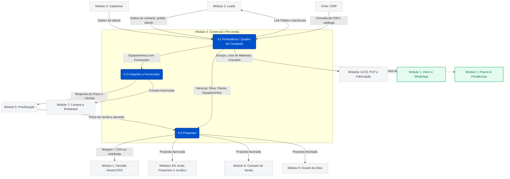

# 4 Comercial | Pré-venda — documento do módulo (REAL, fonte da verdade — 31/10/2026)

> **Status: REAL (documento oficial do módulo 4), aprovado pelo Gelson em 31/10/2026**, no molde de `01_geral.md`, `02_crm.md` e `03_cadastros_mestres.md`. Histórico de entrega (PR, hash) não se repete aqui: o Git guarda.
>
> **Por que este módulo pede mais cuidado que os outros:** é por aqui que as coisas **nascem**. O Nº da cotação nasce no Formulário (4.1) e é a chave que Fornecedor, Precificação, Proposta, Contrato, Compra, Embarque, Dossiê e Dashboard repetem do começo ao fim. Um erro aqui se espalha para todos os módulos seguintes.
>
> **Fonte da verdade:** o código e o banco, conferidos em 31/10/2026 (`origin/main` `746db79`). **Conferido** quer dizer lido no código ou consultado no banco (só SELECT) nesta data; **Herdado** quer dizer que veio do `CLAUDE.md` ou de uma spec e **não** foi reconferido agora; **Não verificado** é o que não foi possível conferir. Sem selo vale como Não verificado (Art. 6). Sem número de linha (envelhece): cita-se arquivo e função.
>
> **Escopo do módulo:** as seis telas do grupo "Comercial | Pré-venda" do menu (`NAV_GROUPS` em `shell.jsx`): **Formulários**, **Controle de Cotações**, **Cotações a Fornecedor**, **Cotação Quadro de Comando**, **Propostas** e **Contratos Social**. Decisão do Gelson (31/10/2026): o formulário **Quadro de Comando** (que abre pelo hub Formulários) fica **completo neste módulo**, dentro da 4.1; o mapa dos 14 módulos o listava no módulo 8. Fora deste módulo: Leads (2), Clientes e Fornecedores (3), Precificação e Atualização de Custos (5), Contrato de Venda, assinatura digital e avais jurídicos (6), P.I./Embarques/Cotações de Varejo (7), Ficha Técnica e Projeto de Elevadores (8 e 9), PCP e Fabricação (12 e 13).

## Como esta numeração funciona
- A regra de numeração (móvel, como cláusula de contrato) e os 11 temas de cada tela moram **uma vez só**, em `docs/modulos/01_geral.md` ("Como esta numeração funciona"). Aqui vale a mesma: módulo = **4**; telas filhas = **4.1 a 4.6**, na ordem do menu; o conteúdo comum fica na **Parte comum**, com prefixo PC-.
- **Tudo o que é janela, aba, cartão ou página pública de uma tela pertence a ela.** Na 4.1 estão o hub, o Formulário de Equipamento (elevador, escada e esteira), o formulário Quadro de Comando e as duas páginas públicas. Na 4.3 estão o detalhe da cotação (abas Detalhes, Tratativas, Imagens e Documentos) e o portal público do fornecedor. Na 4.5 estão a lista, o editor e a janela de envio.
- Mudou algo? Escreva no tema certo da tela e **reescreva o Índice e o Glossário** na mesma sessão.

## Índice
4. **Comercial | Pré-venda**
   4.1 Formulários (hub, Formulário de Equipamento, Quadro de Comando e páginas públicas)
   &nbsp;&nbsp;&nbsp;4.1.1 O que é · 4.1.2 Rota e arquivos · 4.1.3 Perfil e acesso · 4.1.4 O que a tela mostra · 4.1.5 Botões e controles · 4.1.6 Comportamento · 4.1.7 Dados (lê/grava) · 4.1.8 Regras e armadilhas · 4.1.9 Testes · 4.1.10 Pendências e decisões · 4.1.11 Histórico
   4.2 Controle de Cotações
   &nbsp;&nbsp;&nbsp;4.2.1 O que é · 4.2.2 Rota e arquivos · 4.2.3 Perfil e acesso · 4.2.4 O que a tela mostra · 4.2.5 Botões e controles · 4.2.6 Comportamento · 4.2.7 Dados (lê/grava) · 4.2.8 Regras e armadilhas · 4.2.9 Testes · 4.2.10 Pendências e decisões · 4.2.11 Histórico
   4.3 Cotações a Fornecedor (lista, detalhe com Tratativas, Imagens e Documentos, e portal do fornecedor)
   &nbsp;&nbsp;&nbsp;4.3.1 O que é · 4.3.2 Rota e arquivos · 4.3.3 Perfil e acesso · 4.3.4 O que a tela mostra · 4.3.5 Botões e controles · 4.3.6 Comportamento · 4.3.7 Dados (lê/grava) · 4.3.8 Regras e armadilhas · 4.3.9 Testes · 4.3.10 Pendências e decisões · 4.3.11 Histórico
   4.4 Cotação Quadro de Comando
   &nbsp;&nbsp;&nbsp;4.4.1 O que é · 4.4.2 Rota e arquivos · 4.4.3 Perfil e acesso · 4.4.4 O que a tela mostra · 4.4.5 Botões e controles · 4.4.6 Comportamento · 4.4.7 Dados (lê/grava) · 4.4.8 Regras e armadilhas · 4.4.9 Testes · 4.4.10 Pendências e decisões · 4.4.11 Histórico
   4.5 Propostas (lista, editor e envio ao cliente)
   &nbsp;&nbsp;&nbsp;4.5.1 O que é · 4.5.2 Rota e arquivos · 4.5.3 Perfil e acesso · 4.5.4 O que a tela mostra · 4.5.5 Botões e controles · 4.5.6 Comportamento · 4.5.7 Dados (lê/grava) · 4.5.8 Regras e armadilhas · 4.5.9 Testes · 4.5.10 Pendências e decisões · 4.5.11 Histórico
   4.6 Contratos Social
   &nbsp;&nbsp;&nbsp;4.6.1 O que é · 4.6.2 Rota e arquivos · 4.6.3 Perfil e acesso · 4.6.4 O que a tela mostra · 4.6.5 Botões e controles · 4.6.6 Comportamento · 4.6.7 Dados (lê/grava) · 4.6.8 Regras e armadilhas · 4.6.9 Testes · 4.6.10 Pendências e decisões · 4.6.11 Histórico
   Parte comum de Comercial | Pré-venda (sem número de tela)
   &nbsp;&nbsp;&nbsp;PC-1 Mapa de ligações · PC-2 Como nasce uma cotação (Nº, dono e linha do tempo) · PC-3 RFQ ao fornecedor: idiomas, letra de revisão e e-mail · PC-4 Trava, destrave e revisões comerciais · PC-5 Regras de preço que atravessam as telas (margem, DIFAL, Master ID) · PC-6 Identidade, alçadas e segurança · PC-7 Gatilhos e rotinas · PC-8 Tabelas · PC-9 Navegação, cache e testes · PC-10 Menu "?" e tutoriais · PC-11 Documentos soltos e destino do que foi concatenado · PC-12 Benefícios trocados com os outros módulos
5. Financeiro & Preços → `05_financeiro_precos.md` (REAL)

## Glossário (módulo Comercial | Pré-venda)
Termos gerais (soft-delete, alerta, alçada, Nº da cotação) estão no glossário de `01_geral.md`; **Convertido** e **Contribuinte de ICMS** no de `02_crm.md`; **Código humano**, **Documento único** e **Omie primeiro** no de `03_cadastros_mestres.md`. Não se repetem aqui.
- **Formulário de Equipamento:** o formulário único de coleta da obra e dos equipamentos (rota `formulario-elevador`, `-escada` ou `-esteira`). Uma cotação pode ter vários equipamentos de tipos diferentes; cada um é um cartão ("Unidade").
- **Unidade / equipamento:** uma linha de `formularios_elevador_unidades`. Tem **quantidade idêntica** (vários equipamentos iguais num cartão só), `tipo_equipamento` (elevador, escada ou esteira) e um `indice_ativo` que nasce uma vez e nunca é reaproveitado.
- **Código do equipamento (Master ID de ativo):** `VPEL-EL0990-1` (elevador), `VPER-ER…` (escada) e `VPES-ES…` (esteira); nasce da junção do tipo, do Nº da cotação e do `indice_ativo`.
- **Nº da cotação / VPCT-0990:** número sequencial do banco que nasce no INSERT do Formulário e identifica a cotação do cliente para sempre. Prefixos de etapa: VPCT cotação, VPPC precificação, VPPR proposta, VPCV contrato de venda, VPNI contrato do instalador (Herdado).
- **Canal do formulário:** `assistido` (vendedor digita), `self_service` (cliente preenche pelo link) ou `extracao` (cotação da planilha antiga "ressuscitada").
- **Cotação a fornecedor / RFQ / documento:** a solicitação técnica enviada ao fornecedor (linha de `cotacoes_elevador_fornecedor`). Tem número de documento (`VPEL-EL0990-A`), **letra de revisão**, link próprio e um status (rascunho, enviado, visualizado, respondido, em análise, aprovada, expirado).
- **Tratativa:** a conversa com o fornecedor sobre uma cotação a fornecedor. Une mensagens escritas na tela, e-mails do Inbox ligados à cotação e o histórico interno (preço, decisões, eventos).
- **Decidir comprar / Aprovar compra:** as duas etapas internas depois da resposta do fornecedor (`em_analise` e `aprovada`).
- **Proposta:** documento comercial ao cliente (tabela `propostas`). **Publicar** congela a versão que o cliente lê e assina; **travada** é a proposta enviada ou aprovada, que só o Líder destrava; **revisão** é uma proposta irmã da mesma cotação com letra (VPPR-0990-A).
- **Líder:** quem tem as alçadas de destrave (`formularios.destravar`, `propostas.destravar_aprovada`). Hoje 3 perfis em cada uma (Conferido, banco).
- **Perfil (de acabamentos):** bloco de acabamentos e texto comercial de um **tipo** de equipamento da proposta (carga, passageiro, panorâmico…), usado quando a proposta mistura tipos.
- **Ocultar equipamento:** tirar um equipamento da visão comercial da proposta sem apagar nada (`valores.ocultos`).
- **Escopo do pedido / variante / BOM (Quadro de Comando):** o **escopo** é a lista de itens do pedido de quadro (fornecer, reutilizar, terceiro, não se aplica); a **variante** é o modelo do quadro (potência × tensão); o **BOM** é a lista de materiais gerada.
- **Ramo A / Ramo B (Quadro de Comando):** A = fabricar interno; B = comprar pronto de fornecedor (mesmo fluxo da cotação a fornecedor).
- **Contrato social:** o PDF do contrato social de uma empresa cliente, guardado na 4.6.

---

## 4.1 Formulários

> **Atualização de 04/11/2026 (Quadros de Comando, `14_quadros_comando.md`, PC-1):** o card do **Formulário do Quadro de Comando** no hub virou "Em breve" e ficou ilhado; **em 10/11/2026 o card foi reacendido** (volta a abrir `/comercial/formulario-quadro-comando`, onde chegam e são analisadas as respostas do link público de orçamento; detalhe em 14, PC-1). **Conferido** (`comercial.jsx`).

### 4.1.1 O que é
O ponto de partida de toda venda de equipamento: o hub **Formulários** (cartões por tipo de formulário), o **Formulário de Equipamento** (dados do cliente, da obra e de cada elevador, escada rolante ou esteira rolante), o formulário **Quadro de Comando** (levantamento do quadro de comando: fabricar interno ou comprar pronto) e as duas **páginas públicas** (o cliente preenche o formulário de equipamento pelo link; o cliente ou instalador pede orçamento de quadro). Criar o Formulário gera o **Nº da cotação** (PC-2) e dispara a linha do tempo da cotação. **Conferido** em `comercial.jsx` (hub), `formulario-elevador.jsx`, `formulario-elevador-store.js`, `quadro-comando.jsx`, `quadro-comando-store.js` e no banco, 31/10/2026.

**Fora do escopo desta tela:** formar o preço (Precificação, módulo 5); montar e enviar a proposta (4.5); criar o contrato (6); cadastrar o cliente (3, embora o Formulário crie um cliente "nos bastidores" quando preciso, PC-1); capturar o lead (2); Ficha Técnica e Projeto de Instalação (8 e 9); gerar a OP do quadro e a fabricação (13). Os cartões **Modernização Elevador**, **Modernização Escadas e Esteiras**, **Máquina de Tração** e **Portas** do hub estão marcados "Em breve" e **não têm tela**.

### 4.1.2 Rota e arquivos
**Conferido** em `router.js`, `app.jsx`, `docs/MAPA_DE_ROTAS.md` e `index.html`, 31/10/2026.
- **Hub:** rota `formularios`, URL `/comercial/formularios`; item "Formulários" do menu; abre `FormulariosPage`, que **mora em `comercial.jsx`** (o arquivo do CRM, módulo 2).
- **Formulário de Equipamento:** rotas `formulario-elevador`, `formulario-escada` e `formulario-esteira` (as três abrem o **mesmo** componente, `FormularioElevadorPage`); URL `/comercial/formulario-elevador[/<id>]` (idem escada e esteira). A URL acompanha o **tipo do 1º equipamento**: trocar o tipo do 1º cartão troca a URL sem criar entrada no Voltar (efeito em `FormularioElevadorForm`); só o 1º cartão decide a URL.
- **Quadro de Comando:** rota `formulario-quadro-comando`, URL `/comercial/formulario-quadro-comando[/<id>[/<aba>]]`, abas `escopo` (padrão), `configuracao`, `cabina`, `paradas`, `maquina`, `componentes`, `geometria` e `resultado` (`useRouteTab`).
- **Orçamento de quadro com token (10/11/2026):** `formulario-quadro-comando-publico.html?t=<token>` é o mesmo formulário amarrado a um pedido do Omie (sem Lead; as respostas e o PDF ficam em 14.1, `14_quadros_comando.md`). Sem token, igual a antes.
- **Páginas públicas:** `/formulario-cliente/<token>` entrega `formulario-cliente.html` (carrega o mesmo `formulario-elevador.jsx`, em `publicMode`, mais `formulario-elevador-public.jsx`); `/formulario-quadro-comando-publico.html` (sem login; `formulario-quadro-comando-publico.jsx`).
- **Arquivos:** `src/comercial.jsx` (hub), `src/formulario-elevador.jsx` (`FormularioElevadorForm`, `FEUnidadeCard`, `FEClientePicker`, `FEAnexos`, `FECotacaoFornecedorModal`, `FELinkClienteModal`), `src/formulario-elevador-store.js` (`window.FormularioElevadorStore`), `src/quadro-comando.jsx`, `src/quadro-comando-store.js` (`window.QuadroComandoStore`), `src/quadro-comando-bom-engine.js` (`window.QuadroComandoBomEngine`), `src/quadro-comando-codigos.js`, `src/capacidade-passageiros.js`, `src/portas-vidro-calc.js` (`?v=1`), `src/enderecos-api.js`. No `index.html` (**Conferido**): `formulario-elevador.jsx` `?v=26`, `formulario-elevador-store.js` `?v=27`, `quadro-comando.jsx` `?v=38`, `quadro-comando-store.js` `?v=23`, `quadro-comando-bom-engine.js` `?v=20`, `quadro-comando-codigos.js` `?v=3`, `comercial.jsx` `?v=45`; em `formulario-cliente.html`: `formulario-elevador.jsx` `?v=46`, `formulario-elevador-store.js` `?v=22`. **Os dois HTML carregam versões diferentes do mesmo arquivo; o CI barra `?v=` não bumpado em qualquer página** (Art. 19).

### 4.1.3 Perfil e acesso
**Conferido** no código e no banco, 31/10/2026.
- Sem restrição por perfil em `app.jsx` (`RESTRICTED` não tem estas rotas). O menu esconde o grupo para quem não tem "Comercial | Pré-venda" alocado.
- **Alçadas que a tela de fato confere** (`temCapacidade`): `formularios.ver_de_outros` (sem ela, o vendedor só abre, lista e edita as cotações que **ele** criou; 9 perfis a têm), `formularios.destravar` (o Líder; 3 perfis), `propostas.precificar_manual` (mostra o botão "Enviar direto para Precificação"; 4 perfis) e `quadro_comando.decidir_fabricacao` (decidir "Fabricar interno" ou "Comprar pronto"; sem ela o campo fica travado). Administrador passa em todas.
- **Alçadas que existem mas a tela não confere:** `formularios.ver`, `criar`, `editar` e `excluir` (10, 10, 10 e 2 perfis no banco). Criar, editar e salvar um formulário não dependem delas. Ver 4.1.10.
- O Quadro de Comando e a Cotação Quadro de Comando **não têm módulo de alçada próprio no catálogo** com o nome da rota (o catálogo tem `quadro_comando`, com a única ação `decidir_fabricacao`).
- Isolamento real de dados entre vendedores: **não existe** (PC-6). O filtro por dono é do navegador.

### 4.1.4 O que a tela mostra
**Conferido** no código, 31/10/2026.

**Hub "Formulários":** cabeçalho "Comercial · Formulários" / **Formulários** / "Coleta de dados da obra e do equipamento, por categoria, antes de enviar para cotação."; seis cartões: **Equipamento** (subtítulo "Elevador · Escada Rolante · Esteira Rolante", leva ao formulário), **Quadro de Comando** (leva ao formulário do quadro), e **Modernização Elevador**, **Modernização Escadas e Esteiras**, **Máquina de Tração** e **Portas** (opacos, "Em breve", sem clique). O hub **não lista formulários já existentes**: abrir um existente é por 4.2, por link ou pelo Lead (2.1).

**Formulário de Equipamento** (cabeçalho "Comercial · Formulários" / **Formulário — Equipamento**, com o selo do Nº da cotação depois do 1º salvar):
- Legenda "Campo para preencher / Calculado automaticamente / * Obrigatório para enviar a cotação (rascunho pode ficar incompleto) — o que faltar acende em vermelho".
- Faixa 🔒 **Cotação travada** (ou 🔓 **Destravada por …**) quando a cotação já foi precificada (PC-4).
- Cartão **Dados do cliente e da obra**: bloco **Cliente** (busca "Buscar cliente por nome, CNPJ/CPF ou código…" com até 8 sugestões, selo do cliente escolhido com **Trocar**, e o link "cadastrar cliente novo aqui mesmo"; no modo "novo aqui": Tipo de pessoa, Nome / Razão Social, CNPJ ou CPF, Inscrição Estadual, **Contribuinte de ICMS? \***, Telefone, E-mail, Contato, Prédio / Empreendimento e o bloco Endereço), **Finalidade da compra \***, **Cidade da obra \***, **UF da obra \***, **Prazo mínimo desejado em obra**, **Instalação Será \*** (VerticalParts ou Cliente), **Responsável pela entrega \*** (Cliente ou VerticalParts), **Origem da venda** e **Vendedor** (só no uso interno), bloco **Condições** ("Equipamento será instalado em endereço diferente?" Não/Sim, com o endereço da obra) e **Observações**.
- Dois cartões de anexos: **Projeto Civil da Obra** (planta, memorial ou projeto civil) e **Anexos para o Fornecedor** (só no uso interno).
- Um cartão por **equipamento** (título é o código do equipamento, ou "<Tipo> E1" antes do 1º salvar, com "× N" se a quantidade passa de 1): **Identificação do equipamento** (código, Quantidade idêntica, Tipo de equipamento \*, e para elevador: Tipo \*, Modelo, Norma de projeto, Fornecedor; Tração \*, Capacidade (kg), Capacidade (passageiros) calculada (kg ÷ 75; carga não leva pessoas), Velocidade (m/s) \*, Paradas \*, Descrição dos pavimentos \*, Casa de máquinas \*, Agrupamento \*, Porta oposta / múltiplas entradas \*), **Estrutura e dimensões da obra**, **Cabina**, **Portas**, **Elétrico**, **Botoeiras** e **Opcionais** (elevador); para escada e esteira, o bloco **Parâmetros da Cotação (planilha técnica)** e as seções de especificação (4.1.5).
- Faixa amarela "⚠ … sem Fornecedor" quando algum equipamento não tem Fornecedor (ele fica fora do RFQ).
- Rodapé: **Salvar rascunho** (uso interno) ou **Devolver para a VerticalParts** (link do cliente) e, no uso interno depois de salvo, **Enviar cotação a fornecedores**, **Enviar direto para Precificação** (só com a alçada) e **Controle de Cotações**.

**Quadro de Comando:** quando aberto sem id, só o cabeçalho "Comercial · Formulários" / **Quadro de Comando**, "Coleta de dados pra fabricação/cotação do quadro de comando — fabricar interno ou comprar pronto de fornecedor." e dois botões (4.1.5). Aberto com id: cabeçalho "Pedido Nº <n> · Status: <status>[ · Cotação Nº <n>]", cartão **Respostas enviadas pelo cliente** (somente leitura, só quando veio do link público), cartão **Origem de fabricação** (tipo de aplicação MR ou MRL, novo ou modernização, fabricante do comando) e as oito abas da 4.1.2 (Ramo A) ou o fluxo de compra (Ramo B).

### 4.1.5 Botões e controles
**Conferido** no código, 31/10/2026. Rótulos como aparecem.

**Formulário de Equipamento**

| Controle | O que faz |
|---|---|
| **Voltar** (cabeçalho) | Volta ao hub Formulários |
| **Link p/ cliente preencher** | Salva o formulário se ainda não existe, cria o token e abre a janela "Enviar link para o cliente preencher" |
| **Salvar rascunho** | Salva cabeçalho e equipamentos (4.1.6); depois do salvar, acende em vermelho o que ainda falta |
| **+ Adicionar equipamento diferente** | Acrescenta um cartão (segue o tipo do 1º cartão) |
| Cartão: **Duplicar** | Copia todos os campos do equipamento para um cartão novo (sem id nem código) |
| Cartão: **Remover** | Confere se o equipamento já foi enviado a fornecedor (se foi, **não** deixa); senão confirma e apaga no próximo "Salvar" |
| Cartão: ▲/▼ | Recolhe ou abre o cartão |
| **Enviar cotação a fornecedores** | Exige os campos \*; abre a janela "Enviar cotação técnica aos fornecedores" (abaixo) |
| **Enviar direto para Precificação** | Só com `propostas.precificar_manual`: confirma, marca o formulário como enviado direto, trava de novo, e cria a **Proposta** já com cliente, obra e equipamentos e **preço em aberto** |
| **Controle de Cotações** | Vai para a 4.2 |
| **Pedir destrave** / **Destravar (informar motivo)** | Janela com texto de no mínimo 10 letras (PC-4) |
| **Anexar arquivo** / **Ver** / **Remover** (nos cartões de anexos) | Aceita `.pdf`, `.dwg`, `.dxf` e imagens; "Ver" abre por link assinado |

**Janela "Enviar cotação técnica aos fornecedores"** (um bloco por fornecedor × tipo de formulário × categoria): campos Contato no fornecedor, e-mail, WhatsApp (DDI+DDD+número), Cc (EmailCcInput), e os botões **WhatsApp**, **E-mail**, **Copiar link**, **Ver resposta do fornecedor**, **Reenviar (nova revisão) por e-mail/WhatsApp**, **Pedir nova revisão**, **Ver comunicação desta cotação**, **Fechar**. Só o bloco do fornecedor com cadastro ou com contato padrão no código está "configurado"; os demais mostram "Formulário deste fornecedor ainda não configurado — em breve.".

**Janela "Enviar link para o cliente preencher":** link com **Copiar link**, campos WhatsApp e E-mail do cliente, botões **WhatsApp** e **E-mail** (abre o e-mail padrão do computador; **não** usa o envio direto do sistema).

**Parâmetros da planilha técnica (escada e esteira)** — todos listas fechadas: Aplicação/Uso (Comercial, Alto Tráfego), Velocidade (0,50 m/s no Comercial; 0,65 ou 0,75 m/s no Alto Tráfego), Largura do degrau (escada: 600/800/1.000 mm) ou do palete (esteira: 800/1.000/1.400 mm), Inclinação (escada 30° ou 35°; esteira fixa em 12°), Degraus/Paletes em nível (Padrão (2) ou Especial (3 ou 4)), Material do degrau/palete (Alumínio Acinzentado ou Inox Preto), Arranjo (Simples, Paralela, Cruzada; na esteira também Em Série), Apoio intermediário, Iluminação de balaustrada e de rodapé, Vão livre entre apoios, Revestimento externo (e Material: Inox 304 ou 430), Uso do local (Interno/Externo), Tensão de alimentação, Desnível vertical, Tipo de edificação e Horário de pico. Há **aviso, sem bloqueio**, quando o desnível passa de 6.000 mm com 35° ou sem apoio intermediário. As chaves gravadas em `especificacoes` são as que a herança da Proposta lê (não renomear: 4.5.8).

**Quadro de Comando**

| Controle | O que faz |
|---|---|
| **Copiar link público (cliente)** | Copia o endereço da página pública do orçamento de quadro |
| **Novo quadro de comando** | Cria um pedido de quadro avulso e abre |
| **Voltar** / **Salvar** (cabeçalho do pedido) | Volta ao hub / grava tudo (4.1.6) |
| Aba **Escopo** | Lista de 22 itens (Quadro de Comando com o modelo, COP, LOP, LIP, Operador de Portas, Resgate Automático (ARD), Interfone 5 Canais, Botoeira de Inspeção sobre a Cabina e no Fundo do Poço, Botão de Stop, Gongo, Anúncio de Voz, Suporte de Fixação do Cabo de Comando, Sensor Fotoelétrico, Barreira de Luz, Pesador de Carga, Tomada para Fundo do Poço, Câmera, Portas, Máquina de Tração, Cabos, Cabos de Aço). Cada item é **Fornecer**, **Reutilizar existente**, **Fornecido por terceiro** ou **Não se aplica**, com código do Omie e quantidade para os que fornecemos; mais os cartões **Customizações de botoeiras** (logo, furação do totem, display do COP, operador de portas) e **Cabos de aço (tração)** |
| Aba **Configuração** | Local/obra, responsável e datas da medição, número de elevadores, capacidade, velocidade, paradas, portas opostas, parada principal |
| Aba **Cabina** | Largura, profundidade e altura; Aço da cabina, Acabamento porta cabina, Teto falso, Piso, Corrimão; fiação da caixa de passagem (chicotes do carro) |
| Aba **Paradas e portas** | Tabela de paradas com **Adicionar parada** e lixeira por linha |
| Aba **Quadro/máquina** | Tensão da rede (220 ou 380 V), Número de fases, Frequência (50/60 Hz); Tipo de máquina (síncrona ou assíncrona), fabricante, Potência (kW), Corrente (A), Velocidade (rpm), Freio (tipo, tensões, bobinas), Encoder (fabricante, modelo, tecnologia, resolução PPR, alimentação) |
| Aba **Componentes internos** | Inversor, placa PCB, disjuntor, contator, relé térmico, terminais, parafusos, fusíveis, cabos internos, conectores, placas adicionais (encoder, proteção do freio, interface) e capacitores |
| Aba **Geometria p/ fiação** | Profundidade do poço (S), Última altura (K), caixa de corrida, fiação de poço informada pelo cliente, distância entre pisos por intervalo (**Adicionar intervalo**), posição do quadro e distâncias até máquina, limitador e entrada da caixa, e o cartão **Cabo de manobra — comprimento** (seio e pontas) |
| Aba **BOM / lista de corte / checklist** | **Gerar BOM + lista de corte**, **Cruzar com o ERP** (consulta o Omie, não grava nada) e **Gerar checklist de separação** |
| Ramo B (comprar pronto) | Cartões **Vínculo com Formulário de Elevador** (Nº da cotação, **Vincular**) e **Enviar cotação técnica ao fornecedor** (Fornecedor, Telefone, E-mail) |

**Página pública do orçamento de quadro** (7 passos: Início, Identificação, Quadro, Porta/Acionamento, Acessórios, Fiação, Revisão): ver 4.1.6.

### 4.1.6 Comportamento
**Conferido** no código, 31/10/2026, salvo onde dito.

**Formulário de Equipamento**
1. **Salvar** (ordem exata): sem cliente identificado (cliente escolhido; ou, no modo "novo aqui", Nome, Contato ou Prédio) → aviso e não salva; consulta de CNPJ "Omie primeiro" (03 PC-3) se o CNPJ ainda não foi consultado; cria ou reaproveita o cliente (`buscarOuCriarCliente`); cria o formulário (o **Nº da cotação nasce aqui**, pelo banco) ou atualiza; apaga no banco as unidades que o vendedor removeu; atualiza as unidades com `id` e cria as novas (uma por vez, para o `indice_ativo` não repetir); no fim, se for "enviar", marca `status = 'enviado'` e trava de novo.
2. **Rascunho é livre; enviar exige.** Para enviar (a cotação a fornecedores, o envio direto, ou o "Devolver" do cliente): cliente, cidade e UF da obra, Instalação Será, Responsável pela entrega, **Finalidade da compra** e **Contribuinte de ICMS** (sem eles o DIFAL não calcula) e, em cada **elevador**, os campos com \* (tipo, tração, velocidade, paradas, descrição dos pavimentos, casa de máquinas, agrupamento, porta oposta, estrutura da caixa, percurso, tipo de abertura da porta, tensão principal e de iluminação). **Escada e esteira não têm campo obrigatório.**
3. **Quantidade e código.** "Quantidade idêntica" cria um só cartão para vários equipamentos iguais; o código `VPEL-EL<Nº>-<índice>` aparece depois do 1º salvar. Passageiros = kg ÷ 75 (calculado, travado).
4. **Remover equipamento** só apaga de verdade no próximo "Salvar" e é recusado se o equipamento já foi enviado a um fornecedor (lê `cotacoes_elevador_fornecedor.unidade_ids`); falha ao conferir = bloqueia.
5. **Cotação de fornecedor** (janela): "Enviar" por WhatsApp abre o `wa.me` e registra; por e-mail usa o envio direto do sistema (`send-email`) e **só registra "enviada" se o envio funcionou**; se falhou, abre o e-mail padrão, avisa e **não** registra. Do 2º envio em diante cria **documento novo com letra** (PC-3). Trava síncrona contra duplo clique.
6. **Enviar direto para Precificação**: pede confirmação ("a proposta nasce agora, mesmo sem preço"), marca `envio_direto_precificacao_em`, e cria a Proposta pela herança (4.5.6). Falha em montar a proposta vira aviso, o envio já foi feito.
7. **Link do cliente** (`self_service`): gera token de 16 caracteres, grava `canal = 'self_service'` e devolve `/formulario-cliente/<token>`. O cliente abre sem login; se o formulário já foi devolvido (`enviado`, `em_cotacao` ou `concluido`) a página só agradece. Um gatilho do banco avisa a VerticalParts quando um formulário `self_service` é devolvido (**Conferido** a função `alertas_formulario_devolvido`; o texto do aviso não foi lido).
8. **Trava e destrave**: PC-4.
9. **Cotação da planilha antiga** (4.2): o clique "Abrir no Formulário" numa linha da planilha **ressuscita** a cotação como Formulário de verdade, com **Nº novo**, canal `extracao`, 1 equipamento com a descrição original e o cliente resolvido pelo documento (PC-2).

**Quadro de Comando**
10. **Salvar** exige potência, tensão, frequência e tipo de freio da aba Quadro/máquina; grava, nesta ordem, o pedido, as paradas, os intervalos, a geometria, a máquina e os componentes.
11. **Origem de fabricação** (Fabricar interno × Comprar pronto) só muda com a alçada `quadro_comando.decidir_fabricacao`.
12. **Gerar BOM + lista de corte** (**Herdado** do `CLAUDE.md` em 28–29/10/2026 e **Conferido** a existência das funções): a variante (potência × tensão) escolhe um produto em `pcp_quadro_variante` e a lista de materiais vem dos filhos dele em `pcp_estrutura` (a estrutura do Omie); só quando a variante não tem produto ou estrutura no Omie vale a lista fixa antiga do motor (`quadro-comando-bom-engine.js`). O aviso de sucesso diz a origem ("lista de materiais: Omie <código>"). Itens do Escopo com código escolhido entram no BOM; item "fornecer" sem código vira aviso e não entra. Os **chicotes** da Engenharia (VPEL-72x/73x) entram sozinhos conforme os itens do BOM (botoeira de poço `VPB-209` → PT1 e PT2; caixa de topo `VPB-193` → EDP1, FAN, GS1, SOS, SL e os demais conectores da caixa; todo quadro → HW, MT e OS); **cada chicote é feito na VerticalParts** (regra do Gelson, nunca "vem pronto do fornecedor"). A tabela `chicotes_caixa_topo` (códigos VPEL de cada chicote da caixa de topo) **está vazia** (Conferido, banco): os chicotes da caixa saem como "código VPEL a definir".
13. **Cabo de manobra** (**Conferido** em 06/11/2026, código e testes): desde 06/11/2026 o comprimento é a **conta da Calculadora de Cabos** (14.5, decisão do Gelson), que o motor chama: soma dos pisos reais + K (última altura) + seio (calculado da profundidade do poço P) + cabine (6,5 m) + margem de 2 m (sem casa de máquinas) **ou** a distância do quadro até a descida da laje (com casa de máquinas), **arredondado para cima em metros inteiros** (10 paradas × 3 m, P 1,5 m, K 4,5 m, sem casa de máquinas = 45 m). P e K só entram se medidos ou marcados "usar padrão comercial"; sem eles, ou com casa de máquinas e sem a distância, o comprimento **não** é liberado. Os campos "seio" e "pontas" saíram da tela. A regra anterior (pisos + 3 + 3 + 4 + 10 m, calibrada em 47 m) deixou de valer. Sem casa de máquinas e sem medida, a **fiação fixa** (máquina, limitador, HW) segue com a estimativa de 6 m até a UA (UA padrão 4.500 mm).
13a. **Chicotes da caixa de topo e regras de código** (**Herdado** do `CLAUDE.md` de 29/10/2026; a lista de conectores vem do manual da caixa Monarch/Inovance MCTC-CTW-B3, placa MCTC-CTB-H5): com `VPB-193` no BOM saem **um chicote por conector** — CA/CC, EDP1, DC1, DEN1, DP, WT1, RDZ, DZ, Y4, CB/TEL1, COB1, Y1/Y2/S3, FAN, GS1, SOS e SL (sempre) e EDP2, DC2 e DEN2 (só com **porta oposta**), WT2 (só com **célula de carga**) e COB2 (só com **2ª botoeira**); célula de carga e 2ª botoeira ficam sempre "não" até existir campo no formulário. Comprimento padrão **2.400 mm**; **3.500 mm** para o que desce até embaixo da cabine (WT2 e SOS). O padrão de inspeção é botoeira de poço `VPB-209` (→ PT1 e PT2) e topo de cabine `VPB-193`; `VPB-380` (poço P5Y) só se comunica com o quadro e **não** dispara chicote; `VPB-280` é de escada/esteira e nunca entra em elevador. HW, MT e OS saem de todo quadro, direto do quadro até a última altura (UA); o comprimento aparece na descrição do item (ex.: "— 6,00 m"). Chicote sem código cadastrado entra como "A-DEFINIR-<CONECTOR>" (pendência da Engenharia), nunca some. **Ambiguidade do manual não resolvida:** B1/B2 (C1/C2 na traseira) — a legenda e o desenho divergem sobre qual é abrir e fechar; conferir no operador usado.
14. **Cruzar com o ERP** consulta o Omie se cada SKU do BOM existe e se descrição e unidade batem (função `quadro-comando-cruzamento-erp`); **nunca cadastra nem altera**. **Gerar checklist de separação** cria uma versão do checklist para o chão de fábrica; não é automático.
15. **Fases**: "Número de fases" não é mais obrigatório; vazio vale 3 (Herdado); a Edge Function do link público grava `fases: "3"` (Herdado).

**Páginas públicas**
16. **Link do cliente (formulário de equipamento)**: ver item 7.
17. **Orçamento de Quadro de Comando** (página sem login, sete passos). O cliente informa CNPJ (consulta a BrasilAPI), obra, modelo do quadro (7,5 kW ou 15 kW em 220 ou 380 V, e 30 kW em 380 V; o código VPEL **não** aparece), tensão da rede, tipo de porta, operador, freio, acionamento, encoder, acessórios (COP com ou sem display, LOP com material, 1 ou 2 botões e logo, porta oposta e as paradas dela, portas e máquina de tração do catálogo do Omie) e a fiação em metros (L1, UA, TR, BP, LIM, FP). **Marcou portas ou máquina e não escolheu modelo = não avança.** O envio vai para a Edge Function `capturar-lead-quadro-comando`, que valida o CNPJ no servidor, aplica limite de taxa e **cria um Lead** (origem "Formulário Público — Quadro de Comando") **ou**, se o CNPJ já é cliente do Omie, vincula o cliente; cria também o pedido de quadro com as respostas em `respostas_publico` (regra completa em `02_crm.md` PC-2).

### 4.1.7 Dados — o que lê e o que grava
- **Formulário de Equipamento — lê:** `formularios_elevador`, `formularios_elevador_unidades`, `formularios_elevador_anexos` (bucket privado `formulario-elevador-anexos`), `clientes` (via `CadastrosClientesStore`), `fornecedores_elevador` (Glarie, BST e Seloon), `elevador_modelos`, `elevador_opcoes` e `elevador_modelo_opcoes` (opções por modelo), `cotacoes_elevador_fornecedor` (conferir equipamento já cotado), `precificacoes_elevador` (travar), `propostas` (criar), `emails_projeto` (comunicação). **Grava:** as mesmas tabelas de formulário; `clientes` (cria ou completa o Contribuinte de ICMS); `cotacoes_elevador_fornecedor` (RFQ); `propostas` (envio direto); `alertas` (pedido de destrave e destrave); `vp_logs` (módulo "Formulário de Elevadores"); e eventos de fluxo (`FORMULARIO_PREENCHIDO`).
- **Quadro de Comando — lê e grava:** `quadros_comando` (pedido, escopo, configuração, respostas do público) e as tabelas filhas `quadros_comando_paradas`, `_intervalos_piso`, `_geometria`, `_maquina`, `_componentes`, `_bom_itens`, `_trechos_corte`, `_cruzamento_erp` e `_checklist_separacao`; lê `importacao_varejo_produtos` (catálogo de códigos do Omie), `pcp_quadro_variante`, `pcp_estrutura`, `pcp_produtos` e `chicotes_caixa_topo`. Números (31/10/2026): 85 pedidos de quadro, 530 itens de BOM, 191 linhas de cruzamento com o ERP, 376 itens de checklist.
- **Banco (31/10/2026):** 61 formulários (Nº de cotação de 920 a 1008; 29 `assistido` enviados, 21 `assistido` em rascunho, 7 `self_service` enviados, 2 `self_service` em rascunho, 1 `self_service` `concluido` e 1 `extracao` enviado), 104 equipamentos (101 elevador, 3 escada, 0 esteira), 15 anexos (10 do fornecedor, 5 de projeto civil). Planilha antiga: `cotacoes_elevador_historico` com 894 linhas, 2 já "ressuscitadas".
- **Herda de:** Lead (pré-preenche telefone, e-mail, contato, prédio e cliente), Cadastros (cliente), Omie (consulta de CNPJ e catálogo de códigos), Cotação a fornecedor (resposta de preço volta para a Precificação).
- **Doa para:** ver o Mapa de ligações (PC-1).

### 4.1.8 Regras e armadilhas
- **O Nº da cotação, o `id`, a data de criação, o dono e o vendedor do formulário não mudam depois de gravados** — quem garante é o gatilho do banco `trg_formularios_elevador_protege` (**Conferido**, função `fn_formularios_elevador_protege`): no INSERT o Nº sempre vem da sequência (o valor que a tela manda é ignorado); no UPDATE esses campos são mantidos; o DELETE é recusado. Buraco na numeração é possível (falha depois de consumir a sequência), reaproveitar ou trocar um Nº emitido não.
- **Visão por vendedor** (PC-6): `listar`, `listarCotacoes`, `obter`, `salvar`, `gerarLinkPublico` e as operações de unidade checam o dono no navegador. Quem não é o dono nem tem `ver_de_outros` recebe "A cotação Nº … foi criada por outro vendedor". Sem e-mail na sessão (página pública) ou sem dono gravado, o acesso é livre.
- **Campos do cliente moram em `clientes`, não em `formularios_elevador`.** Ao abrir, o endereço **já preenchido no formulário vence** o do cliente (o do cliente só completa o vazio): antes o do cliente sobrescrevia o do formulário e era gravado de volta.
- **Documento do cliente**: vem do tipo escolhido (PF → CPF; PJ → CNPJ) e precisa conferir (03 PC-4). Cotação da planilha com documento que não confere é convertida mesmo assim (cliente com documento pendente; o valor original vai nas observações).
- **Campos de lista com restrição no banco** (`finalidade_compra`, `tipo_mao_de_obra`, `responsavel_entrega`) viram `null` quando vazios, nunca texto vazio.
- **Equipamento já cotado não é removido** (preço e Precificação ficam ligados ao id dele).
- **Modelo de porta, Aço da Cabina e os dois acabamentos de porta** oferecem sempre **Aço 304, Aço 430 e Pintado** (lista fixa; o catálogo por modelo não alimenta mais o Modelo de porta). Formulário antigo mantém o valor gravado. (Herdado)
- **Portas de VIDRO (12/11/2026, pedido do Gelson; Conferido 12/11/2026 por teste de unidade e e2e, sem gravar no banco).** "Acabamento porta cabina" e "Acabamento porta pavimento" ganharam a opção **Vidro**. A coluna `acabamento_porta_*` continua guardando **só o aço** (um por equipamento: 304 **ou** 430 **ou** Pintado, nunca misturados); o vidro é uma exceção em `unidade.especificacoes.portas_vidro` (jsonb que já existia; **sem migration**). Ao escolher Vidro a tela pergunta: **cabina** = frente (e oposta); **pavimento** = "em todos" ou "só em alguns" (marca os pavimentos 1..N das paradas; o rótulo vem de "Descrição dos pavimentos" quando a contagem bate, senão "Pav. n"), mais o **material das portas que não forem de vidro** (obrigatório quando nem tudo é vidro). **Porta oposta:** só quando o campo "Porta oposta" começa com "Sim"; aí cada lado (frente / oposta) é vidro ou aço de forma independente, na cabina e em cada pavimento. Regra e textos (PT, EN, 中文) em `src/portas-vidro-calc.js` (`window.PortasVidro`); a validação bloqueia o envio ("marque onde o vidro será usado", "informe o material das demais portas", pavimento acima das paradas). **Consumidores:** o portal do fornecedor (linha "Acabamento porta …", trilíngue; o snapshot `dados_envio` passou a levar `especificacoes.portas_vidro`) e a herança das especificações para a Proposta por perfil (`acabPortaCabine`, `portasPavimento`). Sem vidro, tudo sai como antes.
- **Tipos de elevador e RFQ:** o campo Tipo oferece Passageiro, Carga, Hospitalar, Panorâmico e Home Lift; só **Home Lift** muda o tipo de formulário do RFQ (`homelift` × `elevator`), e cada fornecedor × tipo de formulário × categoria é um bloco separado da janela de envio. Fornecedor sem cadastro e sem contato padrão aparece no seletor como "(RFQ ainda não configurado)".
- **Cadastro do cliente × formulário:** o contato do fornecedor do RFQ vem do cadastro de Fornecedores, casando nome por aproximação (mínimo de 3 letras); cai no contato fixo do código só sem cadastro (4.1.10 item 3).
- **Hook antes do `return` de "Carregando…"** (padrão de `01_geral.md` PC-9): `FormularioElevadorForm` mantém todos os hooks antes do retorno condicional.
- **Quadro: o modelo do Escopo manda na variante do BOM**; a "Tensão da rede" da aba Quadro/máquina não escolhe o modelo (Herdado).
- **O link público do orçamento de quadro cria Lead ou liga a cliente do Omie**: nunca cria cliente sozinho (regra do CRM).

### 4.1.9 Testes
- **Testes de unidade** (Conferido que existem): `formulario-elevador-dono.test.js` (visão por vendedor), `formulario-elevador-escada-calc.test.js` (rota por tipo, velocidade, aviso de 6 m), `portas-vidro-calc.test.js` (vidro por pavimento, porta oposta, textos, validação) e, no portal, `cotacao-elevador-fornecedor-i18n.test.js`; e2e `e2e/portas-vidro.spec.js`, `quadro-comando-codigos.test.js`, `quadro-comando-bom-omie.test.js`, `quadro-comando-lop.test.js`, `cadastros-clientes-vincula-quadros.test.js`, `cotacao-elevador-fornecedor-i18n.test.js` e `cotacao-elevador-fornecedor-revisao-a.test.js` (RFQ). **Rodei `npm test` em 31/10/2026: 911 passaram, 0 falharam** (suíte inteira). A rota entra sozinha no teste de fumaça do e2e (`KNOWN_ROUTES`); `/formulario-cliente/<token>` e `/cotacao-elevador-fornecedor/<token>` estão na lista de páginas públicas do e2e, mas o **orçamento de quadro (`formulario-quadro-comando-publico.html`) não está** (4.1.10); **não rodei o e2e** (roda no CI). **Não há teste de componente** para o formulário, o hub nem o quadro: salvar, validar, remover equipamento, enviar RFQ e as abas do quadro só têm cobertura das funções puras. Não há teste do gatilho `trg_formularios_elevador_protege` neste repositório (foi testado em transação desfeita quando criado, Herdado).
- **Cenários de aceitação:**
  1. *Dado* um vendedor sem `ver_de_outros`, *quando* abre um formulário criado por outra pessoa, *então* aparece "foi criada por outro vendedor" e a lista só mostra os dele (`formulario-elevador-dono`).
  2. *Dado* um equipamento já enviado a um fornecedor, *quando* o vendedor clica em Remover, *então* o sistema recusa e diz qual fornecedor. **Sem teste automatizado** (lido no código).
  3. *Dado* um formulário com Finalidade da compra vazia, *quando* alguém tenta enviar a cotação ao fornecedor, *então* a tela avisa e acende o campo. **Sem teste automatizado.**
  4. *Dado* uma escada com 35° e desnível acima de 6.000 mm, *quando* o vendedor escolhe a inclinação, *então* a tela avisa, sem bloquear (`formulario-elevador-escada-calc`).
  5. *Dado* um pedido de quadro 7,5 kW/220 V com produto no Omie, *quando* gera o BOM, *então* a lista vem da estrutura do produto (`quadro-comando-bom-omie`).
  6. *Dado* um cliente que escolhe "Portas" no link público e não escolhe modelo, *quando* tenta avançar, *então* é barrado. **Sem teste automatizado** (lido na spec de 28/10 e na página; não reconferido).
  7. *Dado* um elevador de 3 paradas, *quando* o vendedor escolhe Vidro no pavimento, "só em alguns", marca o térreo e o material Aço 304, *então* a tela mostra "Vidro nos pavimentos Térreo; demais portas em Aço 304" (`portas-vidro.spec`, `portas-vidro-calc.test`).
  8. *Dado* "Porta oposta" = "Sim", *quando* o vendedor marca no térreo só a frente (ou frente e oposta), *então* o texto diz "(frente)" ou "(frente e oposta)", e a cabina aceita frente de vidro com oposta em aço (`portas-vidro.spec`).
  9. *Dado* vidro só em alguns pavimentos sem o material das demais portas, *quando* tenta enviar, *então* é barrado com a mensagem do campo que falta (`portas-vidro-calc.test`).

### 4.1.10 Pendências e decisões
Todos são **achados, sem correção** (Art. 45), salvo onde dito.
1. **As alçadas `formularios.ver/criar/editar/excluir` não são conferidas pela tela.** Existem no catálogo e no banco (10/10/10/2 perfis), mas qualquer pessoa com a tela aberta cria, edita e envia. **Decisão do Gelson:** ligar às alçadas ou manter assim.
2. **O link público do cliente (`formulario-cliente`) lê e grava as tabelas direto com a chave pública** (`obterPorToken`, `criar`, `salvar`, `adicionarUnidade`), com RLS aberta a `anon`: o token só filtra a consulta. O portal do fornecedor, ao contrário, já usa funções com token (`public_cef_*`). **Conferido.** Depende da issue #571.
3. **Contato do fornecedor fixo no código.** `FE_RFQ_CONTATOS_PADRAO` guarda nome, e-mails e telefone de um fornecedor como reserva quando não há cadastro. Em repositório público (Art. 28) é dado de terceiro. **Conferido** (valores não copiados aqui). Decisão: mover para o cadastro de Fornecedores.
4. **Anexo sem limite de tamanho e sem limpeza.** `anexarArquivo` sobe o arquivo e depois grava a linha; se a gravação falha, o arquivo fica no bucket (diferente de Contratos Social, que remove). O limite de 25 MB que outras telas aplicam não existe aqui. **Conferido.**
5. **Cartão "Projeto Civil da Obra" só aceita anexo no link do cliente** (`podeAnexar` é `publicMode`); no uso interno é só leitura. Intencional pelo código; **Não verificado** se a Comercial sabe disso.
6. **Cotação a fornecedor da categoria `quadro_comando` (Ramo B) nunca foi criada em produção** (banco: as 38 cotações a fornecedor são todas de elevador). O fluxo existe no código; **Não verificado** se funciona de ponta a ponta.
7. **`chicotes_caixa_topo` está vazia:** todo chicote da caixa de topo sai "código VPEL a definir" até a Engenharia preencher a lista (aba na Lista de fios, módulo 12/13). Decisão da Engenharia.
8. **"Ver lead" no pedido de quadro** leva a `/comercial/leads`, endereço antigo do CRM (hoje `/crm/leads`). O roteador usa só o 2º segmento, então deve abrir; **não testei**.
9. **Texto de comentário defasado:** o comentário de `feHeaderPick` diz que "Finalidade da compra" é opcional; a validação exige para enviar (10/10/2026). Só comentário.
10. **A spec do DIFAL no Formulário (15/10/2026)** previa quadro de aviso do DIFAL, Inscrição Estadual e bloqueio na Precificação. Hoje o formulário **exige** Finalidade e Contribuinte (Conferido) e o Lead tem os campos; o **quadro de aviso do DIFAL no formulário não existe** (nenhuma chamada a `DifalEngine` em `formulario-elevador.jsx`). Estado da Precificação: módulo 5.
11. **Página pública do orçamento de quadro fora do teste de fumaça:** `PAGINAS_PUBLICAS` em `e2e/smoke.spec.js` não lista `formulario-quadro-comando-publico.html` (Art. 33). **Conferido.**
12. **Tutorial desatualizado** (PC-10) e **sem ajuda "?" para `formulario-quadro-comando`**.
13. **A "Origem da venda" do formulário alimenta a comissão paga (5.6):** de 61 formulários, 8 estão sem origem e a origem "Site VerticalParts" (2) **não tem regra** em `regras_comissionamento`; gerar comissão dessas propostas dá erro explicativo. **Conferido** (SELECT, 31/10/2026). **Achado, sem correção**; decisão do Gelson em `05_financeiro_precos.md` 5.5.10 item 3.

14. **Portas de vidro — limites conhecidos (12/11/2026).** (a) **Não testado com gravação real:** salvar, reabrir e enviar o RFQ com vidro foram lidos no código (o payload da unidade já leva `especificacoes`; a coluna existe como jsonb, conferida no banco), mas nenhum formulário real foi gravado. (b) O formulário **não diz em que pavimentos há porta oposta**: com "Porta oposta = Sim", a pessoa marca "Oposta" só nos pavimentos que de fato têm essa porta; marcar onde não existe não é barrado. (c) **RFQ já enviado antes da mudança** não leva o vidro (o snapshot é de quando foi gerado); só o novo envio, com letra de revisão (4.3). (d) **Precificação, Contrato e Quadro de Comando não leem o vidro:** o Quadro de Comando tem lista própria de acabamento (`QC_CABINA_ACABAMENTO_ACO`) e não foi tocado; o custo da porta de vidro não entra na Precificação (5). (e) Não há campo de tipo de vidro (laminado, temperado, cor): pedir à Comercial se é preciso.

### 4.1.11 Histórico
- **12/11/2026:** portas de vidro na cabina e por pavimento, com porta oposta (ver 4.1.8).
- **07/11/2026 (acessibilidade):** o `<label>` do `FEField` era irmão do campo, sem `htmlFor`, então 13 campos e 21 selects do Formulário de Elevador ficavam sem nome para leitor de tela. Agora o `FEField` publica o id do rótulo (`FERotuloCtx`) e `FEInput`, `FESelect`, `FEFornecedorInput` e o novo `FETextarea` o usam em `aria-labelledby`. **Conferido** (axe na tela aberta, antes e depois): os erros críticos `label` e `select-name` sumiram; 50 campos com nome. **Não testado:** digitar e salvar no formulário, a página pública do cliente (usa o mesmo arquivo) e leitor de tela de verdade. A `<textarea>` do modal de motivo de trava (fora de `FEField`) segue sem rótulo. Pendências comuns de contraste e alvo: `01_geral.md` PC-11.
- Passou a existir um só Formulário para elevador, escada e esteira (15/08/2026), cada tipo com seus campos. As três URLs e a planilha técnica de escada e esteira vieram em 29/10/2026.
- O dono do formulário e o Nº travados por gatilho vieram em 02/10/2026; a trava depois da Precificação, em 12/10/2026 (PC-4).
- O formulário público do Quadro de Comando nasceu em 07/10/2026 e foi refeito em 28/10/2026 (modelos sem código VPEL, perguntas guiadas e códigos do Omie no Escopo).

---

## 4.2 Controle de Cotações

### 4.2.1 O que é
A lista de **todas as cotações** de elevador: a planilha antiga (894 linhas) mais as cotações novas do Formulário de Equipamento (61). Serve para achar uma cotação, ver o status, abrir a cadeia de etapas dela, ir às Tratativas com o fornecedor ou abrir no Formulário. **Conferido** em `controle-cotacoes.jsx` e `formulario-elevador-store.js` (`listarCotacoes`), 31/10/2026.

**Fora do escopo desta tela:** criar a cotação (4.1); editar a cotação (4.1); decidir a compra (4.3); o que cada etapa faz (a cadeia é do módulo 1, Prazos & Pendências).

### 4.2.2 Rota e arquivos
- Rota `controle-cotacoes`; URL `/comercial/controle-cotacoes[/<Nº da cotação>]` (o Nº abre a janela da cadeia, via `useRotaId`). Item "Controle de Cotações"; abre `window.ControleCotacoesPage`. **Conferido.**
- Arquivos: `src/controle-cotacoes.jsx` (`?v=11`), `src/formulario-elevador-store.js` (`listarCotacoes`, `abrirOuConverterHistorico`), `src/cotacao-elevador-fornecedor-store.js` (`listarPorFormulario`), e `CadeiaGatilhosCotacao` de `financeiro.jsx` (módulo 1).

### 4.2.3 Perfil e acesso
Sem restrição por perfil. A alçada `controle-cotacoes` (ver, criar, editar, excluir) existe (7, 3, 3 e 2 perfis) mas **a tela não chama `temCapacidade`**. A visão segue a regra do dono da 4.1.3: sem `formularios.ver_de_outros`, a lista traz só as cotações do próprio usuário **e a planilha antiga some** (ela não tem dono). **Conferido.**

### 4.2.4 O que a tela mostra
Cabeçalho "Comercial · Controle de Cotações" / **Controle de Cotações** / "Histórico completo de cotações de elevadores — planilha legada + cotações do Formulário digital."; três KPIs (**Em aberto**, **Conquistadas** com o percentual das decididas, **Cotação mais recente**); busca "Buscar por cliente, vendedor, CNPJ ou nº da cotação…" e contador "N cotação(ões)"; botões de status com contagem; tabela **Nº Cotação · Data · Cliente · Vendedor · UF · Status · Origem** (Planilha ou Formulário) com colunas ordenáveis; estado vazio "Nenhuma cotação encontrada". **Conferido.**

### 4.2.5 Botões e controles
| Controle | O que faz |
|---|---|
| **Voltar** | Vai para o Formulário de Equipamento (não para o hub) |
| **Atualizar** | Lê tudo de novo |
| Botões de status | Filtram (Todos e cada status que existe) |
| Linha **do Formulário** | Abre a janela "Tratativas — Cotação Nº <n>" com a cadeia de etapas (URL `/<Nº>`); linha da planilha não abre nada |
| **Tratativas** (por linha do Formulário) | Sem fornecedor: aviso "ainda não foi enviada a nenhum fornecedor"; com 1: abre a aba Tratativas da 4.3; com 2 ou mais: pergunta qual |
| Ícone régua (**Abrir no Formulário**) | Abre o Formulário; em linha da planilha, **ressuscita** primeiro (4.1.6 item 9) |

Na janela da cadeia: abrir cada etapa, **Fechar lembrete**, confirmar sinal e aval de pagamento (as mesmas janelas de Prazos & Pendências).

### 4.2.6 Comportamento
**Conferido.** Status da planilha (Conquistado, Perdido, Suspenso, Em andamento) e do Formulário (rascunho, enviado, em_cotacao, concluido) misturam-se no mesmo filtro. "Em aberto" é tudo que não é Conquistado, Perdido, Suspenso nem concluido. A lista ordena por Nº da cotação, do maior para o menor. O clique em linha da planilha já "ressuscitada" é escondido: a linha original some e o Formulário novo aparece com Nº novo.

### 4.2.7 Dados
**Lê:** `cotacoes_elevador_historico` (planilha), `formularios_elevador` (com `clientes`), `gatilhos` (a cadeia do Nº) e `cotacoes_elevador_fornecedor`. **Grava** (só ao ressuscitar): `clientes`, `formularios_elevador`, `formularios_elevador_unidades` e `cotacoes_elevador_historico.formulario_id`. **Herda de:** 4.1. **Doa para:** 4.1 (ressuscitar) e 4.3 (tratativas).

### 4.2.8 Regras e armadilhas
- **Clique na linha ≠ botão Tratativas.** O clique abre a **cadeia de etapas** (Geral); o botão leva à **conversa com o fornecedor** (4.3).
- Ressuscitar cria um Formulário com **Nº novo** (a cotação antiga nunca é sobrescrita; só ganha `formulario_id`).
- Datas puras (`aaaa-mm-dd`) são formatadas em texto, sem `new Date()` (que cairia um dia no fuso do Brasil).

### 4.2.9 Testes
Sem teste de componente nem de `listarCotacoes`. A regra do dono é coberta por `formulario-elevador-dono.test.js`. **Cenário:** *dado* um vendedor sem `ver_de_outros`, *quando* abre a tela, *então* vê só as próprias cotações e nenhuma linha da planilha (`formulario-elevador-dono`).

### 4.2.10 Pendências e decisões
1. **A planilha antiga é lida inteira sem paginar:** 894 linhas hoje; o limite de 1.000 do banco cortaria em silêncio acima disso. Planilha parada, risco baixo. **Conferido.**
2. **Sem alçada na tela** (4.2.3).
3. **Tutorial** em `TreinamentoVP/comercial-pre-venda/controle-de-cotacoes` (PC-10); **sem ajuda "?"** para esta rota.

### 4.2.11 Histórico
O botão "Tratativas" por linha chegou em 07/10/2026; a ordenação por coluna, em 23/10/2026.

---

## 4.3 Cotações a Fornecedor

### 4.3.1 O que é
Duas coisas ligadas: (a) a **lista** das solicitações técnicas (RFQ) enviadas aos fornecedores, com o status de cada uma, e (b) o **detalhe** de uma cotação, onde a VerticalParts vê a resposta, conversa com o fornecedor (Tratativas), guarda imagens e documentos que ele mandou, **decide comprar** e **aprova a compra**. O fornecedor responde por um **portal público** trilíngue (português, inglês e chinês). **Conferido** em `cotacoes-fornecedor.jsx`, `cotacao-elevador-fornecedor-store.js`, `cotacao-elevador-fornecedor.jsx`, `tratativas-store.js` e no banco, 31/10/2026.

**Fora do escopo desta tela:** formar o preço de venda a partir da resposta (Precificação, módulo 5); comprar na China, P.I. e embarque (7); enviar e ler e-mail (Inbox, módulo 1); a Proforma Invoice.

### 4.3.2 Rota e arquivos
- Lista: rota `cotacoes-fornecedor`, URL `/comercial/cotacoes-fornecedor`. Detalhe: rota `cotacao-fornecedor-detail`, URL `/comercial/cotacao-fornecedor-detail/<id>[/<aba>]`, abas `detalhes` (padrão), `tratativas`, `imagens`, `documentos`; o `id` na URL é buscado no banco (`ASYNC_FETCH_ROUTES`), então F5 e link direto funcionam. Portal do fornecedor: `/cotacao-elevador-fornecedor/<token>` entrega `cotacao-elevador-fornecedor.html`. **Conferido** (`MAPA_DE_ROTAS.md`, `server.js`).
- Arquivos: `src/cotacoes-fornecedor.jsx` (`?v=21`; `CotacoesFornecedorPage`, `CotacaoFornecedorDetalhe`, `CfTratativas`), `src/cotacao-elevador-fornecedor-store.js` (`?v=28`; `window.CotacaoElevadorFornecedorStore`), `src/tratativas-store.js` (`?v=9`), `src/cotacao-fornecedor-arquivos.jsx` e `-calc.js`, `src/enviar-documentos-fornecedor.jsx` (`?v=2`), `src/cotacao-elevador-fornecedor.jsx` (portal; `?v=15` em `cotacao-elevador-fornecedor.html`).

### 4.3.3 Perfil e acesso
A alçada `cotacoes-fornecedor` (ver, criar, editar, excluir: 10, 6, 6 e 3 perfis) existe, **mas o catálogo a põe no grupo "ADM/ Financeiro"**, enquanto o menu a põe em "Comercial | Pré-venda"; a tela **não chama `temCapacidade`**. O botão "Decidir comprar" é barrado pelos **avais** (PC-5), não por alçada. O portal do fornecedor não exige login (o link com token é a credencial). **Conferido.**

### 4.3.4 O que a tela mostra
**Lista:** "Comercial" / **Cotações a Fornecedor**; KPIs **Aguardando**, **Recebidas**, **Em análise**, **Aprovadas**; filtros (fornecedor, categoria, busca por Nº Documento, Nº Cotação, prédio/cliente ou fornecedor); abas **Todos / Aguardando / Recebida / Em análise / Aprovada** com contagem; tabela **Nº Documento · Nº Cotação (com a letra) · Prédio / Cliente · Fornecedor · Categoria · Enviado em · Status**, com caixa de seleção por linha. "Aguardando" junta rascunho, enviado e visualizado.

**Detalhe:** título (prédio/cliente), selo de status, categoria e data de envio; botões; faixa **Ainda não é possível decidir a compra** (com a lista de avais) quando o gate barra; abas. **Detalhes:** link público enviado ao fornecedor, cartão **Dados enviados** (fornecedor, categoria, Nº da cotação com a letra, equipamentos com o código completo `VPEL-EL0990-A-1`) e cartão **Linha do tempo** (enviado, visualizado, respondido, decidido comprar, aprovado). **Tratativas:** linha do tempo única (4.3.6). **Imagens** e **Documentos:** o que o fornecedor mandou (4.3.6).

**Portal do fornecedor** (EN · PT · 中文): "Solicitação de Cotação Técnica", dados e especificações de cada equipamento (rótulos e valores traduzidos), anexos do projeto, campos de resposta por equipamento (modelo do fornecedor, preço unitário e total, confirmação técnica), condições (moeda, incoterm e porto, pagamento, prazo de fabricação, garantia, validade, embalagem, contêiner, documentos de embarque, observações), **+ Anexar arquivo** e **Enviar cotação**. Link de cotação em rascunho = "Link inválido".

### 4.3.5 Botões e controles
| Controle | O que faz |
|---|---|
| Linha da lista | Abre o detalhe |
| Caixa de seleção + **Excluir selecionadas** | Pede o **motivo** e faz exclusão **lógica** (a linha sai da lista, os dados ficam) |
| **Copiar link público** | Copia o link do portal |
| **Ver resposta do fornecedor** | Abre a resposta completa com divergências e anexos (aparece quando já respondeu) |
| **Decidir comprar** | Só com status `respondido`; barrado pelos avais (abaixo); passa a `em_analise` |
| **Aprovar compra** | Só com `em_analise`; passa a `aprovada` |
| **Voltar para Cotações a Fornecedor** | Volta à lista |
| Aba **Tratativas**: caixa de texto, Cc, **Anexar arquivo**, **Enviar** | Registra a mensagem e envia por e-mail ao fornecedor |
| **Enviar documentos ao fornecedor** | Só habilitado com a cotação em `em_analise` ou `aprovada` (depois de "Decidir comprar"): reúne num envio a cotação do fornecedor, o Projeto de Instalação assinado e as ID-TAGs, com texto pronto em inglês, português e chinês |
| Abas **Imagens** / **Documentos** | Listam o que o fornecedor mandou (somente leitura) |

### 4.3.6 Comportamento
**Conferido** no código, 31/10/2026.
1. **Status:** `rascunho` → `enviado` → `visualizado` → `respondido` → `em_analise` → `aprovada` (ou `expirado`). Envio e visualização são gravados pelo portal; a resposta, pela função `public_cef_responder` (que confere o status, aceita só os campos do formulário e carimba IP e hora). O câmbio USD/BRL do momento da resposta é **congelado** na linha. A confirmação técnica do fornecedor é traduzida para o português por uma Edge Function e a falha da tradução nunca bloqueia o envio.
2. **Decidir comprar** exige que `AvalFinanceiroStore.podeIniciarCompra` libere: **Aval de Pagamento** (Financeiro), **Aval Jurídico**, **Projeto de Instalação assinado pelo cliente** e, só se a margem efetiva for menor que 15% ou desconhecida, a aprovação do CEO. A tela mostra a lista dos avais (✓ ou ○). Ao decidir, o sistema registra o evento `COMPRA_FORNECEDOR_INICIADA`; ao aprovar, `COMPRA_FORNECEDOR_CONFIRMADA`.
3. **Exclusão em lote** faz uma exclusão por vez (sem transação): uma falha no meio deixa as anteriores excluídas.
4. **Tratativas** (histórico único, atualiza a cada 60 s e ao voltar à aba): junta **mensagens** escritas aqui (cada uma vira também um e-mail ao fornecedor, ligado ao Inbox), **e-mails do Inbox** ligados à cotação (por `referencia_id`, ou pelo Nº da cotação só quando há **um único** fornecedor e o outro lado é contato do RFQ), **histórico interno** (mudanças de preço, decisões do Gestor/CEO, eventos com quem fez) e **eventos** da cotação. O destino do e-mail é o contato da própria cotação; sem ele, o cadastro de Fornecedores por aproximação de nome. Se o e-mail falha, a mensagem **fica registrada** e a tela diz "o e-mail NÃO foi enviado: <motivo>".
5. **Imagens e Documentos** (só leitura): juntam os anexos da resposta pelo formulário do link e os anexos dos **e-mails de entrada** ligados à cotação; separam imagem de documento **pela extensão**; agrupam versões do mesmo arquivo e marcam a mais recente como **Vigente**; imagem repetida aparece uma vez; imagem menor que 5 KB fica oculta.
6. **Enviar documentos** copia o que mora em bucket privado ou é gerado na hora (Projeto de Instalação com a página de assinaturas) para o bucket `tratativas` e envia pelo mesmo caminho das Tratativas. Pede ao fornecedor a **Proforma Invoice (PI)**. O chinês é de IA (Herdado).
7. **Alerta ao vendedor:** quando a resposta do fornecedor chega pelo link, o gatilho `trg_evt_aviso_fornecedor_respondeu` enfileira um aviso ao vendedor da cotação (ou ao Comercial); quando chega por e-mail ligado a tratativa ou RFQ, o aviso do Inbox vai ao vendedor e abre direto a aba Tratativas (Conferido o gatilho; o texto do aviso Herdado de `01_geral.md`).

### 4.3.7 Dados — o que lê e o que grava
- **Lê:** `cotacoes_elevador_fornecedor` (sem excluídas), `formularios_elevador` (e `clientes`), `cotacoes_elevador_fornecedor_anexos` (bucket privado `cotacao-fornecedor-anexos`), `tratativas_cotacao`, `emails_projeto`, `vp_logs`, `eventos_fluxo`, `decisoes_gerenciais`, `projetos_elevador_desenhos` e `documento_signatarios` (para o envio de documentos), `avais_financeiros`/`avais_juridicos`/`precificacoes_elevador` (gate). **Grava:** `cotacoes_elevador_fornecedor` (gerar, enviar, decidir, aprovar, excluir), `tratativas_cotacao`, `vp_logs`, eventos de fluxo e o bucket `tratativas`.
- **Banco (31/10/2026):** 38 cotações a fornecedor ativas (35 `respondido`, 3 `visualizado`, **0** `em_analise`, **0** `aprovada`; todas de elevador), 66 anexos de resposta, 1 mensagem de tratativa, 3 fornecedores em `fornecedores_elevador` (Glarie, BST, Seloon). `cotacoes_elevador_fornecedor` está no Realtime, mas **nenhuma tela deste módulo escuta**.
- **Herda de:** 4.1 (equipamentos), Cadastros (contato do fornecedor), Inbox (e-mails). **Doa para:** Precificação (resposta e câmbio), Proposta (códigos e letra), Compra/P.I. (módulo 7), Alerta ao vendedor.

### 4.3.8 Regras e armadilhas
- **A letra da cotação conta por (formulário, categoria), compartilhada entre fornecedores** — não por fornecedor. O número de documento (`VPEL-EL0990-A`) é único em toda a tabela e não leva o fornecedor; se cada fornecedor tivesse a própria sequência, dois gerariam o mesmo número. **Não escope a letra por fornecedor.** (Conferido em `gerar`.)
- **Toda cotação nasce com letra "A"** desde 23/10/2026 (a 2ª é "B"). Cotações anteriores ficam como foram enviadas.
- **Preço do fornecedor não é versionado na linha** (`respostas` é sobrescrito); só o **histórico de mudança** vai para `vp_logs` (a partir de 07/10/2026).
- **O gate de compra falha fechado:** erro ao consultar avais bloqueia "Decidir comprar".
- Resposta registrada **a partir de um e-mail** (Inbox) usa o mesmo formato da resposta pelo link, com `_meta.origem = 'email'` e quem registrou; não sobrescreve resposta do formulário sem confirmação.
- Hooks do portal e das telas antes do `return` condicional (`01_geral.md` PC-9).

### 4.3.9 Testes
`cotacao-elevador-fornecedor-i18n.test.js`, `cotacao-elevador-fornecedor-revisao-a.test.js`, `cotacao-fornecedor-arquivos-calc.test.js`, `tratativas-store.test.js`, `decisoes-gate-compra.test.js` e `aval-financeiro-store.test.js` (gate). **Sem teste de componente** da lista, do detalhe nem do portal. **Cenários:** *dado* um reenvio ao mesmo fornecedor, *então* nasce documento novo com a letra seguinte (`revisao-a`); *dado* uma tradução para chinês de um valor de catálogo, *então* o portal mostra o texto traduzido (`i18n`); *dado* dois arquivos com o mesmo nome base, *então* o mais recente é o Vigente (`arquivos-calc`); *dado* um avais incompleto, *então* "Decidir comprar" fica barrado com o motivo (`decisoes-gate-compra`).

### 4.3.10 Pendências e decisões
1. **Sem alçada conferida e catálogo em grupo diferente do menu** (4.3.3).
2. **Nenhuma cotação chegou a `em_analise` ou `aprovada` em produção** hoje (banco): os botões "Decidir comprar", "Aprovar compra" e "Enviar documentos ao fornecedor" não têm uso real registrado. **Não testado** o envio real ao fornecedor.
3. **Chinês gerado por IA** no portal, nas mensagens e no envio de documentos; recomendado revisar por quem lê chinês (Herdado).
4. **Tratativas apagáveis por qualquer um com a chave pública:** `tratativas_cotacao` tem política de DELETE aberta (**Conferido**, banco).
5. **Exclusão em lote sem transação** (4.3.6 item 3).
6. **Dois históricos de avaliação do fornecedor**: ver 03 3.2.10; a cotação não mostra nota.
7. **E-mail do fornecedor que volta sem o Message-ID e sem o Nº no assunto** fica órfão no Inbox até alguém vincular (regra do `read-inbox`, módulo 1).
8. **Tutorial das Tratativas e do detalhe** desatualizados (PC-10).

### 4.3.11 Histórico
O portal em português, inglês e chinês chegou em 06/10/2026; Tratativas ⇄ Inbox em 07/10/2026; as abas Imagens e Documentos em 20/10/2026; a letra de revisão em todo reenvio em 20/10/2026 e a letra "A" já na 1ª cotação em 23/10/2026; o botão "Enviar documentos" em 08/10/2026.

---

## 4.4 Cotação Quadro de Comando

> **Atualização de 04/11/2026:** o item **"Cotação Quadro de Comando" saiu do menu** (a tela e a rota existem, sem acesso pelo menu), pelo mesmo motivo da nota em 4.1. **Conferido** (`shell.jsx`).

### 4.4.1 O que é
A **lista dos pedidos de quadro de comando**: os que o usuário criou e **todos** os que chegaram pelo link público. Daqui se abre o pedido (4.1) ou se exclui (de forma lógica). **Conferido** em `cotacao-quadro-comando.jsx`, 31/10/2026.

**Fora do escopo desta tela:** gerar BOM, lista de corte e checklist (4.1); fabricar (13). **Apesar do nome, a tela não gera cotação a fornecedor nem número de cotação** (4.4.10).

### 4.4.2 Rota e arquivos
Rota `cotacao-quadro-comando`, URL `/comercial/cotacao-quadro-comando`; item "Cotação Quadro de Comando"; abre `window.CotacaoQuadroComandoPage`. Arquivos: `src/cotacao-quadro-comando.jsx` (`?v=7`) e `src/cotacao-quadro-comando-store.js` (`?v=2`). **Conferido.**

### 4.4.3 Perfil e acesso
Sem restrição por perfil e **sem módulo de alçada** na lista do catálogo. **Cada usuário vê os pedidos que criou (`criado_por`) mais todos os do link público.** Sem e-mail na sessão, só os do link público. **Conferido.**

### 4.4.4 O que a tela mostra
Cabeçalho "Comercial · Pré-venda" / **Cotação Quadro de Comando** / "Gerenciamento de cotações e checklists de produção"; busca "Buscar por pedido, cotação…" e filtro "Status: …"; tabela **Pedido Nº · Nº Cotação · Origem / Solicitante · Status · Criado em**; para os que vieram do link público, as etiquetas **Formulário público** e **Lead** ou **Cliente (já no Omie)**, o solicitante, a empresa, a obra e o lead; rodapé "Exibindo N de M registros". Estados "Carregando…" e "Nenhum registro encontrado". **Conferido.**

### 4.4.5 Botões e controles
**Atualizar**; **Abrir** (leva ao pedido na 4.1); lixeira (**Excluir**, com confirmação, "remove o registro desta lista — os dados ficam preservados para auditoria"). **Conferido.**

### 4.4.6 Comportamento
Lê até **200** pedidos, do mais novo para o mais antigo, sem os excluídos. A busca procura em número do pedido, da cotação, lead, empresa, solicitante e identificação da obra, na própria tela. Excluir marca `excluido_em` (função `QuadroComandoStore.excluir`) e tira a linha da tela.

### 4.4.7 Dados
**Lê:** `quadros_comando` (e `clientes`). **Grava:** `quadros_comando.excluido_em`. Banco: 85 pedidos (80 criados no sistema e 5 vindos do link público; status `rascunho` e `cotado`). **Herda de:** 4.1 e do link público (CRM).

### 4.4.8 Regras e armadilhas
A lista **mistura** "meus pedidos" com "todos do link público" de propósito (o cliente do link não tem login, então esses não têm `criado_por`). O Nº do pedido (`numero_pedido`) é uma sequência interna do site e **não é** o número do pedido de venda do Omie (03/PCP).

### 4.4.9 Testes
Sem teste desta tela. Cenário sem cobertura: *dado* um pedido do link público, *quando* um vendedor abre a lista, *então* vê o pedido mesmo sem tê-lo criado (**sem teste**).

### 4.4.10 Pendências e decisões
1. **Código órfão:** `CotacaoQuadroComandoStore` (gerar Nº de cotação de 6 dígitos e mudar status) **não é chamado por nenhuma tela**, e `listarCotacoes` pede a coluna `criado_em`, que **não existe** em `quadros_comando` (a tabela tem `created_at`); o componente `ModalVisualizarChecklist` está definido e **não é usado**. **Conferido.** Decisão: apagar ou terminar.
2. **O nome da tela não bate com o conteúdo:** é uma lista de pedidos de quadro, sem cotação.
3. **Limite de 200** pedidos sem aviso (hoje 85).
4. **Sem alçada, sem ajuda "?"**; o tutorial existe (PC-10).

### 4.4.11 Histórico
A lista passou a mostrar o solicitante e a etiqueta Lead ou Cliente (já no Omie) quando o link público foi criado (07/10/2026).

---

## 4.5 Propostas

### 4.5.1 O que é
A **lista** das propostas comerciais e o **editor** de cada uma. A proposta nasce da cotação precificada (herda cliente, obra, equipamentos, valores e parcelas), é **publicada** (versão congelada), **enviada ao cliente** por WhatsApp ou e-mail com um **link de assinatura digital**, e fecha quando o cliente assina, recusa ou pede revisão. Gera o PDF. **Conferido** em `precificacao.jsx` (`PropostasPage`), `proposta-editor.jsx`, `proposta-form.jsx`, `proposta-store.js`, `proposta-heranca.js`, `proposta-opcoes.js` e no banco, 31/10/2026.

**Fora do escopo desta tela:** formar o preço (Precificação, módulo 5); criar o contrato a partir da proposta assinada, a assinatura digital em si (`/assinar`, 🔒 `CLAUDE.md`) e os avais (6); a decisão do Gestor e do CEO (Central de Decisões, módulo 1).

### 4.5.2 Rota e arquivos
- Lista: rota `propostas`, URL `/comercial/propostas`; **`PropostasPage` mora em `precificacao.jsx`** (arquivo do módulo 5). Editor: rota `proposta-editor`, URL `/comercial/proposta-editor/<id>` (id na URL, "envelope"). Página pública de assinatura: `/assinar/<token>` (`assinar.html`, módulo 6).
- Arquivos: `src/precificacao.jsx` (`?v=31`), `src/proposta-editor.jsx` (`?v=60`), `src/proposta-form.jsx` (`?v=26`), `src/proposta-store.js` (`?v=30`), `src/proposta-heranca.js` (`?v=28`), `src/proposta-opcoes.js` (`?v=18`), `src/proposta-preview.jsx` (`?v=35`), `src/proposta-reactpdf.bundle.js` (`?v=29`, gerado por `npm run build:pdf:proposta` a partir de `pdf-bundle/proposta-reactpdf.entry.js`), `src/proposta-conteudo-engine.js`, `src/proposta-acabamentos-*.js`, `src/proposta-textos-base.js`, `src/proposta-desconto.js`, **`src/proposta-aumento-calc.js` e `src/proposta-aumento-store.js` (pedido de aumento de valor, 06/11/2026)**, `src/proposta-legado.js`, `src/proposta-padroes-escest.js`, `src/decisoes-store.js` (`?v=29`; margem e decisão de envio). **Conferido.**

### 4.5.3 Perfil e acesso
**Conferido** (código e banco). Alçadas que a tela confere: `propostas.ver_todas` (8 perfis; sem ela a lista traz **só as propostas do vendedor**, pelo `vendedor_id`), `propostas.excluir` (2 perfis; mostra a lixeira), `propostas.destravar_aprovada` (3 perfis; destravar e ocultar equipamento de proposta alheia) e `propostas.precificar_manual` (4.1). **Sem a alçada de um módulo `propostas`** para ver, criar ou editar. O isolamento por vendedor existe também **no banco** para quem usa sessão nativa: a política `vp_valores_dono` (leitura só das próprias quando `vp_so_proprias`) e o gatilho `vp_valores_guarda` (barra quem não tem a liberação dos valores em R$). Quem usa a chave pública não passa por eles (PC-6).

### 4.5.4 O que a tela mostra
**Lista:** "Comercial · Propostas" / **Propostas Comerciais** / "Clique numa proposta pra abrir — herda dados do Formulário + valores da Precificação (Master ID)."; cartão **Prontas para enviar** (precificações calculadas ou aprovadas cujo Nº/letra ainda não tem proposta, com **Analisar e enviar**); cartão **Pedidos de revisão** (cliente pediu ajuste, com **Analisar e reenviar**); quatro KPIs (**Propostas**, **Valor proposto**, **Com Master ID**, **Aprovadas**); busca "Buscar por código, cliente, CNPJ, equipamento, cotação ou vendedor…"; botões de status com contagem; tabela **Nº Documento · Cliente · Vendedor · Master ID · Valor · Status · Data**, com o aviso vermelho "· substituída por <proposta>" quando existe uma mais nova da mesma cotação.

**Editor:** barra superior com "Propostas / <Nº>", "rascunho salvo há …", nome do cliente, chips **Nº**, **Master ID**, **Obra**, **Total** e o **status** (Rascunho, Publicada, Enviada, Visualizada pelo cliente, Assinada, Recusada, Expirada, Cancelada, Revisão solicitada), selo "Publicado … · vN", "Travada" ou "Destravada — edite e salve"; abas **Elevador / Escada Rolante / Esteira Rolante**; menu lateral de seções com a % de preenchimento; formulário por seções; **pré-visualização** do PDF ao lado. Seções do **elevador** (13): Dados da Proposta e Vendedor, Dados do Cliente, Dados da Obra, Texto da Proposta, Especificações Técnicas, Acabamentos, Conteúdo da Proposta, Fotos do Equipamento, Valores e Pagamento, Condições Gerais de Pagamento, Ajustes, Impostos e Câmbio, Prazo e Entrega, Garantia e Condições. **Escada e esteira** (16): as quatro primeiras, Descrição do Produto, Especificações Técnicas, Especificidades, Acabamento, Características Técnicas, Valores e Pagamento, Condições Gerais de Pagamento, Ajustes, Prazo e Entrega, Instalação e Montagem, Responsabilidades e Garantia e Condições.

### 4.5.5 Botões e controles
**Lista**

| Controle | O que faz |
|---|---|
| **Exportar pacote** | Baixa `propostas.csv` das linhas **carregadas** (id, número, título, status, Master ID, valor, data) |
| **Nova proposta** | Abre o editor em branco |
| **Analisar e enviar** (cartão Prontas) | Monta a proposta pela herança da precificação (pinando **aquela** precificação) e abre o editor; o Nº da proposta herda a letra da precificação |
| **Analisar e reenviar** (cartão Pedidos de revisão) | Abre a proposta com pedido de revisão |
| Linha | Abre no editor |
| Lixeira | Só com `propostas.excluir`: confirma e apaga de vez |

**Editor**

| Controle | O que faz |
|---|---|
| **Herdar dados** (seção Dados da Proposta) | Com o Nº da cotação digitado, traz cliente, obra, equipamentos, textos e, numa proposta que acabou de nascer, os valores iniciais; **só completa o que está vazio e nunca sobrescreve**. **O preço já não vem daqui** (REGRA de 06/11/2026, 4.5.6 item 12): reprecificou, a proposta herda sozinha |
| **Ocultar preview / Ver preview**, **Reiniciar** | Mostra ou esconde a pré-visualização; descarta o que foi digitado |
| **Destravar** | Só quem tem `propostas.destravar_aprovada`, com motivo de no mínimo 10 letras |
| **Publicar** / **Republicar** | Congela a versão que o cliente lê; recusa se todos os equipamentos estão ocultos |
| **Gerar PDF** | Abre o PDF em tela cheia: elevador tem **Baixar PDF** (PDF vetorial); escada e esteira têm **Salvar PDF / Imprimir** |
| **Salvar** | Salva no banco |
| **Enviar p/ Cliente** | Confere o gate de envio (abaixo), salva e abre a janela "Enviar para assinatura" |
| **Aceitar revisão** / **Recusar internamente** (com motivo) / **Confirmar recusa** | Decisão interna sobre o pedido de revisão do cliente |
| **Recalcular**, **Oferecer só 120 dias**, **+ Adicionar Parcela** (seção Valores) | Refaz as parcelas (sinal 40% + iguais); remove a opção de 90 dias; acrescenta parcela |
| Ocultar/reexibir equipamento (seção Valores) | Tira o equipamento da visão comercial (4.5.6) |
| **Alterar valor** (card do equipamento) e **Alterar valor da proposta** (topo de Valores) | Abre a janela do **pedido de aumento**: mostra o valor atual, pede o novo valor (maior) e o motivo (opcional) e mostra a variação em R$ e %. **Enviar ao Financeiro** só acende com valor válido. **Não muda o preço**: o pedido volta à Precificação (4.5.6 item 12). Só dono da proposta e Líder; desligado em linha com mais de um equipamento (use o da proposta) e em proposta não salva |
| **Cancelar pedido** | Desfaz o pedido de aumento enquanto o Financeiro não atendeu; fica no histórico |

**Janela "Enviar para assinatura":** campos Nome do destinatário, WhatsApp (com DDD), E-mail, o link com **Copiar**, e os botões **Enviar por WhatsApp** e **Enviar por E-mail**.

### 4.5.6 Comportamento
**Conferido** no código, 31/10/2026, salvo onde dito.
1. **Salvar** exige o nome do cliente. O Nº da cotação precisa ter **Precificação** (ou ter sido enviado direto para a Precificação) para proposta de elevador, ou existir como Formulário para escada e esteira; vale só para proposta **nova** ou quando o Nº muda. Um Nº/tipo/letra não pode ter duas propostas. Se a precificação ligada foi apagada, salva sem o vínculo e avisa. `valor_total` é o total **visível** (sem equipamentos ocultos).
2. **Publicar** guarda o conteúdo em `versao_publicada` e incrementa a versão (`version`); o primeiro **envio** já publica sozinho. O cliente lê a versão publicada; editar depois não muda o que ele vê até republicar.
3. **Enviar p/ Cliente**: antes de salvar, se há Nº de cotação, consulta o gate (`DecisoesStore.podeEnviarProposta`): o **Gestor Comercial** sempre aprova; o **CEO** só entra se a margem efetiva da precificação for **menor que 15% ou desconhecida**. Bloqueado = aviso com o motivo. Depois salva e abre a janela. Todos os equipamentos ocultos = recusa.
4. **WhatsApp e link** registram o envio na hora; **e-mail** usa o envio direto do sistema (`send-email`) com `referenciaTipo = 'proposta'` e **só registra "enviada" se o envio funcionou**; se falhou, abre o e-mail padrão, avisa e **não** registra. O link vale 7 dias. O corpo é o mesmo do WhatsApp, com o link `/assinar/<token>`. A resposta do cliente por e-mail volta ao Inbox ligada à proposta.
5. **Primeiro envio** emite o evento `PROPOSTA_ENVIADA`; reenvio depois de revisão aceita emite `PROPOSTA_REENVIADA`. Criar a proposta emite `PROPOSTA_ELABORADA`. Assinar, recusar ou pedir revisão emitem `CLIENTE_RESPONDEU_PROPOSTA` (a cascata depois da assinatura roda pela fila `fluxo_pendentes`, 🔒 e `01_geral.md` PC-9).
6. **Revisão pedida pelo cliente**: o status vira "Revisão solicitada" e o editor mostra o texto; a VerticalParts **aceita** (edita e reenvia) ou **recusa internamente** (com motivo; a proposta original segue valendo). Aceitar emite `VERTICALPARTS_ACEITOU_REVISAO`; recusar, `VERTICALPARTS_RECUSOU_REVISAO`.
7. **Herança** (`prefillPorNumeroCotacao`): monta, a partir do Formulário, da cotação a fornecedor e da Precificação, os dados da proposta **sem sobrescrever o que o vendedor digitou** (`deepMergeHeranca`). Cada **equipamento físico** vira um item com o **seu código** (`VPEL-EL0963-1 … -27`) e o valor rateado pela Precificação; os valores fecham **no centavo** (o último item absorve a diferença; as parcelas são sinal de 40% + iguais, a última absorve o centavo). **O DIFAL nunca aparece nem entra no total** (o preço de venda da Precificação já o contém). A herança **mantém o equipamento da proposta** (escada e esteira herdam só o comum e a quantidade do próprio tipo).
8. **Acabamentos e texto comercial por tipo** (🔎 Herdado de 20/10/2026, funções conferidas): com 2 ou mais **tipos** de equipamento, a proposta nasce com **perfis** (carga, passageiro, panorâmico…), cada um com seus 13 acabamentos, características, benefícios, diferenciais, recursos e linha de modelos; o PDF e o preview juntam perfis do mesmo tipo com conteúdo idêntico ("VPEL-EL0990-2 a -5"). Proposta de um tipo só, ou já digitada, não muda. "Separar por tipo" e "Separar por equipamento" criam os perfis a partir do Formulário.
9. **Ocultar/reexibir equipamento** (23/10/2026): estado em `valores.ocultos` (nada é apagado; a chave é o código do item). Recalcula as parcelas; **bloqueia** ocultar equipamento com pedido de desconto pendente; só o **dono** da proposta ou quem tem `destravar_aprovada`; proposta travada não permite; zero equipamentos visíveis bloqueia publicar e enviar. Fonte única da visão comercial: `PropostaOpcoes.projetar`.
10. **PDF e preview leem do mesmo helper** (`proposta-opcoes.js`): tudo que o menu lateral grava sai no PDF e na pré-visualização; seção ou campo novo entra no helper, não só em um renderizador. A proposta assinada sai com o **bloco de assinatura digital** (nome em letra de mão, data e hora de Brasília, dispositivo, IP e hash; 🔒 regra do `CLAUDE.md`).
11. **Rascunho local**: o editor guarda uma cópia no navegador a cada 400 ms (uma chave por proposta); a gravação no banco é só nas ações explícitas.
12. **Pedido de aumento de valor (06/11/2026, pedido do Gelson).** O Comercial **nunca digita preço** na proposta: impostos, DIFAL e encargos só recalculam juntos na Precificação (5.2). O fluxo: (a) dono ou Líder clica em **Alterar valor** (por equipamento) ou **Alterar valor da proposta** (valor total) e informa o valor desejado, **maior** que o atual (reduzir é "Solicitar desconto"); (b) o pedido fica gravado **dentro da proposta** (`aumentoPendente` e `aumentoLog`, sem tabela nova) e **vale com a proposta travada**; (c) o aviso de ida vai por `alertas` (→ gi-avisos) a **Financeiro (líderes do departamento Adm/Financeiro, hoje a Juliana), gestor comercial (quem tem `propostas.destravar_aprovada`, hoje a Regiane) e dono da proposta**, com link para a Precificação; (d) a cotação ganha a marca "Revisão de valor pedida" na fila (5.2.4); (e) quando o Financeiro **calcula** a Precificação, a proposta **recebe o preço novo sozinha** (REGRA, abaixo) e o pedido cujo preço mudou em relação à **base do pedido** (o preço que a Precificação tinha na hora do pedido) é **fechado**, com um aviso de volta único a Regiane, dono e Financeiro ("já está com o preço novo" e se o valor pedido foi alcançado). Regras: um pedido aberto por vez; pedido de total e de equipamento **não convivem**; equipamento oculto ou com desconto pendente não aceita; desconto novo, depois, parte do preço novo (o `valorOriginal` dos itens herdados é o novo). Se a proposta **já tem contrato** (qualquer status fora de "em preenchimento"), o **Jurídico (hoje Cleiton, e-mail numa constante de `proposta-aumento-store.js`)** recebe o aviso para refazê-lo quando o preço novo entra pelo Herdar dados. **REGRA (Gelson, 06/11/2026): o preço da Precificação chega SOZINHO à proposta.** Motivo: a VPPR-0993 mostrou defasagem sem aviso (R$ 243.045 na proposta, R$ 250.419,71 na Precificação). Quando a Precificação de uma cotação é **calculada** (e quando o editor abre uma proposta já salva), `PropostaAumentoStore.sincronizarPreco` compara e: (a) **rascunho** recebe o preço novo (itens, `valor_total`, parcelas refeitas no padrão com a mesma forma e quantidade; **o desconto aplicado do equipamento cujo preço mudou é retirado e fica no histórico, e o desconto é pedido de novo sobre o preço novo se for preciso; equipamento cujo preço não mudou fica como estava**; pedido de desconto pendente segue pendente); (b) proposta **que o cliente já viu** (enviada, visualizada, revisão pedida, aprovada) **não muda sozinha**: só muda se o Comercial **pediu** o aumento (pedido aberto, "isso só acontece dentro da empresa"); do contrário fica marcada **"Preço diferente da Precificação"** (aviso na seção Valores e achado no Conferir); (c) o dono recebe um aviso "preço da proposta atualizado". Proposta cancelada, recusada ou expirada não muda. **Limite conhecido:** rascunho já **publicado** (`versao_publicada`) tem o `data_json` atualizado, mas a versão congelada só muda ao republicar (o primeiro envio já publica). **Conferido** no código e no navegador (06/11/2026: janela, validação de valor menor e maior, botões no card, marca na fila com pedido simulado em memória, recusa da gravação sem pedido aberto). **Não verificado:** o ciclo completo com pedido real (gravar, aviso de ida e de volta, Herdar dados fechando o pedido, aviso ao Jurídico).

### 4.5.7 Dados — o que lê e o que grava
- **Lê:** `propostas` (61 colunas; a lista traz as colunas leves e **não** o `data_json`), `clientes`, `perfis`, `precificacoes_elevador`, `formularios_elevador` e unidades, `cotacoes_elevador_fornecedor`, `alcadas_capacidade`, `decisoes_gerenciais`, `avais_*`. **Grava:** `propostas` (`data_json` com toda a proposta, `versao_publicada`, `valor_total`, `status`, `audit`, `log`, `recipient`, `token`, `expires_at`…), `vp_logs`, eventos de fluxo, `alertas` (aviso de envio, visualização, assinatura e recusa; **e os avisos do pedido de aumento de valor**, com `destinatario_email` e `rota`) e `emails_projeto` (via `send-email`). O pedido de aumento mora **dentro do `data_json`** (`aumentoPendente`/`aumentoLog` na proposta e em cada item). Lê também `colaboradores_vpsistema` (líderes do Financeiro), `alcadas_capacidade` + `perfis` (gestores) e `contratos_venda_equipamentos` (existe contrato?).
- **Banco (31/10/2026):** 340 propostas: 286 `enviada` com tipo em branco (importadas do site antigo), 26 `rascunho` de elevador, 13 `enviada` de "Elevador de Passageiros", 1 `enviada` de "elevador", 4 `visualizada`, 3 `cancelada`, 3 `aprovada` (2 de elevador e 1 sem tipo), 1 `revisao_solicitada`, 1 de escada em rascunho, 1 de "Escada Rolante" enviada e 1 rascunho de elevador `em_negociacao` (a revisão); **309 sem Nº de cotação** (legado) e **1 com revisão** (`revisao_indice` > 0). Tabelas de apoio: `proposta_tokens` 8 linhas; `proposta_solicitacoes_revisao` 1; `proposta_envios`, `proposta_eventos`, `proposta_itens`, `proposta_alinhamentos`, `proposta_revisao_validacoes` e `propostas_lib_*` **vazias**; a visão `propostas_vigentes` (339 linhas) **não é lida por nenhuma tela**. `propostas` está no Realtime (a lista e o editor escutam).
- **Herda de:** 4.1, 4.3, Precificação (5), Leads (2, para a conversão em cliente). **Doa para:** Contrato de Venda (6), Avais (5 e 6), Dossiê da Obra (9), Comissões (5), Dashboard e Notificações (1).

### 4.5.8 Regras e armadilhas
- **Proposta enviada, visualizada, com revisão pedida ou aprovada é travada.** Salvar, publicar e enviar são recusados (a tela e o `PropostaStore.salvar`); só o Líder destrava, com motivo de no mínimo 10 letras, e o próximo "Salvar" retrava (PC-4). **Exceção:** o pedido de aumento de valor (4.5.6 item 12) é gravado com a proposta travada, e o preço novo entra pela sincronização com a Precificação quando há pedido aberto; nada mais muda e nada é destravado.
- **Pedido de aumento não é desconto e não digita preço:** nunca troque o botão "Alterar valor" por edição direta do valor na proposta (impostos e DIFAL ficariam para trás). O aviso agrupa por título no gi-avisos (apaga números), por isso o título leva o cliente e o equipamento.
- **Erro de gravação nunca é engolido** em `markSent`, `markSigned`, `refuse`, `solicitarRevisao` e `decidirRevisao`; a assinatura do cliente tem `try/catch` para não prender a tela. **`markViewed` é best-effort de propósito** (é rastreio, não ação do usuário). Não troque.
- **As chaves de `especificacoes` de escada e esteira são lidas pela herança** (`uso_previsto`, `desnivel_elevacao`/`desnivel_vertical`, `largura_degrau`/`largura_palete`, `tensao_alimentacao_equip`, `velocidade_nominal`, `inclinacao`, `disposicao_espaco`…): renomear no Formulário quebra a proposta.
- **Cada equipamento é único**: nunca usar o identificador da Unidade como se fosse o código quando a quantidade passa de 1, e nunca inventar numeração do tipo "(1/6)". Proposta antiga sem códigos cai em uma linha agregada.
- **Modalidade de entrega 120 × 90 dias**: o Financeiro retirou o cenário de 90 dias (10/10/2026); a proposta nova **não oferece** a escolha, mas o código (`proposta-opcoes.js`, assinatura) ainda trata propostas antigas com `opcao90`. Texto das características é rascunho a revisar (Herdado).
- **Excluir é apagar de verdade**, mas o banco recusa excluir proposta com revisão filha e, para quem não é administrador, proposta já enviada (gatilho `propostas_guarda_exclusao`). **Conferido.**
- **Proposta de outro vendedor colada na cotação:** a trava de Nº sem Precificação (item 1 do 4.5.6) existe por um caso real (cotação 982, 02/10/2026): um rascunho digitado com o Nº 982 antes de a cotação existir virou "Proposta elaborada", fez o motor completar sozinho as etapas puladas (Formulário, Fornecedor, Precificação) e colou a proposta de outro vendedor na cotação. As limpezas de dados foram feitas à parte; o motor ainda completa etapas puladas por `garantirNo` (desenho deliberado, Herdado).
- **Textos-base por tipo (`proposta-textos-base.js`):** o de Passageiro é o padrão antigo; os de **Carga e Panorâmico são rascunho conservador não revisado pela Comercial** (Herdado) e moram no código. Texto de passageiro não entra em carga.
- **Modalidade 120 × 90 dias:** os textos de característica e prazo de cada modalidade (`PropostaOpcoes.TEXTOS`) foram redigidos sem revisão do Financeiro/Jurídico (Herdado).
- **Revisões comerciais (Etapa 1 aplicada em 22/10/2026):** o banco tem as colunas de revisão (letra, raiz, base, vigência, substituição), o índice que permite **uma vigente por cotação e tipo** (Herdado do comentário do código), as funções `proposta_criar_revisao`, `proposta_reativar_revisao`, `proposta_aplicar_vigencia`, `proposta_registrar_solicitacao`, `proposta_decidir_solicitacao`, `proposta_validar_trilha`, `proposta_alinhar` e `proposta_proxima_letra` (**Conferido**: existem), e os gatilhos `trg_propostas_vigencia` e `trg_propostas_token_sync`. A função `fn_avais_abrir_na_proposta` em produção **já é a versão que herda ou reabre os avais por revisão** (**Conferido**: o texto da função cita `herdado_de_proposta_id`). **A tela ainda não usa as funções de revisão**: o único caminho de revisão hoje é o `PropostaStore.salvar` criar uma proposta **irmã** (letra do número do documento, `vigencia = 'em_negociacao'`) quando o Nº já tem outra do mesmo tipo (para a precificação de uma revisão nova do fornecedor). O desenho completo (etapas 0 a 3) está em `docs/revisoes/` (PC-11).

### 4.5.9 Testes
`proposta-opcoes.test.js`, `proposta-opcoes-linhas.test.js`, `proposta-opcoes-escesteira.test.js`, `proposta-heranca-*.test.js` (5 arquivos), `proposta-perfis.test.js`, `proposta-ocultos.test.js` e `proposta-ocultos-minimo.test.js`, `proposta-pdf-espec.test.js`, `proposta-preview-espec.test.js`, `proposta-form-espec.test.js`, `proposta-padroes-escest.test.js`, `proposta-legado.test.js`, `proposta-eq.test.js`, `proposta-store-revisao.test.js`, `proposta-lead-cliente.test.js`, `precificacao-proposta-revisao.test.js`, `decisoes-store.test.js` e `decisoes-gate-compra.test.js`, mais `proposta-aumento-calc.test.js` (pedido de aumento: validação, um pedido por vez, cancelar, atender só quando o preço muda, histórico levado pelo Herdar dados, destinatários e texto dos avisos). **Rodei `npm test` em 31/10/2026: 911 passaram, 0 falharam; em 06/11/2026: 1024 passaram, 0 falharam.** **Sem teste de componente** do editor, da lista nem da janela de envio; o e2e de fumaça só abre as rotas. **Cenários:**
1. *Dado* uma cotação com 27 equipamentos, *quando* a herança monta a proposta, *então* há 27 itens com códigos `-1` a `-27` e o total fecha no centavo (`proposta-heranca-equipamentos`, `proposta-opcoes-linhas`).
2. *Dado* um equipamento oculto, *quando* se calcula o total, *então* ele não entra e as parcelas somam o total visível (`proposta-ocultos`).
3. *Dado* uma proposta de dois tipos, *quando* a herança roda, *então* nascem perfis por tipo e o PDF junta os iguais (`proposta-perfis`).
4. *Dado* uma segunda proposta para o mesmo Nº e tipo sem letra nova, *quando* se salva, *então* o sistema recusa e cita a proposta existente (`proposta-store-revisao`).
5. *Dado* margem menor que 15%, *quando* se tenta enviar, *então* o gate exige o CEO (`decisoes-gate-compra`).
6. *Dado* um Nº de cotação sem Precificação, *quando* se salva uma proposta de elevador nova, *então* o salvamento é recusado com a mensagem. **Sem teste automatizado** (lido no código).

### 4.5.10 Pendências e decisões
1. **A lista corta em 300:** `PropostasPage` pede `limit(300)` e o banco tem 340; as 40 mais antigas (importadas) **não aparecem**, e o "Exportar pacote" e os KPIs só contam as linhas carregadas. **Conferido.**
2. **As colunas e funções de revisão comercial existem no banco e a tela não as usa** (4.5.8); as tabelas `proposta_envios`, `proposta_eventos`, `proposta_itens`, `proposta_alinhamentos` e `proposta_revisao_validacoes` estão vazias e sem uso no código, e `propostas_vigentes` não é lida. O desenho de `docs/revisoes/` prevê a Etapa 2 (avais por revisão, decisões por revisão, diff) e a Etapa 3 (cláusulas em vermelho); dessas, os **avais por revisão** já estão no banco (4.5.8), mas **não foi conferido** se as filas e o gate de compra do código (`aval-financeiro-store.js`, `aval-juridico-store.js`) já procuram o aval pela revisão vigente, nem se a decisão de envio do Gestor/CEO já é por revisão (hoje `podeEnviarProposta` recebe só o Nº da cotação). Decisão do Gelson sobre o que fazer com o desenho.
3. **Duas definições de "proposta travada":** `STATUS_TRAVADOS` no `PropostaStore` e a lista em `proposta-editor.jsx` repetem a mesma regra. **Conferido.** Uma mudança num só lado cria divergência.
4. **Escada e esteira ainda saem pela impressão do navegador** (sem "Baixar PDF" vetorial), enquanto o elevador usa o motor próprio. **Conferido** no editor; o `CLAUDE.md` diz o mesmo.
5. **Proposta de escada/esteira não tem Precificação própria**: o preço vem digitado ou da herança do que existir.
6. **309 propostas sem Nº de cotação** (legado) e 287 com tipo em branco (resolvido na abertura pelo conteúdo, `resolverEq`).
7. **"Aprovadas" e outros KPIs contam só as 300 linhas carregadas** (item 1).
8. **Textos jurídicos que citam DIFAL** ("Taxas e Impostos Exclusos" da proposta; o item 3.5.2 do Contrato de Venda) seguem como estavam. Decisão do usuário pendente (Herdado).
9. **Taxa de câmbio de referência** é impressa ao cliente quando preenchida. Se o Financeiro não quiser, tirar `cambio` de `blocosAjustes` (Herdado).
10. **Tutorial da Proposta** é de 10/10/2026 e não cobre perfis por tipo, ocultar equipamento nem revisões (PC-10).
11. **Achados da revisão de 02/11/2026, sem correção** (testados no Chromium e no banco; ver 4.5.11): (a) em `proposta-desconto.js`, `parseNum` tira todos os pontos, então `15000.5` vira 150005 (o placeholder `15.000,00` deixa o botão desabilitado e a fórmula só aceita número puro); `aplicarDesconto(item, null)` arredonda o valor original (257024,57 volta como 257025); (b) `montarPrefill` grava a cidade em `obra.nome` e nunca lê `predio_empreendimento` (propostas "Hotel Plaza Camboriu" e "CONFEA…" ficaram com a cidade); (c) `aplicarEscolha('90')` troca `valorUnit` mas não `itens`, então total e linhas seguem em 120 dias (hoje nenhuma proposta tem `opcao90`); (d) `registrarRespostaPorEmail` aceita cotação `em_analise`/`aprovada` e a volta para `respondido`; (e) `salvarTudo` do Formulário não atualiza o estado das unidades se uma falha no meio: salvar de novo duplica equipamentos; (f) `formulario-cliente.html` não carrega `cadastros-clientes-store.js` (`buscarOuCriarCliente` grava `codigo` nulo) e, no modo público sem CNPJ/CPF, telefone, e-mail, razão social e Contribuinte de ICMS não são gravados; (g) `listarPorFormulario`, `listarComprasAguardandoEmbarque` e `getById` não filtram `excluido_em`; (h) `abrirOuConverterHistorico` cria o Formulário antes de marcar a planilha.

12. **Pedido de aumento de valor (06/11/2026), pontos em aberto:** (a) a janela ainda não mostra a **margem resultante** nem o **mark-up sugerido** para o Financeiro (o cálculo inverso já existe em `alavancaParaPreco`, 5.2.6 item 9); (b) o e-mail do Jurídico que refaz o contrato está fixo em `proposta-aumento-store.js` (não achei alçada própria); (c) o aviso de volta só sai quando a Precificação é **salva**; se o hook falhar, o Herdar dados não repete o aviso de volta (só o do contrato); **corrigido em 06/11/2026 (caso VPPR-0993):** o pedido guarda o preço da **Precificação no momento do pedido** (`precificacaoBase`) e o aviso de volta só sai quando ela **muda em relação a essa base** (antes comparava com o valor da proposta, que pode estar defasado, e avisava a cada Calcular); sai **um aviso por proposta** (lista os equipamentos e diz se o pedido foi alcançado) e o aviso de ida abre **direto a precificação da cotação** (`/comercial/precificacao/<id>`), não a lista; (d) a regra da fila lê as propostas por Nº da cotação e só olha o bloco do elevador, escada e esteira no `data_json`; (e) o **tutorial e a ajuda "?"** da Proposta não citam o botão (PC-10; a sessão de tutoriais regenera, não se edita o HTML à mão). **Nenhuma validação com pedido real.**
13. **Assistente de IA na Proposta — "Conferir antes de enviar" + Bolinha (SPECIFY revisada, 06/11/2026, pedido do Gelson).** **FASE 1 IMPLEMENTADA em 06/11/2026 (local, ainda sem PR):** botão **Conferir** na barra do editor (`proposta-editor.jsx`, janela `ConferenciaModal`) com as **checagens exatas em código** (`src/proposta-conferir-calc.js`, 10 testes em `proposta-conferir-calc.test.js`): cliente sem nome ou documento, tamanho do CNPJ/CPF, e-mail inválido, e-mail colado no telefone, vendedor sem celular, texto vazio, equipamento sem valor, todos ocultos, forma de pagamento, parcelas que não somam o total (com a diferença em R$), pedido de aumento e de desconto abertos, sem especificações, texto de passageiro em perfil de carga, contrato existente e proposta travada; lista **"O que falta para enviar"** e atalho **"Ir para a seção"**; só lê, não bloqueia nem altera, e registra em `vp_logs`. **Conferido** no navegador (06/11/2026, VPPR-1009-A: 1 atenção e 1 sugestão, atalho abre a seção) e `npm test` (1034 passam). **Ainda NÃO implementados:** FR09 (convite da Bolinha, popup), FR10 a FR13 (cadeia da proposta, especificações cotação × proposta, avisos de preço, aviso ao Jurídico), a leitura por IA e a máscara de telefone — selo: Não verificado.
    - **Contexto e objetivo.** O vendedor só descobre proposta errada depois de olhar o PDF ou depois de o cliente receber. A IA já existe no hub: é a **Bolinha** (`vp-copiloto.jsx`), que fala com o **Copiloto VP da VPS** (S3 de `16_servicos.md`, só leitura, respeita alçadas). **Não se constrói outro chat.** O que falta é (a) conferência exata antes do envio, (b) contexto específico de proposta para a Bolinha e (c) **a Bolinha ser notada** no momento certo. **Conferido** (código, 06/11/2026): a Bolinha já tem "✨ Preencher página" (a IA propõe, mostra a prévia e só aplica quando a pessoa confirma), "🔍 Revisar erros" (modo `analyze`), "📎 Anexar doc" (aceita só `.xlsx`, `.xls`, `.md`, `.txt`; **PDF não**) e envia a **visão da tela** (campos com valor, tabelas, botões e avisos, até cerca de 14 mil caracteres).
    - **Requisitos.** **FR01** botão **Conferir proposta** na barra do editor, para **todos os que interagem com propostas** (decisão do Gelson). **FR02** duas camadas: (1) **checagens exatas em código**, mostradas na hora e sem IA; (2) opcional, o botão passa o resultado e a tela para o **"Revisar erros" da Bolinha**, com instruções de proposta na VPS. **FR03** achados com gravidade (**impede**, **atenção**, **sugestão**), a seção, o motivo e o atalho "Ir para a seção". **FR04** a conferência **só lê e aponta**: nunca altera valor, parcela, texto ou status (texto com "Aplicar" é fase 2). **FR05** lista **"O que falta para enviar"**, clicável, **sem IA** (o percentual por seção já existe; falta listar os campos pendentes). **FR06** só roda por clique; o limite do Copiloto é de **20 perguntas por hora por pessoa**, e no limite as checagens exatas continuam. **FR07** selo "Conferido por código" ou "Sugerido pela IA — confira" e uma linha em `vp_logs`. **FR08** falha da IA nunca impede salvar nem enviar. **FR09 — a Bolinha chama a atenção (pedido do Gelson: "poucos conhecem o poder da bolinha"):** ver "Convite da Bolinha" abaixo.
    - **Convite da Bolinha (FR09).** Hoje a Bolinha é um ícone fixo, e quase ninguém sabe que ela preenche, revisa e responde sobre a tela. Ela passa a **convidar em momentos de valor**, sempre por **regra exata** (sem gastar pergunta da IA): (a) **ao clicar em Enviar ou Publicar** com achado "impede" (balão: "Quer que eu confira antes de enviar?", com botão); (b) **ao abrir uma proposta com pedido de revisão do cliente** ("Posso resumir o pedido do cliente e sugerir o que mudar"); (c) **na primeira vez** que a pessoa abre o editor de Proposta, um **popup** (cartão pequeno ao lado da Bolinha, **uma única vez por pessoa**, sem bloquear a tela, com "Entendi" e "Mostrar a Bolinha": "Eu posso conferir esta proposta, preencher e responder dúvidas"; decisão do Gelson, 06/11/2026); (d) **quando um pedido de aumento de valor é atendido** ("O Financeiro atualizou a Precificação — quer ajuda para conferir a proposta?"). **Regras de bom comportamento:** no máximo **um convite por proposta por sessão**; fecha com "Agora não" e **"Não mostrar mais"** (lembrado no navegador, só conveniência); nunca aparece com a Bolinha aberta; **sem animação infinita** (o projeto já retirou "pulsing-dot" por regra de design; só um destaque estático e, no máximo, uma entrada curta que respeita `prefers-reduced-motion`); o clique no convite **abre a Bolinha já com a pergunta pronta**, e cada abertura pelo convite vai para o `vp_logs` (para medir se funciona). Sugestão de medida de sucesso: quantos cliques viram uso da Bolinha na primeira semana.
    - **Checagens exatas previstas.** Parcelas somam o total visível; forma de pagamento coerente com as parcelas; cliente sem nome ou sem documento; equipamento com valor zero; todos os equipamentos ocultos; pedido de aumento ou de desconto aberto; proposta com contrato já criado; cotação sem Precificação; texto-base de um tipo em proposta de outro (ex. passageiro em carga); campo de telefone com e-mail; campos obrigatórios do envio vazios; proposta travada. **Telefone**: padronizar a máscara em código (hoje `(11) 99999-9999` e `+55 11 …` convivem), sem IA.
    - **Regras.** Regra de negócio em arquivo puro (`*-calc.js`, Art. 20) com teste de unidade; a IA não decide o que uma conta exata decide; **a IA nunca toca em preço, parcela ou status** e o **Herdar dados continua sendo o único caminho dos valores** (traz preço e parcelas exatos da Precificação e não sobrescreve o digitado); especificação técnica **não** é "puxada de catálogo" pela IA (vem do Formulário e da Ficha Técnica); a IA não inventa dado: sem a informação, deixa em branco e avisa. Busca de CNPJ/endereço já é em código (consulta "Omie primeiro").
    - **Fora do escopo.** Alterar qualquer campo; enviar ou aprovar; texto fantasma, destaques em cada campo e "varinha" por campo (caros: gastam a cota de 20 por hora e são intrusivos); reescrever texto e resumo de acabamentos (fase 2); ler PDF do cliente (fase 3, a Bolinha não lê PDF); revisão jurídica; mensagem de envio e resposta ao cliente.
    - **Cenários de aceitação.** (1) *Dado* parcelas que não somam o total, *quando* se clica em Conferir, *então* aparece o achado "impede" com a diferença em R$ e o atalho para Valores, sem IA (teste de unidade). (2) *Dado* uma proposta de carga com texto de passageiro, *quando* se confere, *então* aparece "atenção" em Texto da Proposta. (3) *Dado* o Copiloto fora do ar, *quando* se confere, *então* só as checagens exatas aparecem e há o aviso "a leitura por IA não respondeu". (4) *Dado* que a conferência rodou, *então* nenhum campo da proposta mudou e há uma linha no log. (5) *Dado* o clique em Enviar com achado "impede", *quando* o convite aparece, *então* é um balão estático, uma vez por proposta por sessão, e clicar abre a Bolinha com a pergunta pronta e registra no log. (6) *Dado* "Não mostrar mais", *então* o convite não volta naquele navegador.
    - **A Bolinha como secretária do vendedor (FR10 a FR13, decisão do Gelson, 06/11/2026: "o vendedor passa a ter uma secretária que o ajude a resolver problemas").** A regra geral (todos os módulos) está em `01_geral.md` **PC-13**; aqui ficam os casos da Proposta.
      - **FR10 — Cadeia da proposta** (painel "Situação da cotação" no editor, **calculado em código** e entregue também à Bolinha como contexto): Formulário → cotações enviadas **por fornecedor** (enviada sem resposta, respondida, substituída por revisão) → Precificação → Proposta → avais → contrato. Caso real que a tela deve explicar: o Formulário foi a **dois fornecedores** (um de elevador, outro de escada e esteira) e **só a Glarie respondeu**, então não há Precificação do outro; o vendedor vê isso ao abrir, com a frase "a cotação ao fornecedor X foi enviada em … e ainda não respondeu" e o botão **"Reenviar o e-mail a esse fornecedor"** (a pessoa confirma; o reenvio usa o helper de envio que já existe, 🔒 e-mail).
      - **FR11 — Especificações da cotação × da proposta** (checagem **exata**, por equipamento): modelo, capacidade, velocidade, paradas, tração, dimensões e acabamentos da proposta contra a Unidade do Formulário e a resposta do fornecedor; diferença vira achado "atenção" com os dois valores lado a lado.
      - **FR12 — Preço, mark-up, DIFAL e lucro:** a Bolinha **avisa**, não altera: compara o valor da proposta com o da Precificação (diferença, pedido de aumento aberto), lembra a regra de margem (CEO abaixo de 15%) e comenta DIFAL e mark-up **com números só para quem tem a alçada de ver** (valores em R$ e margem seguem `vp_valores_*`); **ao vendedor, que não vê valores (decisão do Gelson, 06/11/2026), só o aviso em palavras, sem número**. Quando o vendedor quer mudar o preço, ela oferece o **"Alterar valor"** (pedido ao Financeiro, 4.5.6 item 12); **nunca** grava preço.
      - **FR13 — Contrato já enviado:** se a proposta tem contrato (qualquer status fora de "em preenchimento") e o valor ou o conteúdo mudou, a Bolinha avisa na hora e oferece **"Avisar o Jurídico (Cleiton) para revisar o contrato"**; a pessoa confirma e o aviso sai pela tabela `alertas` (o mesmo caminho do aviso de contrato refeito).
      - **Ações da Bolinha** (reenviar e-mail, avisar o Jurídico, pedir alteração de valor) são **botões que a pessoa confirma**; quem executa é o **código do site** (helpers existentes), **nunca o Copiloto**, que continua só leitura.
    - **CLARIFY.** **(a) Resolvido (06/11/2026, "só avisar" recomendado):** a conferência **só avisa**; o único bloqueio é o gate de envio que já existe, e achado "impede" pede uma confirmação extra ("Enviar assim mesmo"). **(b) Resolvido (06/11/2026, "Concordo"):** a Bolinha manda a tela **como já é hoje** (a VPS recebe os campos com valor, **inclusive CNPJ, telefone e e-mail do cliente**); resumo reduzido fica descartado. **(c) A conferir:** o que cada modo do `servico.py` faz (`chat`, `fill`, `analyze`, `questionario`; ler o código da VPS ou perguntar à sessão da VPS) e pedir um modo **sem memória** (chamar com `novaConversa` reinicia a conversa da Bolinha de quem pediu). **(d) Resolvido (06/11/2026):** o **convite da Bolinha vale para todos os módulos** (regra geral em `01_geral.md` PC-13; ao entregar, o Art. 49 manda doar aos demais documentos). **(e) Resolvido em parte (06/11/2026, "só avisa"):** a Bolinha **só avisa e oferece o Alterar valor**, nunca altera preço direto (coerente com o 4.5.6 item 12). **Resolvido (06/11/2026):** o **vendedor não vê valores** (margem, mark-up, DIFAL, custo, lucro): a Bolinha lhe dá **só o aviso, em palavras e sem número** (ex.: "a margem desta proposta está fora da regra; fale com o Financeiro"). Quem tem a alçada de ver os valores (Financeiro, Líder, Administrador) continua vendo os números.

14. **Preço da Proposta sempre em dia com a Precificação (REGRA do Gelson, 06/11/2026; IMPLEMENTADA, ver 4.5.6 item 12 e `05_financeiro_precos.md` 5.2.6 itens 14 e 15).** Reprecificou, a proposta herda; o **"Herdar dados" não traz mais preço**. A proposta que o cliente já viu não muda sozinha: fica marcada "Preço diferente da Precificação" e só muda quando o Comercial pede. **Conferido** no código, nos testes (1047 passam) e na tela da Precificação da 993 (06/11/2026); **Não verificado:** o ciclo completo com um Calcular real (sincronização gravando em proposta e avisos).

15. **Número da proposta (REGRA do Gelson, 06/11/2026 — vale só daqui pra frente; as propostas que já existem NÃO foram corrigidas, por decisão dele).** O Nº da proposta é o da cotação: `VPPR-<Nº da cotação, 4 dígitos>[-letra da revisão]`; ninguém o digita e **ele não muda depois de criado**. (a) O campo "Nº da Proposta" do editor fica **travado** quando a proposta já foi salva ou está ligada a uma cotação; (b) `PropostaStore.salvar` **não troca** o número de uma proposta que já existe (não envia `numero_documento`) e o `data_json` acompanha o número gravado; (c) proposta **nova** que ainda está com o número padrão do editor (`VP-<ano>-001`) ou sem número e tem Nº de cotação recebe `PropostaStore.numeroPadrao` (letra vinda do Master ID da cotação, `VPCT-1004-A`, ou de equipamento, `VPEL-EL1004-A`). **Motivo (06/11/2026):** a proposta da 993 passou a se chamar "993 A" (número digitado à mão) e a da 1004 ficou sem o "-A" que a precificação e o Master ID têm. **Conferido** no código, em teste (`proposta-salvar-sobrescrita.test.js`) e no editor (VPPR-1009-A: campo travado). **Fica como está (achados, sem correção, por decisão do Gelson):** 993 = `993 A`; 1004 = `VPPR-1004`; formatos antigos (`VP-2026-xxx`, `955`, `LEGADO-…`); salto de **32 números** nas cotações (1012 a 1043, causa não encontrada); buracos no contador interno `numero`. **Não verificado:** criar uma proposta nova de ponta a ponta com a regra (a proposta que nasce pela fila da Precificação já vinha com o número certo); e **não há trava no banco** (quem usa a chave pública ainda poderia trocar o número direto).

### 4.5.11 Histórico
O envio por e-mail direto (em vez de `mailto:`) entrou em 28/09/2026. A herança por equipamento com código próprio, o fechamento no centavo e a retirada do DIFAL são de 10 e 13/10/2026; o PDF em letra de mão e o bloco de assinaturas digitais, de 05/10/2026; os perfis por tipo, de 20/10/2026; ocultar equipamento, de 23/10/2026; o pedido de aumento de valor que volta ao Financeiro, de 06/11/2026.
- **02/11/2026 (revisão de código do módulo):** (1) **proposta nova sobrescrevia a existente** — o editor nasce com o número `VP-<ano>-001` e o `salvar` sem `editId` achava a proposta pelo número e a atualizava, mesmo a de outro vendedor e mesmo enviada (a trava só valia com `editId`); hoje só se atualiza o próprio rascunho do vendedor, e o editor passa o id da linha já criada nos Salvar seguintes. (2) **as 125 propostas importadas em 06/04/2026 (`data_json` vazio) derrubavam o editor** ("Erro ao carregar o VP Gestão"); hoje abrem com o padrão e o número delas (travadas, por estarem enviadas). **Conferido** (banco, `src/proposta-salvar-sobrescrita.test.js` e `e2e/comercial-pre-venda.spec.js`, Chromium). **Achados da mesma revisão, não corrigidos** (descrição em 4.5.10, item 11): desconto em R$ com ponto decimal vira 10x e remover desconto arredonda os centavos; a herança usa a cidade como nome da obra; escolha de 90 dias não troca os itens; resposta por e-mail volta cotação aprovada para "respondido"; salvar o Formulário com várias unidades não é atômico; a página pública do formulário não carrega a store de clientes (cliente novo sem código) e perde os dados do cliente sem CNPJ/CPF; consultas de cotação a fornecedor não filtram as excluídas.
- **11/11/2026 (selo OEA):** o PDF da Proposta ganhou o selo no rodapé, à esquerda, em todas as páginas internas (a folga inferior da página subiu de 90 para 120 pt, então a paginação pode mudar). Selo **OEA Conformidade – Qualificado** (versão original, texto azul, em português), arte em `assets/selo-oea-conformidade-qualificado.png`, conforme o manual do selo OEA da Receita Federal (v2.0): uso só com certificado ativo e no nível concedido (a modalidade foi informada pelo Gelson; **não conferida** no Sistema OEA), sem deformar, recolorir ou aplicar efeitos. Em caso de alteração de nível ou exclusão, trocar/retirar o arquivo e rebuildar. **Conferido** gerando o PDF no Chromium.
- **11/11/2026 (selo OEA, complemento):** a prévia em HTML do editor da Proposta (e a página pública `/assinar`, que usa a mesma prévia) não tinha o selo; hoje ganhou, acima do endereço e à esquerda, e o respiro inferior da página na tela subiu de 130 para 170 px. **Conferido** renderizando a prévia no Chromium (selo nas 16 páginas com rodapé, sem cobrir conteúdo). O PDF e a prévia têm rodapés separados: mudou um, mudar o outro.

---

## 4.6 Contratos Social

### 4.6.1 O que é
Um **repositório de PDFs**: o vendedor escolhe o cliente (de Cadastros › Clientes), anexa o PDF do contrato social da empresa e salva. A lista permite buscar, abrir o PDF e excluir. **Conferido** em `contratos-sociais.jsx` e `contratos-sociais-store.js`, 31/10/2026.

**Fora do escopo desta tela:** cadastrar cliente (3: cliente não cadastrado é recusado, "Cadastre em Cadastros Mestres › Clientes"); ligar o PDF a contrato de venda; versionar ou substituir o contrato de um cliente (cada salvamento é uma linha nova).

### 4.6.2 Rota e arquivos
Rota `contratos-sociais`, URL `/comercial/contratos-sociais`; item "Contratos Social"; abre `window.ContratosSociaisPage`. Arquivos: `src/contratos-sociais.jsx` (`?v=3`) e `src/contratos-sociais-store.js` (`?v=1`). **Conferido.**

### 4.6.3 Perfil e acesso
Sem restrição por perfil. A alçada `contratos-sociais` (ver 6, criar 3, editar 3, excluir 3 perfis) existe, **mas a tela não chama `temCapacidade`**. O link do PDF é **público** (URL pública do bucket `engenharia`, sem login).

### 4.6.4 O que a tela mostra
Cabeçalho "Comercial · Pré-venda" / **Contratos Social** / "Repositório dos contratos sociais (PDF) dos clientes"; botões **Atualizar** e **+ Salvar contrato social**; campo de busca "Buscar por cliente, CNPJ/CPF ou arquivo…"; tabela **Cliente** (com a observação), **CNPJ/CPF**, **Arquivo**, **Tamanho**, **Salvo por** e **Data**, com **Abrir PDF** e a lixeira. Vazio: "Nenhum contrato social salvo ainda. Clique em "Salvar contrato social".".

### 4.6.5 Botões e controles
**+ Salvar contrato social** abre a janela: **Cliente \*** (busca por nome ou CNPJ, mínimo de 2 letras; **documento completo com um único cliente correspondente seleciona sozinho**; Enter escolhe a 1ª sugestão; **Trocar**), **PDF do contrato social \*** (máximo 20 MB, só PDF), **Observação (opcional)**, **Cancelar** e **Salvar**. A lixeira abre "Excluir contrato social?" com **Cancelar** e **Sim, excluir**.

### 4.6.6 Comportamento
Salvar sobe o PDF para `contratos-sociais/<cliente>/<data>_<nome>` no bucket `engenharia` e grava a linha; **se a gravação falha, remove o PDF recém-subido** (sem arquivo órfão). Excluir marca `excluido_em`/`excluido_por` e tira da lista; **o arquivo continua no bucket** ("fica guardado para recuperação pelo suporte"). A lista lê até 1.000 linhas, da mais recente para a mais antiga. Salvar e excluir gravam em `vp_logs` (módulo "Contratos Social").

### 4.6.7 Dados
**Lê:** `contratos_sociais` (sem excluídos) e `clientes` (`listarTodos`). **Grava:** `contratos_sociais`, o bucket `engenharia` e `vp_logs`. Banco: 1 contrato social. RLS ligada com 3 políticas abertas ao público (ler, inserir, atualizar) e **sem política de DELETE de propósito**. **Conferido.**

### 4.6.8 Regras e armadilhas
Soft-delete (Art. 27). Cada salvamento cria uma **linha nova**: o mesmo cliente pode ter vários contratos sociais (alterações). O nome do cliente e o documento são **copiados** para a linha no momento do salvamento (não acompanham mudanças posteriores no cadastro).

### 4.6.9 Testes
**Sem teste automatizado** da tela nem do store. Cenário sem cobertura: *dado* um CNPJ completo com um só cliente correspondente, *quando* o usuário digita, *então* o cliente é selecionado sozinho (**sem teste**).

### 4.6.10 Pendências e decisões
1. **Alçada não conferida** (4.6.3).
2. **Link público do PDF** com dado societário: qualquer pessoa com o endereço abre. Decisão do Gelson (isolamento real: issue #571).
3. **Sem substituir nem versionar** o contrato de um cliente; sem pré-visualizar o PDF na tela; sem vínculo com o Contrato de Venda (Herdado).
4. **Sem ajuda "?"** para a rota; o tutorial existe (PC-10).

### 4.6.11 Histórico
Criada em 30/09/2026 (o item novo do menu abria o Dashboard por causa do cache do `app.jsx`; corrigido no mesmo dia).

---

# Parte comum de Comercial | Pré-venda

## PC-1 Mapa de ligações
**Conferido** (código e banco), 31/10/2026, salvo onde dito.

| De → Para | O que passa | Telas |
|---|---|---|
| Lead (2) → Formulário | `lead_id`, telefone, e-mail, contato, prédio, cliente; equipamento **não** vem do Lead | 2.1 → 4.1 |
| Link público do Quadro (4.1) → Lead (2) ou cliente do Omie (3) | cria o lead (ou liga ao cliente) e o pedido de quadro | 4.1 → 2.1, 3.1 |
| Cadastros (3) → Formulário | seletor de cliente; cria cliente provisório quando não há cadastro | 3.1 → 4.1 |
| Omie → Formulário e Quadro | consulta de CNPJ "Omie primeiro"; catálogo de códigos | 4.1 |
| Formulário → Cotação a fornecedor | cada equipamento com fornecedor vira um bloco do RFQ | 4.1 → 4.3 |
| Cotação a fornecedor → Precificação (5) | resposta de preço, câmbio congelado, containers | 4.3 → 5 |
| Precificação (5) → Proposta | preço de venda por equipamento (rateado), forma de pagamento, parcelas | 5 → 4.5 |
| Proposta → Decisões (1) | decisão de envio do Gestor e, se a margem pede, do CEO | 4.5 → 1.3 |
| Proposta → Avais (5 e 6) | proposta aprovada abre Aval Financeiro e Aval Jurídico (gatilho) | 4.5 → 5, 6 |
| Proposta → Contrato de Venda (6) e Dossiê (9) | proposta assinada alimenta o contrato (fila "aguardando contrato") e o dossiê da obra | 4.5 → 6, 9 |
| Cotação a fornecedor → Compra (7) | "Decidir comprar" exige os avais; depois vêm a P.I. e o embarque | 4.3 → 7 |
| Quadro de Comando → PCP e Fabricação (12 e 13) | escopo, BOM, lista de corte e checklist alimentam a OP do quadro | 4.1 → 12, 13 |
| Eventos de fluxo → Prazos & Pendências (1) | cada ação cria ou fecha uma etapa da cadeia da cotação | PC-7 |
| Todo o módulo → Inbox (1) e WhatsApp | RFQ, Proposta e Tratativa saem pelo envio direto de e-mail e voltam ao Inbox | PC-3 |

## PC-2 Como nasce uma cotação (Nº, dono e linha do tempo)
- **O Nº nasce no INSERT do Formulário**, na sequência `formulario_elevador_numero_cotacao_seq` (hoje de 920 a 1008 nos formulários novos, depois da planilha histórica). Quem manda o valor é o banco; a tela é ignorada (`trg_formularios_elevador_protege`).
- **Dono:** `created_by` (e-mail da sessão). Vale para a visão por vendedor (4.1.8).
- **Três origens de um formulário:** vendedor digitando (`assistido`), cliente pelo link (`self_service`) e cotação da planilha antiga "ressuscitada" (`extracao`, com Nº novo).
- **Nº sem formulário:** só existem na planilha histórica (cotações antigas) e na proposta legada. Uma proposta de elevador com Nº de cotação precisa que o Nº tenha Precificação ou envio direto (4.5.6 item 1).
- **Criar o formulário** emite `FORMULARIO_PREENCHIDO`; criar a proposta, `PROPOSTA_ELABORADA`; o resto da cadeia está em PC-7.

## PC-3 RFQ ao fornecedor: idiomas, letra de revisão e e-mail
**Conferido** em `cotacao-elevador-fornecedor-store.js`, `formulario-elevador.jsx` e `tratativas-store.js`.
- **Mensagem do RFQ em três idiomas** (português, inglês e chinês, cada bloco com o link), montada por uma função só (`mensagemRfq`); o assunto começa com "Cotação técnica <nº>" e leva a letra ("Revisão A / Revision A / 修订 A"). O portal e os rótulos das 71 linhas de especificação são trilíngues; valores de catálogo (aço, tipo de abertura, 29 opções) são traduzidos por código. **Opção nova no catálogo exige a linha correspondente na tabela de tradução** (`CEF_OPCOES_I18N`), senão chega só o código. Chinês gerado por IA (Herdado).
- **Letra de revisão em todo reenvio:** a 1ª cotação da categoria já nasce "A"; do 2º envio em diante o fornecedor recebe **documento novo** com a letra seguinte e um aviso de nova versão; o documento anterior continua salvo. Rascunho de revisão que falhou ao enviar é reaproveitado. A letra é compartilhada entre fornecedores (4.3.8).
- **E-mail:** envio direto pelo sistema (`send-email`), com `referenciaTipo` (`cotacao_fornecedor`, `proposta`, `tratativa_cotacao`) e `referenciaId`. Falha = não registra "enviado" e abre o e-mail padrão com aviso. A resposta volta ao Inbox ligada à cotação pelo Message-ID; sem ele, só pelo Nº no assunto. **Área blindada 🔒 (E-mail/Inbox): `send-email`, `read-inbox`, o vínculo e o soft-delete não são alterados por este módulo.**

## PC-4 Trava, destrave e revisões comerciais
- **Formulário:** travado quando a cotação foi **precificada** (existe `precificacoes_elevador` do formulário ou `envio_direto_precificacao_em`) e não está destravado. Quem edita pela tela do Formulário é barrado (`origem: 'formulario'`); a Precificação ("Trocar") não passa por essa trava. **Pedir destrave** (o vendedor, motivo de no mínimo 10 letras) avisa quem tem `formularios.destravar`; **Destravar** (o Líder, com motivo) avisa o dono. O destrave acaba quando o vendedor devolve a cotação (enviar ou enviar direto) ou, no caso da proposta, no próximo "Salvar". Tudo grava em `vp_logs`.
- **Proposta:** travada em `enviada`, `visualizada`, `revisao_solicitada` e `aprovada`; destrave com a alçada `propostas.destravar_aprovada` e motivo de no mínimo 10 letras (log e `log` da proposta). Ocultar equipamento é permitido ao dono ou ao Líder, nunca com a proposta travada.
- **Revisões comerciais:** ver 4.5.8 e `docs/revisoes/` (PC-11). Regra de desenho do Gelson de 22/10/2026: **toda atualização de proposta já enviada gera letra nova**; o destrave deixa de ser o caminho de editar proposta enviada **quando a Etapa 3 for implementada** (Herdado; hoje o destrave continua valendo).
- **Limite honesto:** é checagem do navegador (RLS aberta, issue #571). Quem chama o banco direto passa pela trava.

## PC-5 Regras de preço que atravessam as telas
- **Margem e CEO:** o Gestor Comercial sempre aprova o envio; o CEO só se a **margem efetiva** da precificação ficar abaixo de **15%** ou for desconhecida (`LIMITE_MARGEM_SEM_CEO` em `decisoes-store.js`). A mesma regra vale para a decisão de compra (`compra_equipamento_ceo`).
- **Finalidade da compra e Contribuinte de ICMS** definem se há DIFAL e quem recolhe; viram obrigatórios para **enviar** a cotação (10/10/2026). O cálculo é da Precificação (5); a proposta **não mostra o DIFAL**.
- **Master ID de ativo:** `VPEL-EL<Nº>-<índice>` (e letra de revisão quando existe) identifica cada equipamento desde o Formulário até o Contrato; o número do documento da cotação a fornecedor, da precificação e da proposta usa o **mesmo inteiro da cotação** com prefixo próprio.
- **Dólar e câmbio:** ficam na Precificação; o fornecedor responde em sua moeda e o câmbio do dia da resposta é congelado.

## PC-6 Identidade, alçadas e segurança
**Conferido** (banco, 31/10/2026):

| Tabela | RLS | Políticas |
|---|---|---|
| `formularios_elevador`, `_unidades`, `cotacoes_elevador_fornecedor` (e anexos), `cotacoes_elevador_historico`, `quadros_comando` (e as filhas `_maquina` e `_bom_itens`; as demais filhas **não foram conferidas**), `fornecedores_elevador`, `elevador_*` | ligada | **tudo liberado** a `anon` e `authenticated` |
| `propostas` | ligada | tudo liberado a `anon` e `authenticated` **mais** a política de leitura `vp_valores_dono` e o gatilho `vp_valores_guarda` (só valem para sessão nativa) |
| `tratativas_cotacao` | ligada | **ler, inserir, atualizar e apagar** liberados ao público |
| `contratos_sociais` | ligada | ler, inserir e atualizar liberados ao público; **sem DELETE** |
| `proposta_tokens` | ligada | só leitura para usuário ativo (`vp_usuario_ativo()`) |

- **Trava na tela é organização, não segurança** (Art. 25). A visão por vendedor, a trava do Formulário e a da Proposta são do navegador; o que o banco garante sozinho: o Nº e o dono do formulário (gatilho), a guarda de exclusão da proposta, e a política de leitura do dono para sessão nativa.
- **Páginas públicas:** o portal do fornecedor usa funções com token (`public_cef_obter`, `public_cef_visualizado`, `public_cef_responder`); a assinatura da proposta usa `public_proposta_*` (🔒 módulo 6); o **formulário do cliente e o orçamento de quadro** gravam direto com a chave pública (o orçamento passa pela Edge Function `capturar-lead-quadro-comando`, com limite de taxa).
- **Alçadas do módulo** (catálogo × banco × uso na tela): `formularios.ver_de_outros`, `formularios.destravar`, `propostas.ver_todas`, `propostas.excluir`, `propostas.destravar_aprovada`, `propostas.precificar_manual` e `quadro_comando.decidir_fabricacao` são conferidas; `formularios.ver/criar/editar/excluir`, `controle-cotacoes.*`, `cotacoes-fornecedor.*` e `contratos-sociais.*` existem e **não** são conferidas; `cotacao-quadro-comando` e `formulario-quadro-comando` não têm módulo.
- **Edge Functions do módulo:** `capturar-lead-quadro-comando` (v10, sem JWT de propósito, o formulário vem de fora), `quadro-comando-cruzamento-erp` (v8), `vp-translate-to-pt` (v13; tradução da confirmação técnica), além de `send-email`, `read-inbox` e `omie-buscar-cliente` (módulos 1 e 3). Nenhuma foi alterada nesta tarefa.

## PC-7 Gatilhos e rotinas
- **Gatilhos do banco** (**Conferido**): `trg_formularios_elevador_protege` (Nº, dono); `trg_alertas_formulario_devolvido` (avisa quando o cliente devolve o link); `trg_evt_aviso_fornecedor_respondeu` (avisa o vendedor quando o fornecedor responde pelo link); em `propostas`: `trg_avais_abrir_na_proposta` (aprovada abre os avais), `trg_propostas_guarda_exclusao`, `trg_propostas_token_sync` (mantém `proposta_tokens`), `trg_propostas_vigencia` (aplica a vigência por cotação/tipo) e `vp_valores_guarda`; em `cotacoes_elevador_fornecedor`: `vp_valores_guarda`.
- **Eventos de fluxo emitidos pelo módulo** (**Conferido** no código): `FORMULARIO_PREENCHIDO`, `COTACAO_ENVIADA_FORNECEDOR`, `FORNECEDOR_RESPONDEU`, `COMPRA_FORNECEDOR_INICIADA`, `COMPRA_FORNECEDOR_CONFIRMADA`, `PROPOSTA_ELABORADA`, `PROPOSTA_ENVIADA`, `PROPOSTA_REENVIADA`, `CLIENTE_RESPONDEU_PROPOSTA`, `VERTICALPARTS_ACEITOU_REVISAO`, `VERTICALPARTS_RECUSOU_REVISAO`. Cada um cria ou fecha etapas da cadeia da cotação (motor do módulo 1, `01_geral.md` PC-1).
- **Fila `fluxo_pendentes`:** a cascata depois da assinatura da proposta roda no sistema interno (🔒; `01_geral.md` PC-9).
- **Rotinas agendadas:** nenhuma específica do módulo (a busca em `cron.job` só achou `decisoes-expirar-orfas-diario`, do módulo 1).
- **Realtime:** `propostas` (lista e editor escutam) e `cotacoes_elevador_fornecedor` (publicada; nenhuma tela **deste módulo** escuta; a Precificação (módulo 5) também está publicada e a tela **não escuta**, **Conferido** em 31/10/2026: `05_financeiro_precos.md` 5.2.10 item 8).

## PC-8 Tabelas
**Conferido** (31/10/2026; linhas = contagem exata nas já consultadas).

| Tabela | Para que serve | Linhas |
|---|---|---|
| `formularios_elevador` | cabeçalho do formulário (obra, cliente, canal, dono, trava) | 61 |
| `formularios_elevador_unidades` | um equipamento por linha | 104 |
| `formularios_elevador_anexos` | anexos (projeto civil, para o fornecedor) | 15 |
| `cotacoes_elevador_historico` | planilha antiga de controle | 894 |
| `cotacoes_elevador_fornecedor` / `_anexos` | RFQ, resposta, decisão / anexos da resposta | 38 / 66 |
| `tratativas_cotacao` | mensagens das Tratativas | 1 |
| `fornecedores_elevador` | lista curta de fornecedores do RFQ (Glarie, BST, Seloon) | 3 |
| `elevador_modelos`, `elevador_opcoes`, `elevador_modelo_opcoes` | catálogo de modelos e opções | 5 / 28 / 54 (aprox.) |
| `propostas` | a proposta (61 colunas) | 340 |
| `proposta_tokens`, `proposta_solicitacoes_revisao` | links emitidos / pedidos de revisão | 8 / 1 |
| `proposta_envios`, `_eventos`, `_itens`, `_alinhamentos`, `_revisao_validacoes`, `propostas_lib_*` | revisões comerciais e biblioteca (sem uso no código) | 0 |
| `quadros_comando` e filhas | pedido de quadro, paradas, geometria, máquina, componentes, BOM, cortes, cruzamento, checklist | 85 (pedidos), 530 (BOM) |
| `chicotes_caixa_topo`, `pcp_quadro_variante` | códigos dos chicotes / produto de cada variante | 0 / 6 |
| `contratos_sociais` | PDFs de contrato social | 1 |

## PC-9 Navegação, cache e testes
A regra geral (hooks, `setSubsel` + `setRoute`, estado na URL, cache `?v=`, jsx-loader) está em `01_geral.md` PC-9. O que é específico daqui:
- **Estado na URL:** Quadro de Comando (aba), Cotação a fornecedor (aba), Controle de Cotações (janela da cadeia pelo Nº), URL do Formulário por tipo (`replace`, sem entrada no Voltar).
- **Pontos de atenção:** o hub e o Quadro de Comando usam `setRoute` direto; o "Novo quadro" navega por `VpRouter.navigate` e abre no próprio componente.
- **Testes:** os arquivos da lista de cada tela; **911 testes passam** (Conferido, `npm test`, 31/10/2026). `node scripts/check-cache-bust.js origin/main` rodado nesta tarefa. **E2E** (`npm run test:e2e`) **não rodado** (roda no CI); não há e2e específico deste módulo, só a fumaça de rotas. Teste que grava dados usa registro "TESTE CLAUDE (excluir)" e apaga no fim (Art. 10).

## PC-10 Menu "?" e tutoriais
Conferido em `shell.jsx` (`HELP_TOPICS`, `TUTORIAIS`, `MODULOS_TUTORIAL`) e em `TreinamentoVP/`, 31/10/2026.
- **Ajuda "?"** existe para `formularios`, `formulario-elevador`, `formulario-escada`, `formulario-esteira`, `cotacoes-fornecedor` e `propostas`. **Não existe** para `controle-cotacoes`, `formulario-quadro-comando`, `cotacao-quadro-comando`, `contratos-sociais`, `cotacao-fornecedor-detail` nem `proposta-editor`. Os textos de `formularios` e `propostas` estão curtos ("Editor com PDF de 18 páginas para Elevador").
- **Copiloto VP:** o texto de cada tela mora na tabela `vp_copiloto_docs`, que tem prioridade sobre o texto embutido da Edge Function `vp-copiloto`. Existe linha para `rota:formulario-quadro-comando` (UA padrão 4.500 mm); ajustar essa tela é um UPDATE nessa linha, sem redeploy (**Herdado**, 29/10/2026; a tabela não foi consultada nesta tarefa). Não conferi se as demais telas do módulo têm texto lá.
- **Cache do navegador:** quando uma tela nova "abre o Dashboard" ou mostra a versão antiga depois de um deploy, a causa costuma ser `?v=` igual ao já publicado (caso real das Contratos Social); Ctrl+F5 resolve e o bump deve comparar com o valor atual de `origin/main` (Art. 19).
- **Tutoriais** em `TreinamentoVP/comercial-pre-venda/` (`formularios`, `formulario-de-equipamento`, `controle-de-cotacoes`, `cotacoes-a-fornecedor`, `cotacao-a-fornecedor-detalhe`, `cotacao-a-fornecedor-tratativas`, `cotacao-quadro-comando`, `propostas`, `contratos-sociais`): o do módulo e o das propostas têm arquivo de **10/10/2026**; **não existe tutorial do formulário Quadro de Comando**. Telas mudaram depois (perfis por tipo, ocultar equipamento, abas Imagens/Documentos, escada/esteira por URL, envio de documentos). **Tutorial não se edita à mão:** pedir à sessão de tutoriais para regenerar (Art. 46). Parte dos arquivos da pasta está **fora do Git** (de outra sessão): não mexi.

## PC-11 Documentos soltos e destino do que foi concatenado
Busca feita em `CLAUDE.md`, raiz, `docs/`, `docs/superpowers/specs/`, `docs/superpowers/plans/`, `docs/seguranca/`, `docs/revisoes/`, `handoffs/` e `TreinamentoVP/` (Art. 50). Nada foi apagado.

| Origem | Destino | Situação |
|---|---|---|
| Seções do `CLAUDE.md` só deste módulo: "Envio de Proposta ao Cliente…", "Envio de Proposta por E-mail…", "Alçadas — Envio de Proposta: CEO só decide…", "Comercial \| Pré-venda › Contratos Social…", "Cotação 982…", "Formulário/Cotação — dono permanente…", "Formulário de Escada/Esteira…", "Proposta de Elevador" (as 6 seções: 120×90, tensão/tração, equipamento único, tudo o que o menu grava, por tipo, DIFAL), "Formulário de Elevador — opções de aço…", "RFQ ao fornecedor" (2), "Tratativas ⇄ Inbox" (e 3 subseções), "Controle de Cotações — botão Tratativas", "Cotação a fornecedor — abas Imagens e Documentos", "Tratativas — botão Enviar documentos…", "Formulário público de orçamento — Quadro de Comando", "Quadro de Comando" (3 seções: BOM do Omie, formulário público v2, fases/chicotes/cabo), "Trava do Formulário e da Proposta…" | **Concatenadas** aqui (4.1 a 4.6 e PC-2 a PC-6) | cada uma ganha no `CLAUDE.md` uma nota "→ parte já migrada para Comercial \| Pré-venda"; o texto antigo **continua** lá até o Gelson aprovar a retirada (como foi feito com o CRM) |
| Seções **mistas** do `CLAUDE.md`: "Consulta de CNPJ Omie primeiro" e "CPF/CNPJ de verdade + comissão manual" (trecho do Formulário), "Auditoria de amarrações" (itens do Formulário, da Tratativa e da conversão da planilha), "Auditoria #843", "Contrato de Venda — Criar contrato a partir da Proposta 955" (herança de ativos), "Realtime" (Proposta), "Segurança real (#571)" (proposta pública por RPC), "PCP — Formulário do Quadro → PCP" | **Ficam** no `CLAUDE.md` com nota; o trecho do módulo 4 está aqui | mistas: não se apagam |
| `docs/superpowers/specs/2026-10-23-ocultar-equipamento-proposta.md` | 4.5.6 item 9 | **Concatenada**; arquivo fica como histórico |
| `docs/superpowers/specs/2026-10-29-formulario-escada-esteira-url-planilha.md` | 4.1.5, 4.1.6 | **Concatenada**; histórico |
| `docs/superpowers/specs/2026-10-28-formulario-quadro-publico-v2.md` | 4.1.6 item 17 | **Concatenada**; histórico (o `2026-10-31-mapa-de-destino-docs-soltos.md` pedia a decisão do destino: **resolvida aqui**, módulo 4) |
| `docs/superpowers/specs/2026-10-15-difal-cadastro-formulario-design.md` | 4.1.10 item 10 | **Desenho aprovado, só em parte implementado**: fica como histórico; o que falta está em 4.1.10 |
| `docs/revisoes/00` a `03` (revisões comerciais) | 4.5.8 e PC-4 | **Não concatenadas por inteiro**: a Etapa 1 está no banco; as Etapas 2 e 3 são desenho. Ficam onde estão, apontadas daqui. **Decisão do Gelson** (4.5.10 item 2) |
| `docs/superpowers/specs/2026-10-31-revisao-B-bugs-e-defasagens-de-codigo.md` | — | É da sessão de desenvolvimento do módulo 1; nenhum item é deste módulo além do que já está aqui. Fica |
| `docs/superpowers/specs/2026-10-31-mapa-de-destino-docs-soltos.md` | PC-11 | Ficou desatualizado nas linhas do módulo 4 (já resolvidas aqui); fica como histórico |
| `docs/seguranca/cascata-assinatura.md` e `matriz-acesso-rls.md` | 06 e 14 | Apontados, não copiados |
| `docs/eventos/`, `docs/relatorios/` | outros módulos | Sem relação direta encontrada; ficam |
| `handoffs/desenho-tecnico-elevador/` | 8 e 9 | É do Projeto de Elevadores (Engenharia); fica |
| `TreinamentoVP/comercial-pre-venda/*` | PC-10 | Tutoriais gerados por outra sessão; só apontados |
| Raiz do repositório (`README.md`, `AUDITORIA_FORENSE_E2E_SCORE.md`) | — | Sem trecho deste módulo que valha concatenar; ficam |
| **Parecem obsoletos — decisão do Gelson** | — | `docs/DIAGNOSTICO_separacao_envio_producao.md` e `docs/PLANO_separacao_envio_producao.md` (da Separação, módulo 12; a spec de 26/10 supera). `CotacaoQuadroComandoStore` e `ModalVisualizarChecklist` (código, 4.4.10) |

## PC-12 Benefícios trocados com os outros módulos

- **Recebido de Quadros de Comando (04/11/2026, texto em `14_quadros_comando.md` PC-12, Art. 49):** (a) o Omie repete a linha do item com **quantidade 0** — somar por código e ignorar o zero antes de contar linhas ou unidades; (b) **metro e peça nunca se somam** — total por unidade de medida; (c) a caixa de uma tabela longa deve ter a **altura da janela**, para a barra de rolagem lateral ficar à vista; (d) função de banco nova se testa **numa transação que se desfaz**, incluindo um usuário ativo **sem** a alçada (a recusa por "sem sessão" não prova a trava de alçada); (e) a **observação do item** do pedido do Omie (`pcp_pedido_itens.obs_item`) guarda o que a proposta mostra dentro do item. **Conferido** (04/11/2026).
- **Recebido de Geral (`01_geral.md`):** a regra de numeração e o molde; hooks antes do `return` condicional (4.1.8); estado na URL; fila `fluxo_pendentes` e a cascata de assinatura; alerta individual ao vendedor (4.3.6 item 7); o gate de envio e a Central de Decisões (PC-5).
- **Recebido de CRM (`02_crm.md`):** o link público do Quadro cria Lead ou liga ao cliente do Omie (PC-1); o campo de comissão e documento de lead; o achado do `id` do lead.
- **Recebido de Cadastros (`03_cadastros_mestres.md`):** conferência prévia de duplicidade e índice único (aplicável a `propostas`: um Nº/tipo/letra só, já feito no `salvar`); código pela sequência do banco (o Nº da cotação já nasce assim); aviso para link de registro inexistente (o Formulário aberto por link direto com id que não existe: **Não verificado** o que a tela faz); leitura paginada de 1000 em 1000 (aplicável a `PropostasPage`, que corta em 300: 4.5.10 item 1).
- **Recebido de Engenharia & Produto (01/11/2026, texto em `08_engenharia_produto.md` PC-12):** o **Projeto de Instalação assinado** é o terceiro aval da compra e mora em 8.1 (a regra, em 5 PC-3); a **Linha do Tempo** (8.5) lê os e-mails da cotação sem passar pela regra de dono do Formulário, como a Tratativa (4.3); a foto e o código do produto vêm da Ficha Técnica (8.4).
- **Recebido de Obras & Instalação (01/11/2026, texto em `09_obras_instalacao.md` PC-12):** a Proposta assinada cria o Dossiê (`criarDeProposta`, 9.1.6) e dá a ele o `codigo_obra` nativo `VPNI-<cotação>` (o mesmo número do Contrato do Instalador); hoje só **1 de 68** Dossiês tem Nº de cotação, os demais são obras legadas sem cotação. **Conferido** no banco, 01/11/2026.
- **Recebido de Entrega & Documentação (01/11/2026, texto em `10_entrega_documentacao.md` PC-12):** a assinatura pública da **Proposta** por RPC leva os efeitos pela fila `fluxo_pendentes`; o **Termo de Entrega** foi migrado para RPC **sem** a fila e perdeu o evento `TERMO_ASSINADO` (10.2.8). A Proposta é o modelo certo. **Conferido** no 10, 01/11/2026.
- **Recebido de Parceiros & Instaladores (01/11/2026, texto em `11_parceiros_instaladores.md` PC-12):** o número do Contrato Instalador nasce do Nº da cotação da Proposta (`VPNI-<Nº>`) e dos ativos marcados nela (11.3.6); mudar os ativos da Proposta muda o que o Contrato oferece. **Conferido** no código, 01/11/2026.
- **Recebido de Logística Interna (01/11/2026, texto em `12_logistica_interna.md` PC-12):** nada específico do Comercial; vale o bloco do `01_geral.md`.
- **Recebido de Fabricação (01/11/2026, texto em `13_fabricacao.md` PC-12):** o **Pedido de Quadro** (4.4) vira OP-mãe + frentes no PCP (13.1); o nº "Pedido" do quadro é sequência interna, não o do Omie, e o vínculo com o pedido do Omie é escolhido na hora de gerar. **Conferido** no código.
- **Recebido de Administração (01/11/2026, texto em `15_administracao.md` PC-12):** as funções públicas `capturar-lead-verticalparts` e `capturar-lead-quadro-comando` são das 8 com `verify_jwt: false` (PC-6 do 14); a defesa é o limite de taxa. **Conferido** na lista de funções.
- **Recebido de Suprimentos & Importação (31/10/2026, texto em `07_suprimentos_importacao.md` PC-12):** a **P.I. nasce do Nº da cotação** (herda os modelos da Precificação) e a decisão de compra passa pelo gate de avais; P.I., RFQ e IMS **sem** Nº de cotação são legítimos (varejo). A Tratativa e a RFQ de **equipamento** (4.3) não se misturam com o lote de varejo (7.3/7.10). Os containers da Precificação alimentam o embarque (7.5): trocar o vocabulário ISO quebra o casamento (área blindada de Containers).
- **Recebido de Contratos & Jurídico (31/10/2026, texto em `06_contratos_juridico.md` PC-12):** a assinatura da proposta e a do contrato passam pela mesma página pública e pelo mesmo desenho de fila (PC-3 de lá); o PDF assinado e a regra de um link por pessoa valem para a proposta. Cuidados de lá que valem aqui: o documento remontado mostra a data de hoje (conferir `proposta-preview.jsx`; **Não verificado** na proposta) e a função que regrava depois do fechamento (a proposta travada recusa `salvar`, 4.5.8). O contrato de venda **não** lista a fila de propostas assinadas por vigência (6.1.10 item 8).
- **Doado** (acrescentado na mesma sessão aos outros documentos, no tema certo, texto completo aqui):
  - **A Geral (PC-9) e ao CRM (2.1.10) e a Cadastros (3.1.10 e 3.2.10): gatilho de identidade no banco.** O Formulário protege `id`, Nº, data e dono por gatilho `BEFORE UPDATE` (`fn_formularios_elevador_protege`), não pela tela. `clientes`, `fornecedores` e `leads` **só têm gatilho de exclusão** (e eventos): o código humano e o `id` "nunca mudam" apenas por convenção do front. **Conferido** (lista de gatilhos, 31/10/2026; não testei um UPDATE).
  - **A Geral (PC-9): trava com destrave por motivo.** Padrão usado no Formulário e na Proposta: ação travada por regra de negócio, destrave só por alçada de Líder, motivo obrigatório de no mínimo 10 letras, aviso ao dono e registro em `vp_logs`. Outras telas com a mesma necessidade podem reaproveitar (PC-4).
  - **A todos: achados de lista cortada.** `PropostasPage` pede 300 de 340; o quadro 200; contratos sociais 1.000; planilha de cotações 894 sem paginar. Padrão seguro: ler em páginas de 1.000 e avisar quando a lista veio incompleta.
- **Pedidos de mudança de código** que estes benefícios sugerem ficam como pendência (4.5.10, 4.1.10); nenhuma linha de código foi alterada.
- **Recebido de Serviços (01/11/2026, texto em `16_servicos.md` PC-2):** todo alerta com destinatário também vira WhatsApp pelo gi-avisos; para chegar certo, título curto com o essencial na frente, sem "teste", sem R$ no título e com o dia da semana por extenso, a obra ou o código do contrato quando houver vários no mesmo dia (o agrupamento de 24 h apaga números). **Conferido** no código do gi-avisos. O Copiloto em uso é o da VPS e **não lê** `vp_copiloto_docs`: o "ajuste por UPDATE sem redeploy" citado neste documento só valia para a Edge Function antiga `vp-copiloto`, removida em 01/11/2026 (`16_servicos.md` S3.5, divergência D1). **Conferido.**
#### Fluxograma das ligações do módulo

